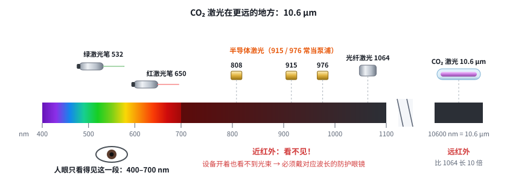
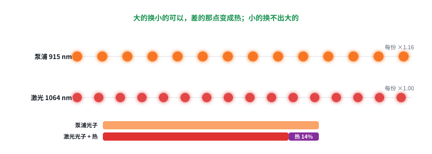
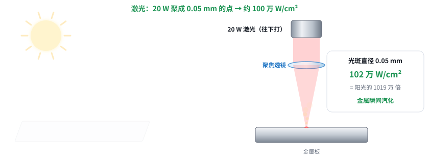

# 激光快速入门 01：光的三个量——波长、光子能量、功率密度

日期：2026-11-11 · 交互课件：[在线打开](https://claude.ai/artifact/U25s2FeBPwzAgBRs4b3AmK) · [源文件](互动/快速01课_光的三个量.html)

起因：用户要求“从头讲，但不要特别基础，要快速掌握”，重排为 6 课的快速入门，这是第 1 课。

## 问题 1：915、1064 nm、10.6 μm 是什么？在哪？

- 波长 = 光的“颜色编号”，单位 nm（1 nm = 百万分之一毫米）。人眼只看得见 400–700 nm（激光笔 532 绿、650 红）。
- 近红外看不见：808 / 915 / 976 nm 半导体激光（915 / 976 常当泵浦），1064 nm 光纤激光。设备开着也看不见光束，必须戴对应波长的防护眼镜。
- CO₂ 激光 10600 nm = 10.6 μm，远红外。1 μm = 1000 nm，行业里常说“1 微米激光”（光纤）、“10 微米激光”（CO₂）。

记住一句：波长就是光的“颜色编号”；人眼只看得见 400–700 nm，915、1064 nm 和 CO₂ 的 10.6 μm 全是看不见的红外光，所以激光设备必须戴对应波长的防护眼镜。

## 问题 2：光子能量和波长什么关系？

- 光是一份一份来的，每份叫光子；20 W 激光每秒约 10²⁰ 个。
- 能量 ∝ 1 / 波长：532 nm 是 1064 nm 的 2 倍，915 nm 是 1064 nm 的 1.16 倍。
- 同样功率：短波长光子少而大，长波长光子多而小。
- 泵浦 915 每个光子比激光 1064 大，能“大换小”，差的约 14% 变成热；反过来不行。

记住一句：波长越短，每个光子带的能量越大；同样功率下，短波长的光子少而“重”，长波长的光子多而“轻”。泵浦光（915）每个光子比激光（1064）大，才能换出激光，差的那点变成热。

## 问题 3：20 W 为什么聚成小点就能打穿金属？

- 能量 J = 总共多少；功率 W = 每秒多少（1 W = 1 J/s）。
- 功率密度 W/cm² = 每平方厘米分到多少瓦。阳光约 0.1 W/cm²；放大镜功率不变、面积变小 → 烧纸。
- 20 W 激光：20 mm 粗约 6 W/cm²；聚到 0.05 mm 约 100 万 W/cm²（阳光的 1000 万倍），金属瞬间汽化。
- 光斑直径缩小 10 倍 → 功率密度涨 100 倍。

记住一句：功率是“每秒送多少能量”，功率密度是“每平方厘米分到多少”。功率不变，光斑直径缩小 10 倍，功率密度就涨 100 倍——这就是我们拼命要小光斑的原因。

## 小测（答案）
1. 1064 nm 看得见吗？→ 看不见，近红外。
2. 10.6 μm = ？→ 10600 nm。
3. 915 和 1064 谁的光子能量大？→ 915。
4. 直径缩到 1/10，功率密度？→ 100 倍。

## 本课对项目的推进
- 915 / 1064 nm 都是近红外，镀膜、振镜镜片、防护眼镜都要按波长选。
- “10 m 处光斑 ≤ 5 mm”本质是保功率密度：20 W 在 5 mm 光斑上约 100 W/cm²，光斑大一倍只剩 1/4。
