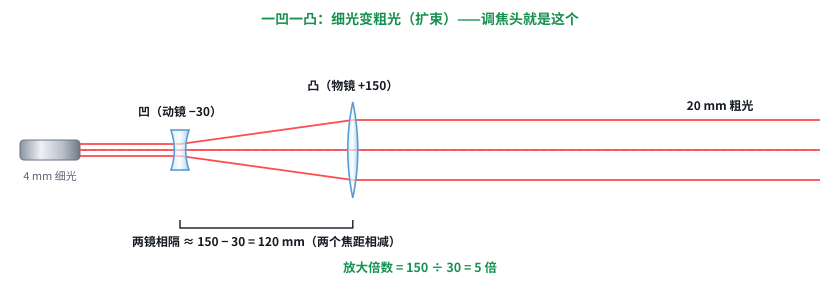
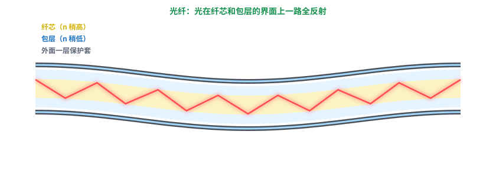
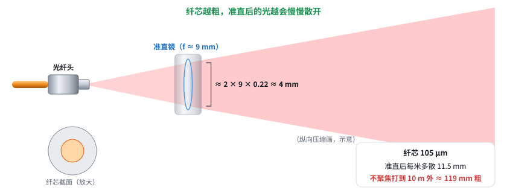

# 激光快速入门 02：透镜和光纤怎么“管住”光

日期：2026-11-11 · 交互课件：[在线打开](https://claude.ai/artifact/XHL9Kg1kx99Uz5ma8D8183) · [源文件](互动/快速02课_透镜和光纤.html)

## 问题 1：透镜怎么让光聚拢、散开？焦距是什么？

- 凸透镜（中间厚）把平行光聚到焦点，透镜到焦点的距离 = 焦距（如 +150 mm）。镜面越弯，焦距越短。
- 凹透镜（中间薄）把平行光散开，好像从镜前的虚焦点发出，焦距记负数（如 −30 mm）。
- 一凹一凸 = 扩束：4 mm → 20 mm，放大倍数 = 焦距之比（150 ÷ 30 = 5），两镜相隔 ≈ 150 − 30 = 120 mm。这就是调焦头结构。

记住一句：凸透镜把平行光聚到一点，这段距离叫焦距；凹透镜把平行光散开，好像从镜前一个点发出来，焦距记成负数。镜面越弯，焦距越短。一凹一凸配起来就能把光变粗——我们的调焦头就是这么做的。

## 问题 2：光纤为什么能把光关在里面？

- 光从玻璃射向空气，一部分折出去、一部分反射；斜过临界角（玻璃对空气约 43°）就全部反射，叫全反射。
- 光纤 = 折射率稍高的纤芯 + 稍低的包层，光在界面上一路全反射，弯着也能走。
- 弯得太急会漏光（弯曲损耗），大功率时会烧光纤 → 光纤线有最小弯曲半径。

记住一句：光从“密”的玻璃往“疏”的那边走，斜到一定程度就一点都出不去，全部反射回来，叫全反射。光纤 = 折射率高的纤芯 + 稍低的包层，光在界面上一路全反射，弯着也能走；弯得太急就会漏。

## 问题 3：光从光纤头出来什么样？芯径、NA 为什么决定光束好坏？

- 出来是一个锥，张多大由 NA 决定（NA 0.22 ≈ 半角 12.7°）。
- 准直：在一个焦距处放凸透镜，变平行光，粗细 ≈ 2 × 焦距 × NA（9 mm × 0.22 × 2 ≈ 4 mm）。
- 纤芯有粗细，准直后仍慢慢散开：105 μm 芯配 9 mm 准直镜，每米多散约 11.5 mm，不聚焦打到 10 m 外约 119 mm 粗【推算，几何近似】。芯越细越好。

记住一句：光从光纤头出来是一个锥，张多大由 NA 决定；在一个焦距处放凸透镜就“准直”成平行光，粗细 ≈ 2 × 焦距 × NA。但纤芯越粗，准直后的光越会慢慢散开，远处光斑越大——光束好坏的根子在纤芯粗细。

## 小测（答案）
1. 透镜到焦点的距离？→ 焦距。
2. 镜面越弯焦距？→ 越短。
3. 光纤为什么导光？→ 纤芯折射率比包层高，全反射。
4. 纤芯越粗准直后？→ 散得越快。

## 本课对项目的推进
- 调焦头“动镜 −30 + 物镜 +150”就是一凹一凸扩束，动镜一挪焦点就前后移。
- 105 μm / NA 0.22 的 915 nm 光源准直后散得快，远处光斑大（第 6 课用 M² 定量）。
- 光纤线按最小弯曲半径走线。
