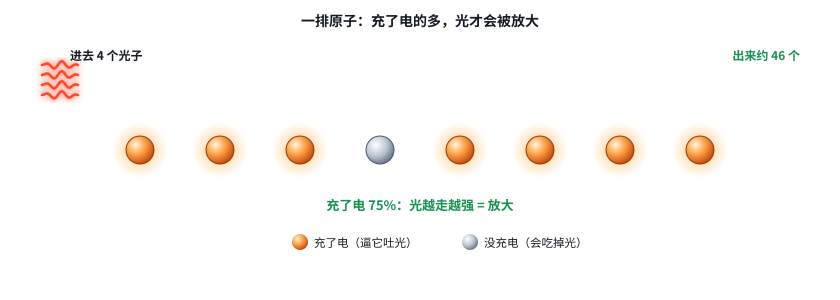
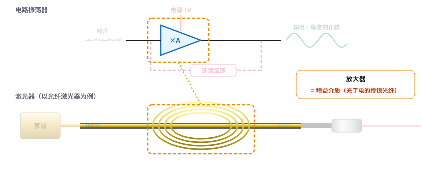
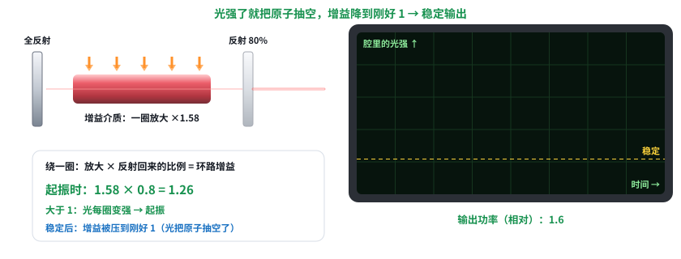

# 激光快速入门 03：激光器原理，一课讲透

日期：2026-11-11 · 交互课件：[在线打开](https://claude.ai/artifact/Ve49mwuBmj8wsZWSDPCqzf) · [源文件](互动/快速03课_激光器原理.html)

## 问题 1：原子和光打交道的三种方式，放大从哪来？

1. **吸收**：没充电的原子吃掉能量对得上的光子，自己充上电。
2. **自发辐射**：充了电的原子自己掉下来放光，方向、时间都随机（灯泡、LED 的光；激光器里的“噪声”）。
3. **受激辐射**：路过的光子逼充了电的原子放出一模一样的光子（方向、波长、步调相同），1 变 2 = 放大。
- 一排原子：充了电的多于没充电的（粒子数反转），光才会被放大；否则被吃掉。泵浦就是让大多数原子充上电。

记住一句：没充电的原子会吃掉光（吸收），充了电的原子会被路过的光逼着吐出一模一样的光（受激辐射）。充了电的比没充电的多，光才会越走越强——泵浦就是为了让大多数原子充上电。

## 问题 2：激光器和电路振荡器的对应

| 电路振荡器 | 激光器 |
|---|---|
| 放大器 | 增益介质（如充了电的掺镱光纤） |
| 电源 | 泵浦 |
| 正反馈（带选频） | 两面镜子 / 光栅 = 谐振腔（光栅只反射 1064，定波长） |
| 起振的噪声 | 自发辐射 |
| 输出 | 半透镜（低反光栅）漏出的光 |

记住一句：增益介质 = 放大器，泵浦 = 放大器的电源，两面镜子 = 正反馈（顺带选频率），自发辐射 = 起振的噪声，半透镜漏出来的 = 输出。激光器就是一个光的振荡器。

## 问题 3：起振、门槛、为什么不会无限变强

- 环路增益 = 一圈放大倍数 × 反射回来的比例。
- < 1：光一圈圈变弱，没有激光；= 1：门槛（阈值）；> 1：从噪声指数长大 = 起振。
- 增益饱和：光强了把充电原子抽空，放大倍数降到环路增益刚好 = 1，稳定输出（相当于振荡器放大器限幅）。泵浦越强，稳定输出越大。（图中数值为示意）

记住一句：光绕一圈“放大倍数 × 反射回来的比例”叫环路增益；小于 1 光就死掉，大于 1 就从噪声里指数长大；长大后把原子抽空，增益自动降到刚好 1，稳定输出。门槛就是环路增益刚好等于 1 的那个泵浦强度。

## 小测（答案）
1. 哪种过程能放大？→ 受激辐射。
2. 为什么要泵浦？→ 让大多数原子充电，光才放大。
3. 相当于正反馈的？→ 两面镜子（谐振腔）。
4. 环路增益 < 1？→ 没有激光。

## 本课对项目的推进
- 以后看任何激光器，都按“增益介质 + 泵浦 + 谐振腔”拆（下一课）。
- 门槛解释了低功率设定不出光，控制卡功率标定从门槛以上开始。
