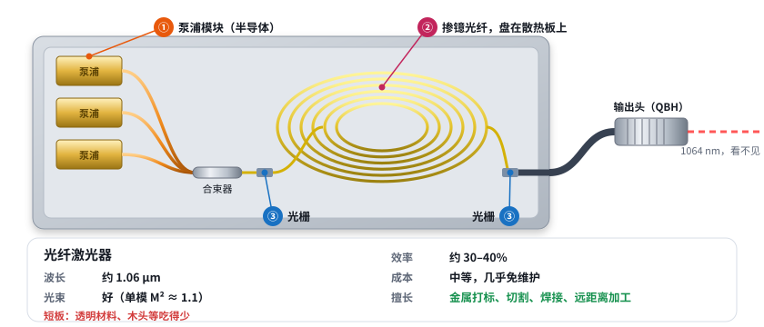
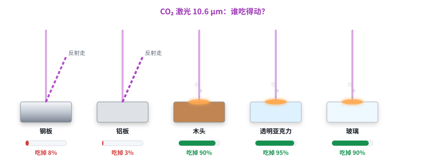
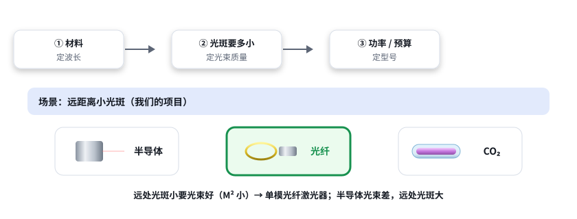

# 激光快速入门 04：常见激光器怎么选

日期：2026-11-11 · 交互课件：[在线打开](https://claude.ai/artifact/H9rd8JGgQTeeUYZgTa8xWL) · [源文件](互动/快速04课_常见激光器怎么选.html)

## 问题 1：三种激光器各有什么本事和短板？

| | 半导体 | 光纤 | CO₂ |
|---|---|---|---|
| 波长 | 0.8–1 μm（也有蓝光） | 约 1.06 μm | 10.6 μm |
| 光束 | 差（光纤输出 M² 常 10–100） | 好（单模 M² ≈ 1.1） | 好（M² ≈ 1.1–1.5） |
| 效率 | 最高，约 50% | 约 30–40% | 约 10–20% |
| 成本 | 每瓦最便宜、最小 | 中等、免维护 | 便宜，要换气 / 换管 |
| 擅长 | 泵浦、塑料焊接、熔覆、加热 | 金属打标切割焊接、远距离 | 木头、亚克力、皮革、纸、玻璃 |
| 短板 | 光束差 | 透明材料、木头吃得少 | 金属反射大；不能走普通光纤 |

（【典型值】）

记住一句：半导体最便宜、最省电但光束差；光纤光束好、免维护，是 1 μm 的主力；CO₂ 是 10 μm，专吃非金属，但只能用镜子和特殊镜片传光。

## 问题 2：同一块材料，为什么有的激光打得动、有的打不动？

- 只有被吸收的部分能打动材料；反射、透过的都白费。
- 1 μm：钢约 35%、木头约 40%、铝约 8%、透明亚克力和玻璃几乎全透过。
- 10.6 μm：木头、亚克力、玻璃约 90% 以上；钢只有百分之几。
- 铜、金对 1 μm 反射也大，有人用绿光、蓝光。（吸收率为量级，和表面状态、温度有关）

记住一句：激光能打动材料，前提是材料“吃”这个波长：金属吃 1 μm、反射 10 μm；木头、亚克力、玻璃、皮革吃 10 μm，对 1 μm 要么透过去要么吃得少。选激光器先看材料。

## 问题 3：碰到需求怎么挑？

三步：材料定波长 → 光斑要多小定光束质量 → 功率 / 预算定型号。
- 金属打标 → 脉冲光纤；切木头 / 亚克力 → CO₂；远距离小光斑（本项目）→ 单模光纤；大功率加热 → 半导体；老师的 915 → 半导体光纤输出（M² ≈ 40），要先问材料和光斑要求。

记住一句：先看材料定波长，再看光斑要多小定光束质量，最后看功率和预算。远处要小光斑，就选光束好的光纤激光器。

## 小测（答案）
1. 每瓦最便宜但光束最差？→ 半导体。
2. 切透明亚克力？→ CO₂。
3. 金属打标？→ 光纤。
4. 第一步看什么？→ 材料吃哪个波长。

## 本课对项目的推进
- 远距离动态聚焦要小光斑 → 单模光纤激光器（1064 nm）最合适。
- **要问老师：打什么材料？** 非金属、透明材料对 915 / 1064 可能根本打不动。
