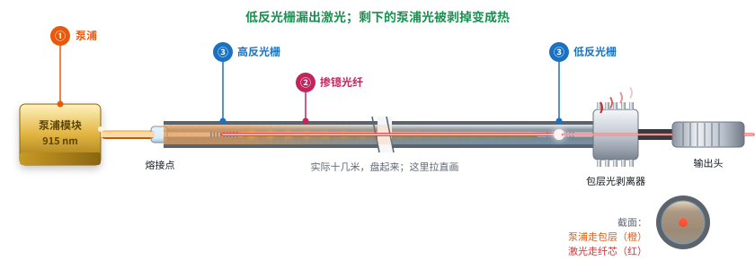
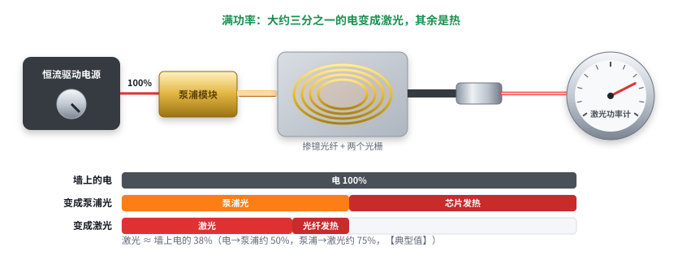
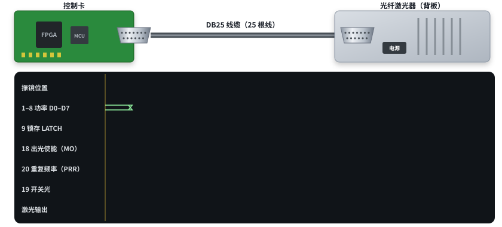

# 激光快速入门 05：光纤激光器和控制卡

日期：2026-11-11 · 交互课件：[在线打开](https://claude.ai/artifact/Tpx9jyuD8aRCLuAFSV4Tzk) · [源文件](互动/快速05课_光纤激光器和控制卡.html)

图 1、图 2 沿用第 16 课补课的图（单泵浦拉直画、功率怎么调），图 3 新做。调 Q / MOPA 的内部原理按用户要求不讲。

## 问题 1：光从泵浦走到输出头

泵浦模块 → 熔接点 → 高反光栅 → 十几米掺镱光纤（盘起来）→ 低反光栅 → 包层光剥离器 → 输出头。泵浦走内包层、被吃掉；自发辐射当种子，在两光栅间来回放大；低反光栅漏出 = 激光；剩余泵浦被剥掉变热。

记住一句：泵浦光从包层进去、一路被镱离子吃掉；镱离子放出的 1064 nm 光被两个光栅关在纤芯里来回放大；从低反光栅漏出来的就是激光，没吃完的泵浦光在出口前被剥掉。

## 问题 2：功率怎么调、电去哪了

调功率 = 调泵浦电流；过门槛后近似直线；电 → 泵浦光约 50%，泵浦 → 激光约 75%，合计约 1/3 电变激光（【典型值】）。

记住一句：激光功率是靠调泵浦电流来调的；过了门槛以后几乎是一条直线；墙上的电大约三分之一变成激光，其余都是热。

## 问题 3：控制卡通过 DB25 怎么指挥激光器

| 顺序 | 脚 | 作用 |
|---|---|---|
| ① 写功率 | 1–8 + 9 | 8 位功率值（0–255），锁存脉冲锁进激光器 → 变成泵浦电流 |
| ② 出光使能 | 18（MO） | 拉高：激光器准备出光；常要求等几毫秒再开光 |
| ③ 重复频率 | 20（PRR） | 方波，每个上升沿一个脉冲；连续激光器不用 |
| ④ 开关光 | 19 | 跟着振镜：画线时开、跳转时关 |

激光输出 = 使能 × 开光 × PRR。开光 / 关光要和振镜到位对齐（打标软件里的开光延时、关光延时），由 FPGA 统一管。各品牌叫法、时序要求以手册为准。

记住一句：控制卡先写功率（8 根数据线 + 锁存）、打开出光使能、给上重复频率，然后跟着振镜：振镜在画线时开光，跳到下一段时关光。这几根线的时序由 FPGA 统一管。

## 小测（答案）
1. 泵浦光走哪层？→ 内包层。
2. 功率怎么调？→ 调泵浦电流。
3. 第 9 脚？→ 锁存功率值。
4. 跳转为什么关光？→ 否则留下痕迹。

## 本课对项目的推进
- 控制卡草案 J3 对应：18 = LASER_MO，19 = LASER_PA（开关光），20 = LASER_PWM（实为 PRR，建议改名），1–8 = IP0–IP7，9 = LATCH。
- FPGA 要按微秒级精度对齐振镜和开关光。
