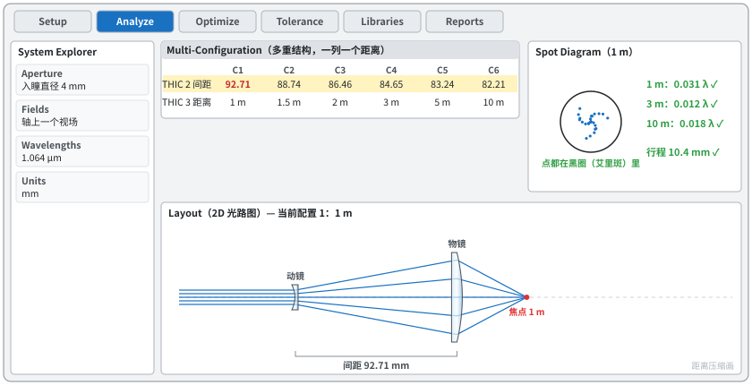

# 快速 06i（问答配图）：Zemax 设计的流程是什么？

日期：2026-11-16 · 配图（用户要求）：[在线打开](https://claude.ai/artifact/CmxoKsjpXkXjQg5E6zUKFs) · [源文件](互动/快速06i课_Zemax设计流程.html)

按 1064 nm、入口 4 mm、动镜 −20 / 物镜 +100、1–10 m 演示（第 4–7 步数字为示意）：

1. **设系统**（Setup → System Explorer）：入瞳直径 4 mm、波长 1.064 μm、单位 mm。
2. **理想透镜搭骨架**（Lens Data）：动镜、物镜用 Paraxial，只填焦距和间距；点列图缩成一点 = 表填对了。
3. **多重结构**（Multi-Configuration）：一列一个距离（1 / 1.5 / 2 / 3 / 5 / 10 m），改间距和目标距离；理想间距 91.11 → 81.01 mm。
4. **换真实镜片**（Libraries → Lens Catalogs）：熔石英，正反都试。
5. **设变量 + 评价函数 + 优化**（Optimize）：间距设变量，评价函数 = RMS 波前（全部配置），按 Optimize。
6. **看结果**（Analyze）：点列图、RMS 波前（≤ 0.035 λ）、行程（≤ 11.6 mm）。
7. **公差 + 出图**（Tolerance）：设加工装配误差，蒙特卡洛看合格率；够了再出镜片图纸和间距。

Codex 第 2 轮任务单的第 1–6 条 = 这里的第 1–6 步；第 7 步等方案定了再做。

记住一句：设系统 → 用理想透镜搭骨架核对 → 多重结构放进各个距离 → 换成真实镜片 → 设变量和评价函数去优化 → 看结果是否合格 → 做公差、出图。Codex 跑的就是这个顺序。
