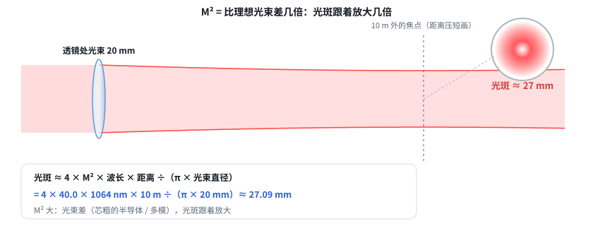
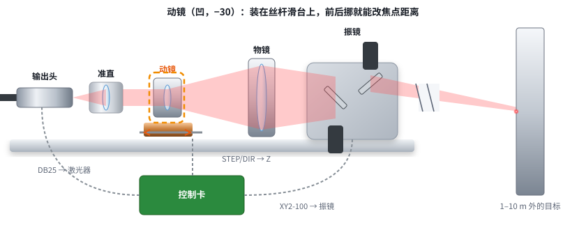
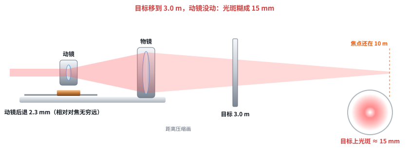

# 激光快速入门 06：从出光口到工件——接回动态聚焦头

日期：2026-11-11 · 交互课件：[在线打开](https://claude.ai/artifact/AchjDwkg57nngHXnqdiso2) · [源文件](互动/快速06课_从出光口到工件.html)

## 问题 1：光斑为什么不能无限小？M² 是什么？

- 光是波，聚焦后最细处也有粗细（衍射极限）。
- M² = 比理想光束差几倍（= BPP ÷ (λ/π)），光斑跟着放大几倍。
- 远处光斑 ≈ 4 × M² × 波长 × 距离 ÷（π × 光束直径）：M² 1.1、1064 nm、20 mm、10 m → 约 0.75 mm；M² 40 → 约 27 mm（915 nm 约 23 mm）；光束只有 4 mm → 约 3.7 mm。所以要扩 5 倍。
- 焦深：焦点前后一小段光斑差不多细；光斑越小焦深越短。

记住一句：光是波，聚焦后最细的地方也有粗细（衍射）；M² 就是“比理想光束差几倍”，光斑跟着放大几倍。远处光斑 ≈ 4 × M² × 波长 × 距离 ÷（π × 光束直径）：要小，就要 M² 小、光束粗。

## 问题 2：出光口后面那一串

输出头 → 准直（约 4 mm 平行光）→ 动镜（凹 −30，装在丝杆滑台上）+ 物镜（凸 +150）：扩到 20 mm 并决定焦点多远 → 振镜（两面转镜，管左右、上下）→ 目标。控制卡同时指挥：激光（DB25）、振镜（XY2-100）、Z 轴（STEP / DIR），FPGA 负责对时。

记住一句：输出头 → 准直（变平行）→ 动镜 + 物镜（扩束到 20 mm，同时决定焦点落多远）→ 振镜（两面转镜把光点扫到不同位置）→ 目标。控制卡同时指挥三样：激光（DB25）、振镜（XY2-100）、Z 轴动镜（步进）。

## 问题 3：为什么要动态聚焦？动镜挪多少？

- 焦点只在一个距离最细：焦点在 10 m、目标在 3 m 时，光斑约 15 mm。
- 动镜相对“对焦无穷远”的后退量 = f2² ÷ (L − f2)：10 m 约 2.3 mm，3 m 约 7.9 mm，1 m 约 26.5 mm【推算，薄透镜，现方案 −30 / +150】。
- 控制卡发 STEP / DIR → 步进电机 → 丝杆 → 动镜。

记住一句：焦点只在一个距离上最细；目标近了，不调焦光斑就糊成十几毫米。动镜往后退一点（近处退得多），焦点就跟过去，这就是动态聚焦——控制卡用步进电机带丝杆去挪它。

## 小测（答案）
1. M² 40 光斑大多少？→ 约 40 倍。
2. 为什么扩到 20 mm？→ 光束越粗远处光斑越小。
3. 目标 10 m → 3 m，动镜？→ 往后退。
4. 控制卡怎么挪动镜？→ STEP / DIR 给步进电机。

## 本课对项目的推进（快速入门结束）
- 能看懂项目核心数：M²、20 mm 出口、动镜行程（1–10 m 约 24 mm）、10 m ≤ 5 mm 要 M² ≤ 8.6（915 nm）。
- 下一步回到项目：① 老师回答三个问题（915 是什么激光器 / 打什么材料 / 光斑要求）；② Zemax 第二轮定光学方案（含 f2 ≈ 100 双胶合）；③ 改 Z 轴结构。
