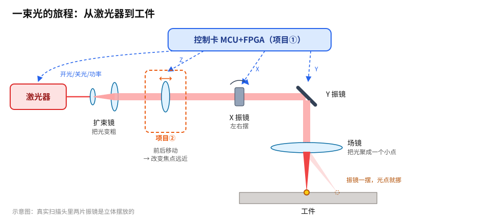
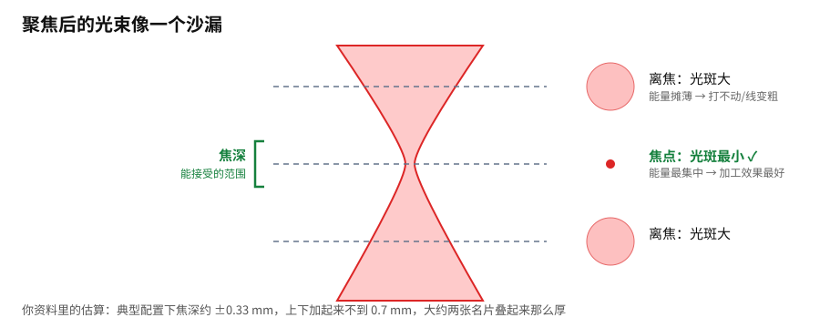
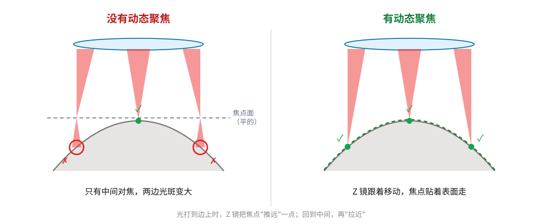

# 第 01 课｜光的旅程

> 日期：2026-11-03　·　目标：知道一束光从哪来、经过什么、为什么需要“动态聚焦”

## 1. 光路全景

- **激光器**负责产生光，**场镜**把光聚成一个小点，**两片振镜**一摆，这个点就在工件上移动。
- **控制卡（项目①）**同时指挥激光器和振镜：什么时候开光、开多强、光点打到哪里。
- **Z 镜（项目②）**插在光路中间，前后移动，用来改变焦点的远近。

## 2. 焦点：光束像一个沙漏

- 光点最小的那个位置叫**焦点**，能量在这里最集中。
- 离开焦点，光斑会变大，能量被摊薄，结果就是打不动，或者打出来的线变粗。
- **焦深**是“偏离焦点多少还能接受”的范围，通常很薄（不到 1 mm）。

## 3. 为什么要动态聚焦

- 普通扫描头的焦点落在一个**平面**上，工件一旦是曲面，就只有一部分能对上焦。
- 动态聚焦让 Z 镜**一边扫描一边移动**，焦点就能贴着曲面走。

## 小测（想一想再展开）

Q1：光点在工件上左右移动，靠的是哪个零件？

振镜（X、Y 两片）。Z 镜只负责焦点的远近，不负责左右。

Q2：工件比焦点低了 2 mm，而焦深只有 ±0.33 mm，会发生什么？

光斑会明显变大，能量摊薄，打出来的线变粗、变浅，甚至打不动。

Q3：为什么说控制卡是 Z 镜的“大脑”？

Z 镜应该移动到哪里，取决于光点此刻在工件的哪个位置，这个信息只有控制卡知道。所以控制卡得同时指挥 X、Y、Z 三个轴。

## 本课对项目的推进

- ✅ 确认整体定位：**项目①控制卡 + 项目②Z 聚焦头 = 一套三轴扫描系统**
- ⏳ 待你决定：主要应用场景（见进度.md 的“待决定”）
