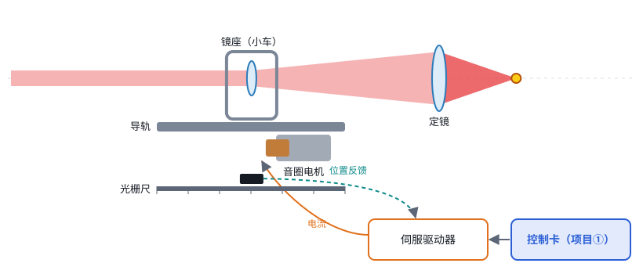
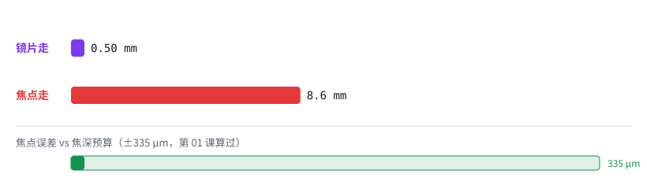
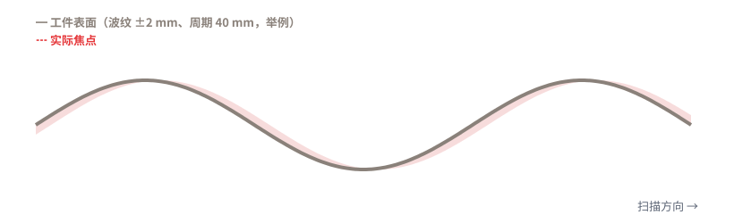

# 第 02 课 · 加餐｜移动透镜拆开看

> 日期：2026-11-03　·　起因：你问“移动透镜最简单对吧？”
>
> 🖐 **交互版（推荐）**：[在线打开](https://claude.ai/artifact/Du8JuUiMjnaPGwLHwfe2J3)，可以点零件、拆开看、拖滑块。源文件见 [互动/第02b课_移动透镜拆开看.html](互动/第02b课_移动透镜拆开看.html)。

**答：对。但“简单”要分三层意思看。**

| 意思 | 移动透镜 | 说明 |
|---|---|---|
| 原理好不好懂 | ✅ 最简单 | 推一片镜片，焦点就跟着动 |
| 能不能买到 | ✅ 最成熟 | SCANLAB、RAYLASE、思特、FEELTEK 都有产品 |
| 自己做好难不难 | ⚠️ 不简单 | 难在误差被放大、镜片慢半拍、光学设计要和场镜一起配 |

## 1. 里面有什么

- **能直接买**：导轨（S016/S017）、音圈电机（S018）、光栅尺（S015）
- **要设计**：动镜、定镜（和场镜一起设计）、镜座
- **难点**：伺服驱动器调参（快、稳、不抖）

## 2. 杠杆效应

- 镜片走 1 mm，焦点可能走 17 mm（SCANLAB 示例倍率）。好处是行程很省。
- 代价是**误差也被放大 17 倍**：镜片 0.5 μm 的误差，到焦点就变成约 8.6 μm。

## 3. 跟不跟得上

- 镜片总会慢半拍。例如 0.7 ms（VCM F1），扫描速度 2 m/s 时，焦点会落后表面最多约 0.44 mm，超出焦深。
- 解决办法：控制卡**提前**发 Z 指令，把这段延迟补回来。

## 本课对项目的推进

- ✅ 确认：主力 Z 模块走**移动透镜路线**
- 📋 分工：能买的部件直接买；光学设计、伺服调参、标定要自己攻
- 🆕 控制卡新需求：**Z 指令提前量（延迟补偿）**，毫秒级、可调 → 写进系统规格
