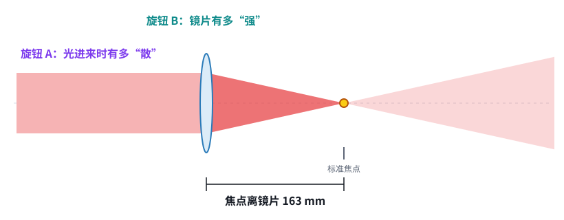
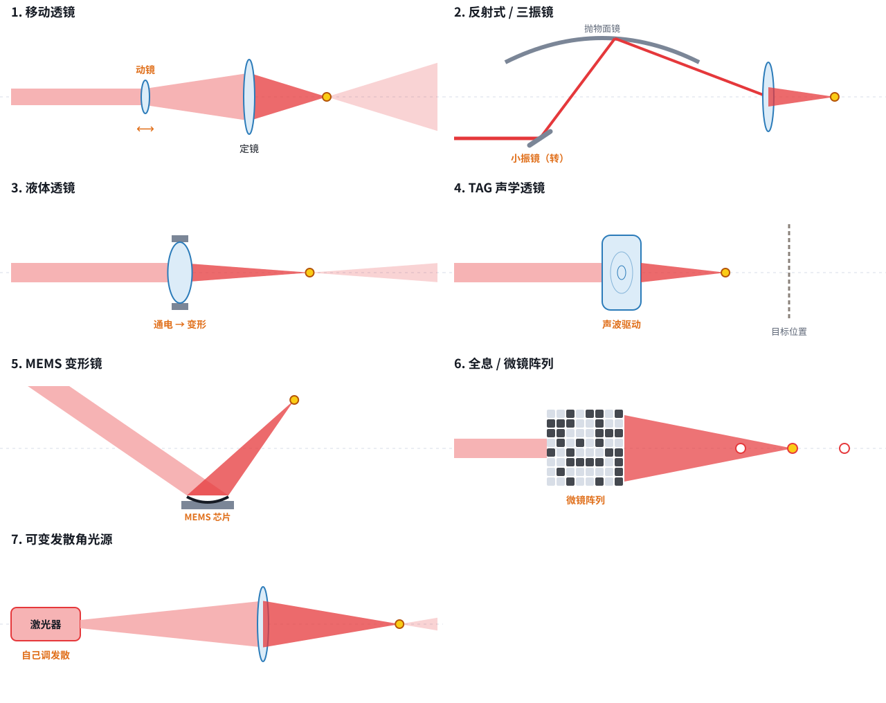
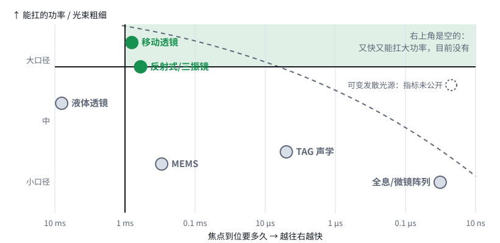
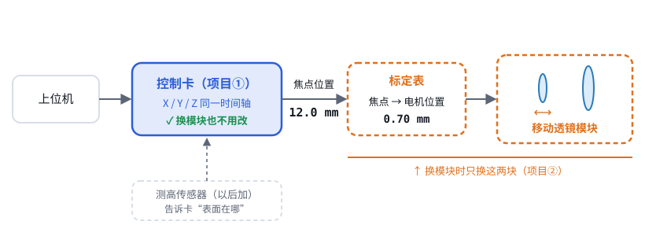

# 第 02 课｜聚焦的七种办法

> 日期：2026-11-03　·　起因：你说要做**通用**的设备，不局限于加工工件
>
> 🖐 **交互版（推荐）**：[在线打开](https://claude.ai/artifact/4213vkHZumNDdnoEYyriZi)，有动画、选型地图和可切换的模块。源文件见 [互动/第02课_聚焦的七种办法.html](互动/第02课_聚焦的七种办法.html)。下面是静态版。

## 1. 其实只有两个旋钮

- **旋钮 A**：光进入镜片时有多“散”。越散，焦点越远。
- **旋钮 B**：镜片本身有多“强”。越强，焦点越近。
- 七种办法，都是在拧这两个旋钮中的一个（或者两个一起拧）。

## 2. 七种办法，各自怎么拧

| 办法 | 旋钮 | 改焦点要多久 | 能调多远 | 功率 / 口径 | 成熟度 | 资料 |
|---|---|---|---|---|---|---|
| 移动透镜 | A | 0.7–0.9 ms | 几十 mm | 大，工业主流 | 量产 | R029 R033 R036 R038 |
| 反射式 / 三振镜 | A | 约 0.6 ms 走 2 mm | 数 mm 到数十 mm | 反射镜耐功率 | 论文 + 专利 | R018 R021 R044 |
| 液体透镜 | B | 4.5–12 ms | ±2 dpt | 10 mm，约 50 W | 元件量产 | R039 |
| TAG 声学 | B | 3–7 μs 扫一个来回 | 约 1.3 mm | 小 | 实验室，焦点停不住 | R023 |
| MEMS 变形镜 | B | 例：0.3 ms | 看具体器件 | 很小 | 研究为主 | R027 |
| 全息 / 微镜阵列 | A+B | 约 32 ns | 三维多焦点 | 低功率 | 实验室 | R025 |
| 可变发散光源 | A | 未公开 | 未公开 | 未公开 | 只有专利申请 | R013 |

## 3. 选型地图

- **右上角是空的**：镜片越大越重，就越慢。所以“又快又能扛大功率”目前做不到（R025）。
- 没有哪一种办法能通吃所有用途。

## 4. “通用”应该落在哪一层

- 控制卡只发“**焦点要到哪**”（mm），不关心后面接的是哪种模块。
- 每个 Z 模块自带一张**标定表**，把焦点位置换算成自己的指令，比如电机位置、光焦度或转镜角度。
- 换模块时只换“模块 + 标定表”，控制卡不用改。

## 小测

Q1：液体透镜拧的是哪个旋钮？
旋钮 B。通电让镜面变形，镜片本身变强或变弱。

Q2：为什么没有“又快又能扛大功率”的办法？
要扛大功率就得用大口径，大口径的镜片重，动起来就慢。

Q3：通用设备最该通用的是哪一层？
控制卡和“焦点位置”接口。光学模块按用途更换。

## 本课对项目的推进

- ✅ **决定（来自你“要做通用”的需求）**：通用 = 控制卡通用 + Z 模块可换。Z 通道传“焦点位置”，每个模块自带标定表。
- 💡 **建议**：第一个用来验证的模块选移动透镜式。它最成熟，市面上有 XY2-100 接口的现成模块（例如 VCM F1，R038），可以先买来验证控制卡，再自研模块。
- 🔍 **新发现**：TAG 这类“只能来回扫”的模块，控制卡的工作方式会完全不同：不是命令焦点去某个位置，而是等焦点扫到目标时再开光。如果以后要支持，控制卡需要“按相位触发开光”的功能，先记下来。
