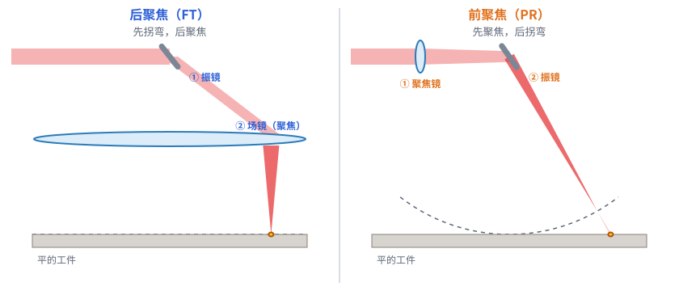
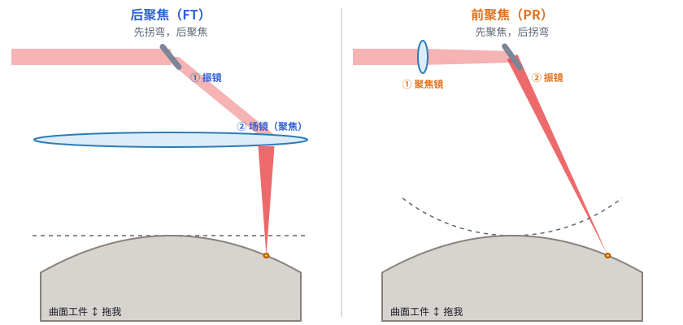
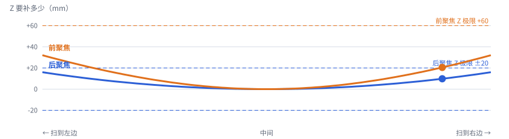

# 第 03 课 · 补课｜先拐弯，还是先聚焦？

> 日期：2026-11-03　·　起因：你说 FT、PR、前聚焦、后聚焦没看懂，希望演示里的工件是曲面、能前后挪
>
> 🖐 **交互版（推荐）**：[在线打开](https://claude.ai/artifact/QyiFp7nGcvWaans3wjH13T)，可以拖着工件前后挪、开关 Z。源文件见 [互动/第03b课_前聚焦与后聚焦.html](互动/第03b课_前聚焦与后聚焦.html)

## 名字对照（只有两件事）

| | 后聚焦 | 前聚焦 |
|---|---|---|
| 英文缩写 | FT（F-Theta，场镜的名字） | PR（PRefocus，预先聚焦） |
| 聚焦镜在振镜的 | **后面** | **前面** |
| 一句话 | 先拐弯，后聚焦 | 先聚焦，后拐弯 |
| 打个比方 | 先用镜子把阳光转到某个方向，再穿过一块大放大镜聚成点 | 手电筒先调好焦，再用镜子把光反射到墙上各处 |

## 1. 平的工件，Z 先不动

- 前聚焦：从振镜到焦点的距离固定，所以焦点走的是**弧线**，到了边上就虚了
- 后聚焦：大场镜专门把这条弧“拉平”

## 2. 曲面工件，还能前后挪

- 后聚焦的 Z = 曲面高低 + 工件前后位置
- 前聚焦的 Z = 曲面高低 + 工件前后位置 + **弧面补偿**
- 工件前后挪，只是让整条 Z 曲线**整体平移**

## 本课对项目的推进

- ✅ 弄清楚了：后聚焦（FT）= 聚焦镜在振镜后面；前聚焦（PR）= 聚焦镜在振镜前面
- 🔍 **新发现**：Z 行程要同时容纳“曲面高低 + 工件前后位置变化”。例：凸起 16 mm 的曲面再往远处挪 10 mm，后聚焦需要 Z 走到 +26 mm，超过了 v0 的 ±20 mm → 写进设计文档的待确认事项
