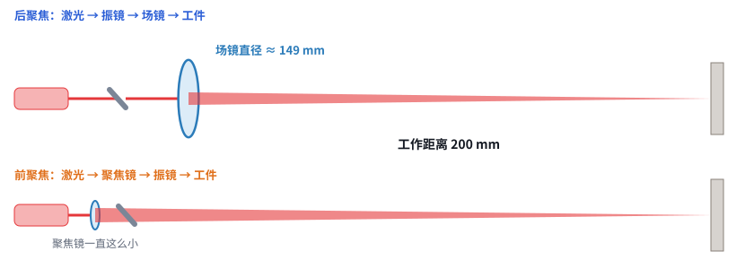
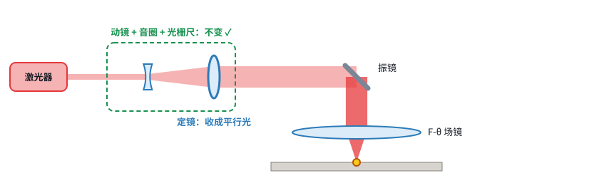

# 第 03 课 · 之三｜前聚焦还是后聚焦，看用途

> 日期：2026-11-03　·　起因：你问“哪个好？艾思兰的好像是前聚焦吧”
>
> 🖐 **交互版（推荐）**：[在线打开](https://claude.ai/artifact/A5Z4Qp4B2JZs248yZ4tffX)，有距离滑块和四问选择器。源文件见 [互动/第03c课_怎么选.html](互动/第03c课_怎么选.html)

## 1. 距离一远，后聚焦就做不出来

- 后聚焦的场镜焦距 ≈ 工作距离：0.2 m 时直径约 150 mm，能买到；到 1 m 以上实际就做不出来了
- 前聚焦的聚焦镜一直很小，只是距离越远，光斑越粗（150 m 时有几十毫米）

## 2. 四个问题帮你选

| 问题 | 偏向后聚焦 | 偏向前聚焦 |
|---|---|---|
| 离工件多远 | < 0.3 m | > 0.3 m（> 1 m 时只能前聚焦） |
| 一次覆盖多大 | < 150 mm | 150–600 mm，或靠云台挪 |
| 光斑要多细 | 精细 < 40 μm | 粗一些也行（如清洗） |
| 功率 | < 100 W | > 100 W（资料：前聚焦可达 3000 W） |

## 3. 动镜模块两种都能用

- SCANLAB：动镜扩束以后，定镜要么收成平行光（配场镜），要么直接聚焦（R030）
- 要从后聚焦改成前聚焦，主要是**换定镜、去掉场镜、重新标定**

## 关于艾思兰（核对资料后）

| 产品 | 光路 | 证据 |
|---|---|---|
| 一字激光除冰（150 m） | **先调焦、后指向**（前聚焦一类）：平凹 + 平凸柱面镜，间距 45–55 mm 可调，再由电动转台指向 | R008 专利正文 |
| 激光除障仪 | 光纤准直器 + 云台指向 | R007 |
| 激光驱鸟器 | 激光器 + 扩束镜 + 电动云台 | R014 |
| 激光洗模机 | 只写了“准直聚焦镜系统、振镜系统……均为现有技术”，**看不出顺序** | R015 / R063 |

→ 远距离产品你判断得对；洗模机暂时不能下结论。

## 本课对项目的推进

- ✅ 选择规则：近距离、小幅面、精细 → 后聚焦；远距离、大幅面、大功率（清洗）→ 前聚焦
- ✅ 动镜模块设计成两种都能用（定镜可换）
- ❓ **待你决定**：主要用途更接近哪一类？它决定 v0 用后聚焦还是前聚焦
