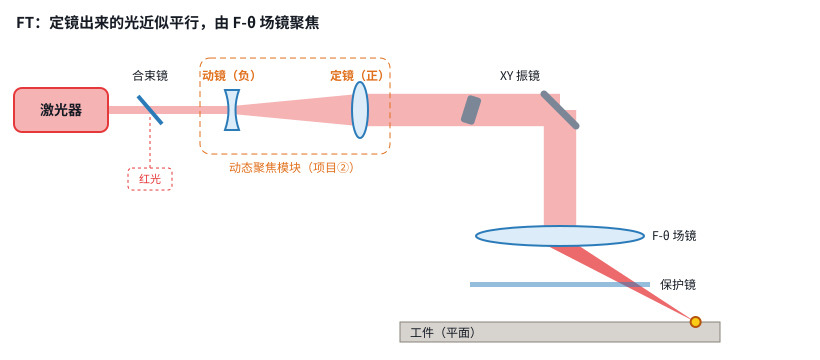
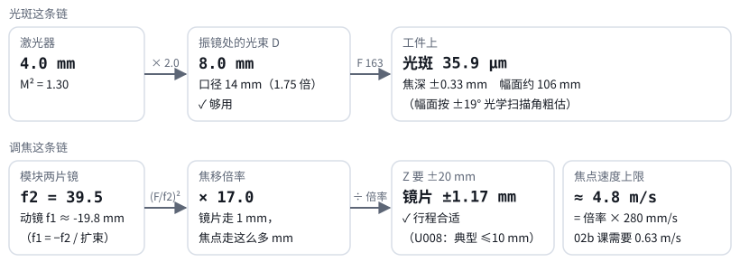

# 第 03 课｜移动透镜的整条光路

> 日期：2026-11-03　·　起因：你决定 Z 模块用移动透镜，让我把整条输出光路整理出来
>
> 🖐 **交互版（推荐）**：[在线打开](https://claude.ai/artifact/ThzcVtA8iNZQ3bpnmmYXRk)，里面有参数链计算器。源文件见 [互动/第03课_移动透镜光路.html](互动/第03课_移动透镜光路.html)
> 📐 **正式整理结果**：[设计/移动透镜输出光路_v0.1.md](../设计/移动透镜输出光路_v0.1.md)

## 1. 两种摆法

- **FT（带场镜）**：定镜出来的光近似平行，由 F-θ 场镜聚焦。加工平面时 Z 不用动。**v0 用这个。**
- **PR（前聚焦）**：定镜直接把光聚到工件上。幅面大、能扛大功率，但 Z 要一直工作。留作二期。

## 2. 参数链

- 光斑这条链：激光器出光直径 × 扩束倍数 = 光束 D → 再经场镜焦距 F → 光斑（和 D 成反比）
- 调焦这条链：定镜焦距 f2 → 焦移倍率 (F/f2)² → 镜片要走多少
- D 变大，光斑会变小，但振镜口径必须跟上；倍率变大，行程会变小，但误差会被放大

## 3. 为什么 PR 加工平面也要一直调 Z

- 没有场镜时，焦点面是以振镜为圆心的弧面，到了角落会离开平面几十 mm
- 焦深只有 ±2 mm 左右，所以 Z 必须一直补偿

## 本课对项目的推进

- ✅ 定下 v0 光路：激光器 → 合束镜（红光） → 动镜（负）+ 定镜（正） → XY 振镜 → F-θ f163 → 保护镜 → 工件
- 📐 设计文档：`设计/移动透镜输出光路_v0.1.md`（初值、公式、FT/PR 对比、选型问题、风险、待确认事项）
- ❓ 待你提供：激光器型号，以及振镜口径选 14 mm 还是 20 mm
