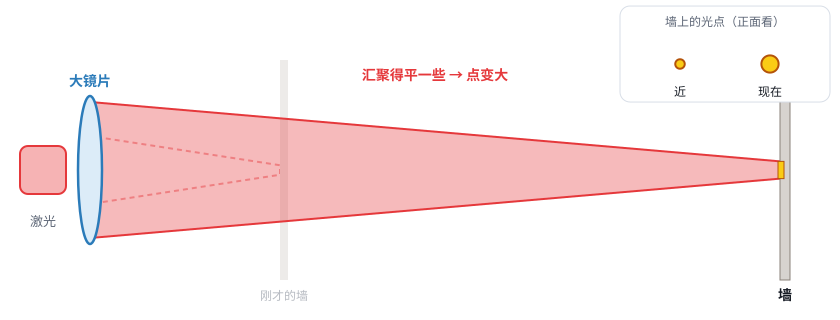
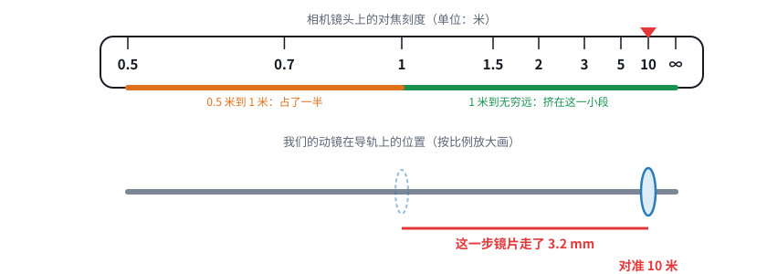
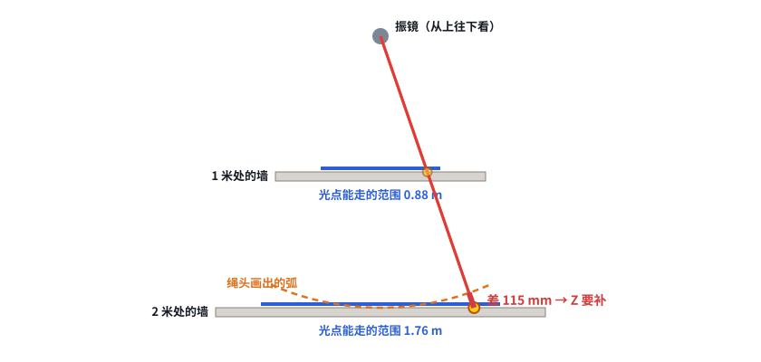

# 第 04 课 · 补课｜打得远，用三个比方讲清楚

> 日期：2026-11-03　·　起因：你说第 04 课的示意图看不懂在表达什么
>
> 🖐 **交互版（推荐）**：[在线打开](https://claude.ai/artifact/P2mKC5bnHci67HTqa4jfEo)。点“下一步”一步一步看。源文件见 [互动/第04b课_三个比方.html](互动/第04b课_三个比方.html)

## 问题 1：为什么打得越远，光点越大？（手电筒）

目标越远，光汇聚得越“平”，光点越大。想在远处保持小光点，就要用更大的镜片。

## 问题 2：目标一远一近，对焦镜片要挪多少？（相机对焦环）

就像相机镜头上的刻度：0.5 到 1 米隔得很开，5 米到无穷远挤在一起。1 米以外，镜片几乎不用动；最占行程的是近处。

## 问题 3：为什么控制卡必须知道目标有多远？（绳子和墙）

- 振镜转同样的角度，远墙上的光点走的路更长 → 角度换算成位置要用到距离
- 焦点像绳头，画出来的是弧，墙却是平的 → 边上 Z 要往远处推

## 本课对项目的推进

和第 04 课相同（前聚焦 v0.2，控制卡要知道目标距离），只是换了讲法。
