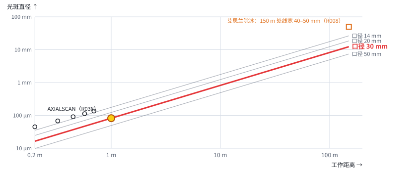
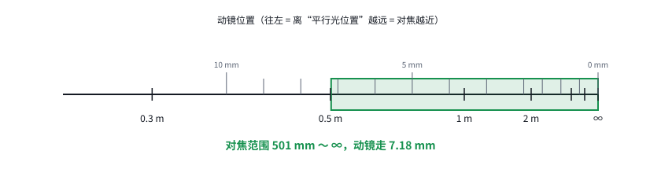
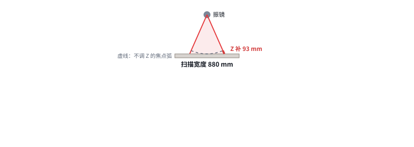

# 第 04 课｜打得远，要付什么代价

> 日期：2026-11-03　·　起因：你决定“按前聚焦设计，想打得远一点”
>
> 🖐 **交互版（推荐）**：[在线打开](https://claude.ai/artifact/9ce6eXXBtSDoLAv2gFGGtT)。源文件见 [互动/第04课_打得远的代价.html](互动/第04课_打得远的代价.html)
> 📐 **设计文档**：[设计/移动透镜输出光路_v0.2_前聚焦.md](../设计/移动透镜输出光路_v0.2_前聚焦.md)（v0.1 作废）

## 1. 距离翻倍，光斑也翻倍

- 光斑 ∝ 距离 ÷ 光束直径；光束直径又受振镜口径限制
- 光斑、焦深、扫描宽度、位置误差，全都随距离放大

## 2. 动镜行程：近处占行程，远处挤成一堆

- 动镜行程 ≈ f2² × (1/最近 − 1/最远)：0.5 m 到无穷远约 7.2 mm（f2 = 60 mm）
- 对焦精度占焦深的比例**和距离无关**（约 7%）

## 3. 同一个角度，远处就是另一个位置

- 扫描宽度和弧面补偿都随距离变：1 m 时宽 0.88 m，边上要补 93 mm
- 控制卡把角度换算成位置、计算 Z 时，都要用到距离

## 本课对项目的推进

- ✅ 设计改为前聚焦：v0.2 文档（固定扩束 ×2 + 动态模块 ×2.5 → 20 mm 光束，30 mm 口径振镜，f2 = 60 mm）
- 🆕 控制卡新要求：Z 永远在动；XY 换算要用距离；目标距离不固定时要测距；远距离要做安全防护
- ❓ 待你定：“远一点”是多远（最近 / 最远对焦距离）
