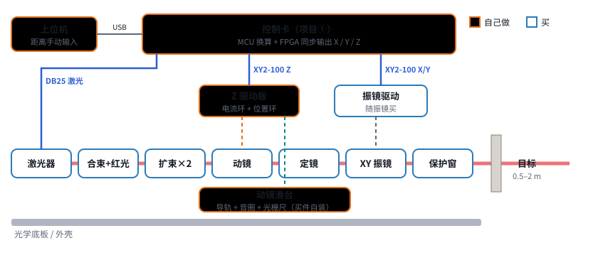
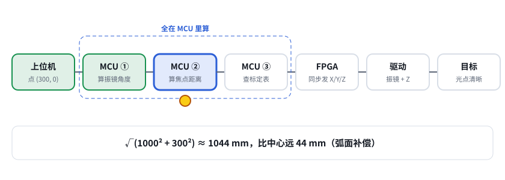
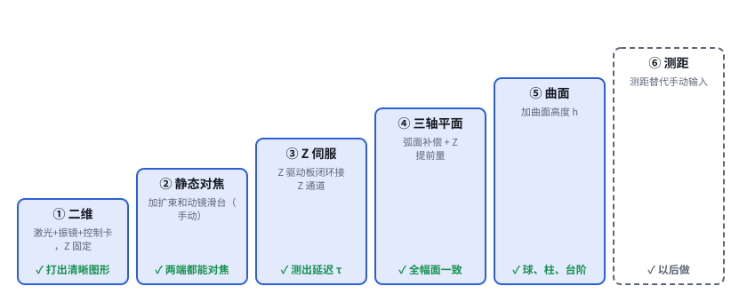

# 第 05 课｜前聚焦系统全貌

> 日期：2026-11-03　·　起因：你说“测距先不考虑，我们先做前聚焦的系统”
>
> 🖐 **交互版**：[在线打开](https://claude.ai/artifact/LzwfqPStY189xaK3EbZbRq)（分步讲解）。源文件见 [互动/第05课_前聚焦系统全貌.html](互动/第05课_前聚焦系统全貌.html)
> 📐 **设计文档**：[设计/前聚焦系统方案_v0.3.md](../设计/前聚焦系统方案_v0.3.md)
> 🧮 **计算脚本**：[设计/工具/前聚焦一阶计算.py](../设计/工具/前聚焦一阶计算.py) → [结果](../设计/工具/前聚焦一阶计算结果.md)

## 问题 1：由哪几层组成？哪些买、哪些做？

自己做：控制卡、上位机、Z 驱动板、动镜滑台装配。其余都买。

## 问题 2：一个点从上位机到目标，经过哪几步？

上位机（点 + 手动输入的距离）→ MCU 算角度 → MCU 算焦点距离（弧面 + 曲面）→ MCU 查标定表 → FPGA 同步发 X/Y/Z（Z 提前）→ 驱动执行 → 光点

## 问题 3：按什么顺序搭？

① 二维 → ② 静态对焦 → ③ Z 伺服 → ④ 三轴平面 → ⑤ 曲面 → ⑥ 测距

## 本课对项目的推进

- 📐 系统方案 v0.3（取代 v0.2）：系统框图、买/做划分、点的处理流程、6 个搭建阶段及通过标准
- 🧮 一阶计算（高斯光束）：动镜行程 5.3 mm（机械留 8 mm）；定镜通光 ≥ 31 mm；振镜 30 mm 口径余量 ×1.5；动镜速度需求约 12 mm/s，**难点在延迟**
