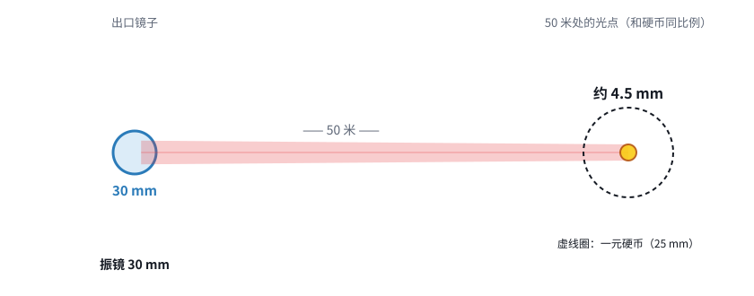
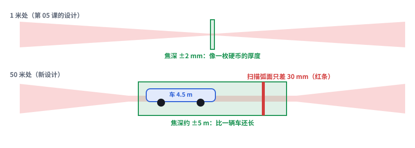
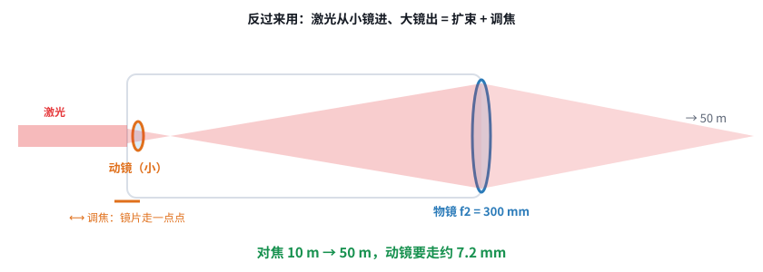

# 第 06 课｜50 米，设计要换思路

> 日期：2026-11-03　·　起因：你给定工作距离 50 m，激光器暂无型号
>
> 🖐 **交互版**：[在线打开](https://claude.ai/artifact/QMTPHw9T3jmaqYxgq8EsKN)（分步讲解）。源文件见 [互动/第06课_50米换思路.html](互动/第06课_50米换思路.html)
> 📐 **设计文档**：[设计/远距离系统方案_v0.4.md](../设计/远距离系统方案_v0.4.md)
> 🧮 **计算**：[设计/工具/远距离方案对比.py](../设计/工具/远距离方案对比.py) → [结果](../设计/工具/远距离方案对比结果.md)

## 问题 1：50 米外，光点能做到多小？

30 mm 振镜约 4.5 mm，50 mm 振镜约 2.7 mm，100 mm 望远镜加云台约 1.3 mm。**激光器 M² 差（如 10），光点会胀到约 34 mm。**

## 问题 2：还需要“动态”聚焦吗？

焦深从 1 米时的 ±2 mm 变成 50 米时的约 ±5 m。扫描时弧面只差 30 mm，所以 **Z 基本不用动，换距离时调一次就行**。

## 问题 3：Z 模块要怎么改？

把望远镜反过来用 = 扩束 + 调焦。物镜焦距选 150–300 mm，10 → 50 m 的行程是 1.8–7.2 mm；用精密丝杠加步进电机就够了。

## 本课对项目的推进

- 📐 v0.4：推荐方案 A（30 mm 振镜 + 调焦望远镜，控制卡直接沿用）
- 🔍 激光器 M² 是第一指标；Z 的要求从“快”变成“准”；**50 m 开放光束的安全是头号风险**
- ❓ 待定：50 m 外要做什么（决定光斑和功率），最近要打多近，用振镜还是云台指向
