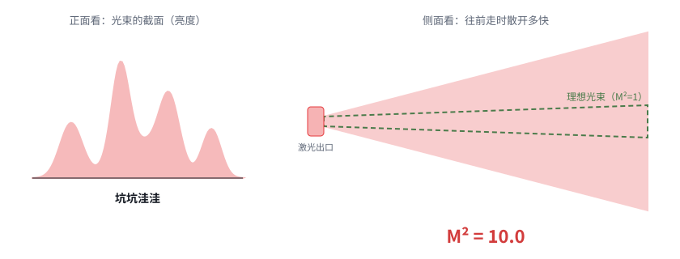
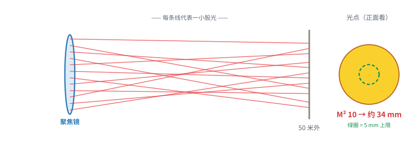
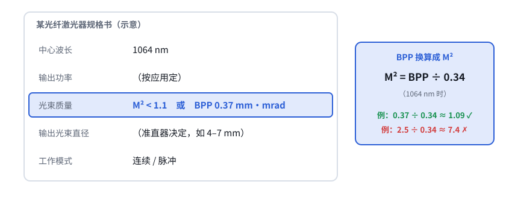

# 第 07 课 · 补课｜M² 是什么：光有多“整齐”

> 日期：2026-11-03　·　起因：你问“激光器 M² 是什么东西？”（安全测试先不管）
>
> 🖐 **交互版**：[在线打开](https://claude.ai/artifact/Csop4noC9ZxHZVxRcywFvM)（分步讲解，带 BPP 换算滑块）。源文件见 [互动/第07b课_M2是什么.html](互动/第07b课_M2是什么.html)

**一句话**：M²（读“M 平方”，光束质量因子）衡量激光有多“整齐”。**1 是完美，越大越乱。**

## 问题 1：M² 到底在说什么？

M² = 真实光束散开的角度 ÷ 理想光束散开的角度（光束一样粗时）。单模激光截面是光滑的“小山包”；多模激光坑坑洼洼，散得快。

## 问题 2：为什么 M² 一大，光点就大？

光点大小和 M² 成正比：一队人齐步走能穿过小门，一群人乱走就得开大门。50 m 处：M² 1.1 → 3.7 mm，1.3 → 4.4 mm，2 → 6.8 mm，10 → 34 mm。

## 问题 3：规格书怎么看？

- 先找“光束质量”这一行：要 **M² ≤ 1.2**
- 写的是 BPP 时：**1064 nm 下 M² = BPP ÷ 0.34**，要 **BPP ≤ 0.41 mm·mrad**
- 顺便看输出光束直径（我们按 4 mm 设计）

## 本课对项目的推进

- ✅ 激光器第一条选型标准：**M² ≤ 1.2 或 BPP ≤ 0.41 mm·mrad（1064 nm）**，一般就是“单模”光纤激光器
- ⏸ 安全测试按你的意思暂缓（风险条目保留在设计文档）
