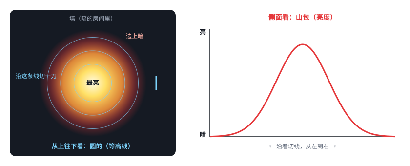
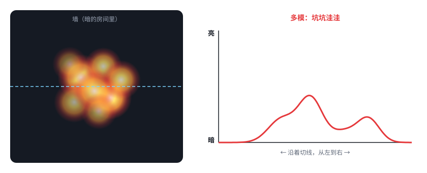

# 第 07 课 · 补课二｜光点是圆的，“小山包”画的是亮度

> 日期：2026-11-03　·　起因：你问“正面看：光束的截面（亮度）没懂，激光不是圆形的？”
>
> 🖐 **交互版**：[在线打开](https://claude.ai/artifact/AYSK3SGDtY6c6VVvQMiwPo)（分步讲解）。源文件见 [互动/第07c课_光点是圆的.html](互动/第07c课_光点是圆的.html)

**答：是圆的。** 上一课那条曲线画的不是形状，而是**亮度**。

## 问题 1：圆形的光点，怎么变成“小山包”？

光点中间最亮、边上暗。沿中间切一刀，把每个位置的亮度画成高度，就是“小山包”。就像一座山：从上往下看是圆的，从侧面看是山包。

## 问题 2：M² 大的激光，光点看起来什么样？

大体还是圆的，但里面有一块块亮斑，切一刀是坑坑洼洼的；而且走同样远，散得更大。

## 本课对项目的推进

把“光点形状”和“亮度分布”分开理解。以后实测光斑时，相机拍到的是圆点，分析软件画出来的就是这条曲线，用它来量光斑有多大。

（同时把第 07 课补课里那张图的标题改成了“沿光点中间切一刀：各处有多亮”，并注明光点本身是圆的。）
