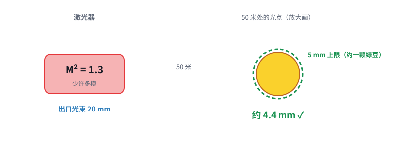
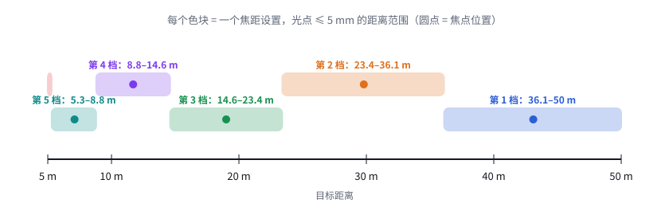
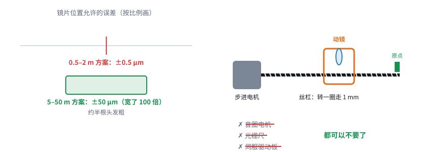

# 第 07 课｜5–50 米、光点 ≤ 5 mm，落地

> 日期：2026-11-03　·　起因：你给定“光点 5 mm 以内都能接受；距离不固定，5–50 m”
>
> 🖐 **交互版**：[在线打开](https://claude.ai/artifact/W4zrcEN9t83GJVXteUqvRg)（分步讲解）。源文件见 [互动/第07课_需求落地.html](互动/第07课_需求落地.html)
> 📐 **设计文档**：[设计/远距离系统方案_v0.5.md](../设计/远距离系统方案_v0.5.md)
> 🧮 **计算**：[设计/工具/需求落地计算.py](../设计/工具/需求落地计算.py) → [结果](../设计/工具/需求落地计算结果.md)

## 问题 1：“≤ 5 mm”对激光器提了什么要求？

用 30 mm 振镜时 M² 上限是 1.48，留出余量后按 **≤ 1.2** 选；如果只能买到 M² 1.5 的，就把光束扩到 25 mm（振镜约 38 mm）。

## 问题 2：5 到 50 米，焦点要一直调吗？

每个焦距都能覆盖一段距离，6 档就能盖住 5–50 m。**扫描过程中 Z 不用动**，换目标距离时调一次就行。

## 问题 3：Z 要多准？用什么推？

公差从 ±0.5 μm 放宽到 ±50 μm（宽了 100 倍），**丝杠 + 步进 + 原点开关**就够用；要注意丝杠回差和镜筒热胀。

## 本课对项目的推进

- 📐 v0.5：方案 A（30 mm 振镜 + 调焦望远镜 f2 150 mm、行程 4 mm），激光器 M² ≤ 1.2
- 🔧 Z 驱动大幅简化：步进 + 丝杠；控制卡用 STEP/DIR/EN/HOME 驱动，不需要和扫描同步
- 📌 待办：在控制卡引脚草案里预留 4 个 IO
