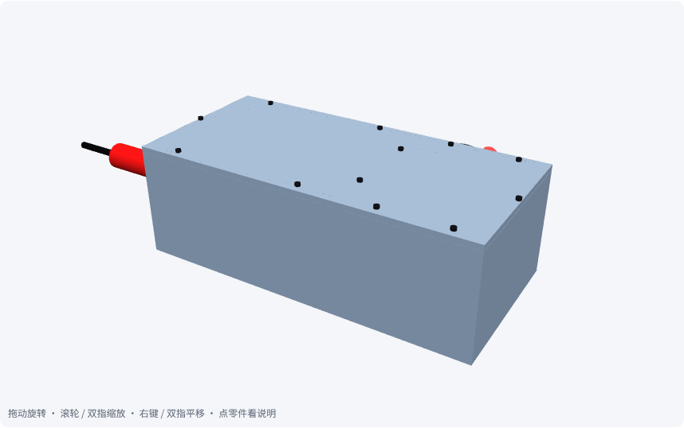
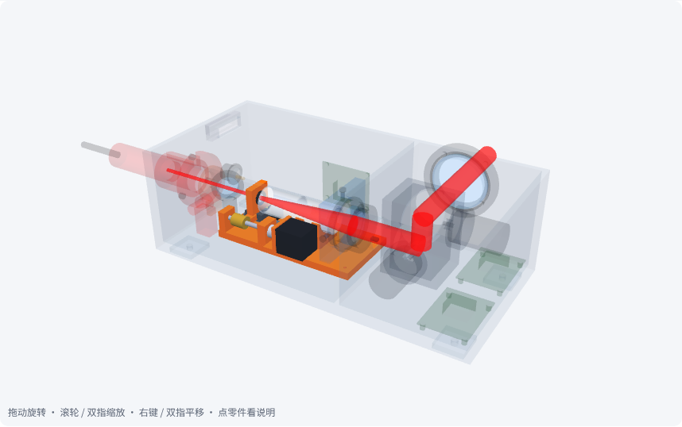
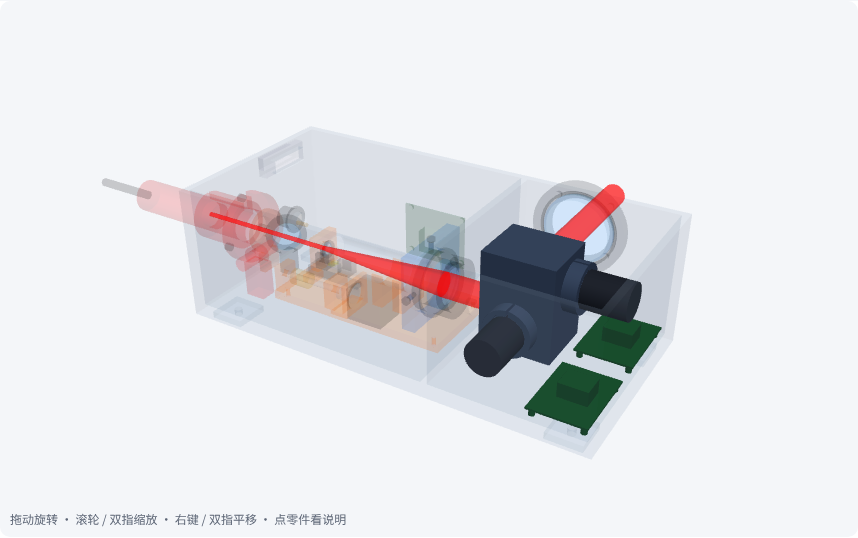
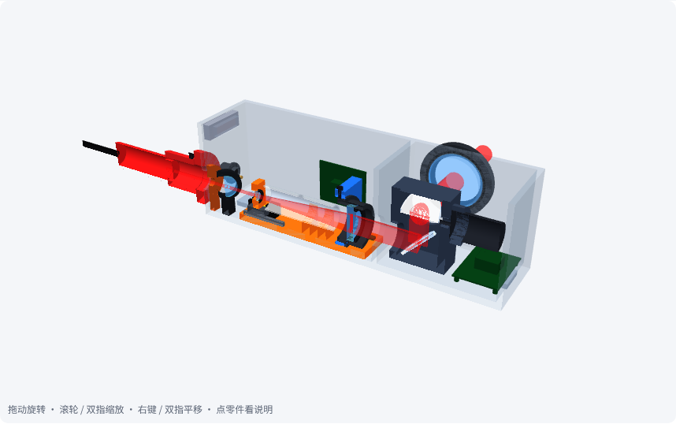
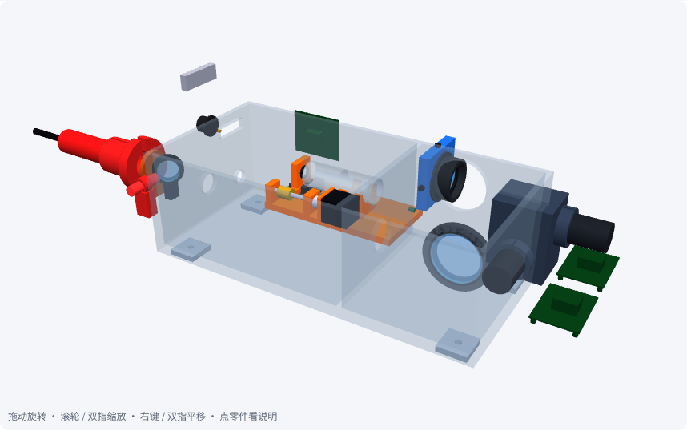

# 第 08 课 · 重做｜调焦头详细结构

> 日期：2026-11-03　·　起因：你说“太粗糙了，参考参考文献里面的设备做，要完整、精细，每个结构都要有”
>
> 🖐 **交互版**：[在线打开](https://claude.ai/artifact/U6RcgpS4siF9UGpsYQbNPV)（真实 CAD 3D：旋转、分子系统高亮、剖开、拆开、点零件看规格；零件清单可筛选）。源文件见 [互动/第08b课_详细结构.html](互动/第08b课_详细结构.html)
> 📐 **结构方案**：[设计/调焦头结构方案_v0.2.md](../设计/调焦头结构方案_v0.2.md)　·　🧊 **CAD**：[设计/CAD/调焦头_v0.2.step](../设计/CAD/调焦头_v0.2.step)　·　📋 [BOM](../设计/CAD/BOM_v0.2.md)

## 整机与各子系统

| | |
|---|---|
|  |  |
| 整机（上盖关闭） | Z 调焦机构：导轨、滑座、镜座、丝杠、预紧螺母、轴承座、联轴器、步进、光电开关、遮光筒 |
|  |  |
| 振镜组件：内支架、X/Y 电机 + 电机夹、两面镜片、驱动板 | 沿光轴剖开 |

## 参考来源

- **CN213163617U**：光路底座 + 上盖密封腔、隔断分腔、入光孔 → 壳体
- **CN205899130U**：Z 轴底座保证同轴、遮光座、内支架、电机夹、保护窗、驱动板
- **CN120928524B**：滑动镜片安装结构、遮光片 + 探测器 → 动镜镜座、挡光片 + 光电开关
- **SCANLAB varioSCAN**：可水冷入口光阑

## 本课对项目的推进

- 🧊 结构从“方块”升级为**详细结构 v0.2：55 种零件、干涉 0 处**，STEP 可直接进 CAD 软件
- 📋 BOM：每个零件都标了自制 / 外购和参考来源
- 🔧 新工具：`干涉检查.py`（两两求交）、`glb转json.py`（网页 3D）
