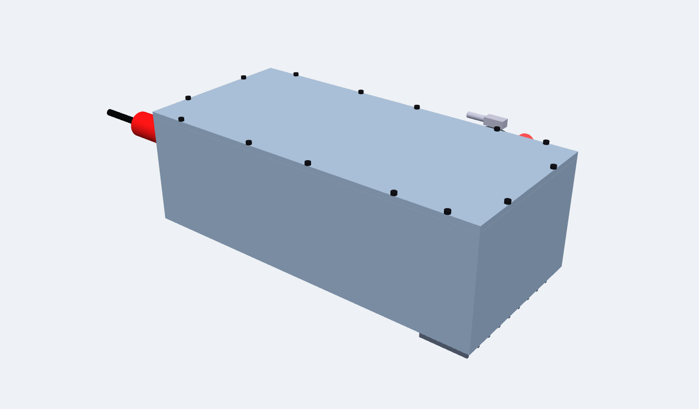
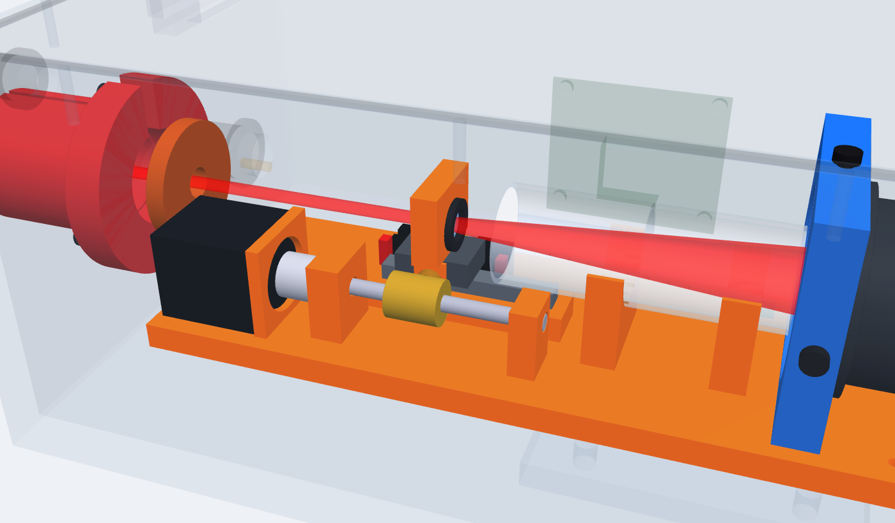
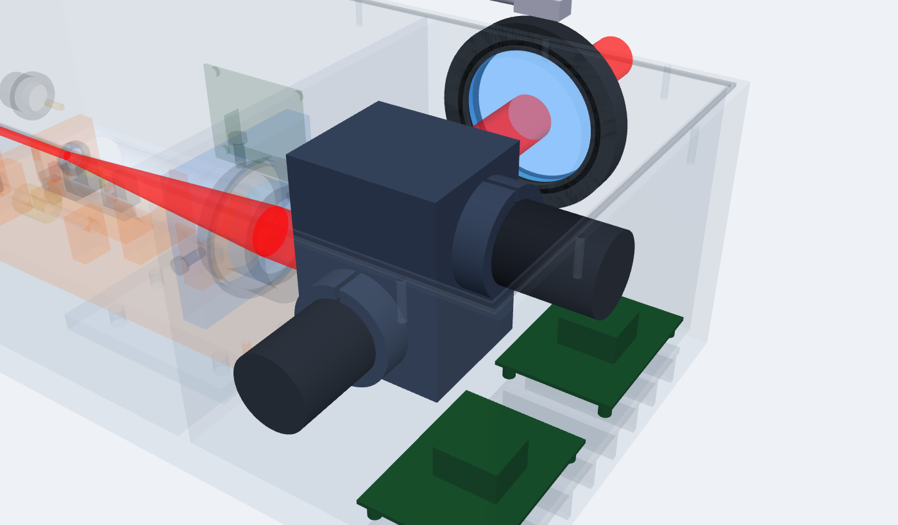
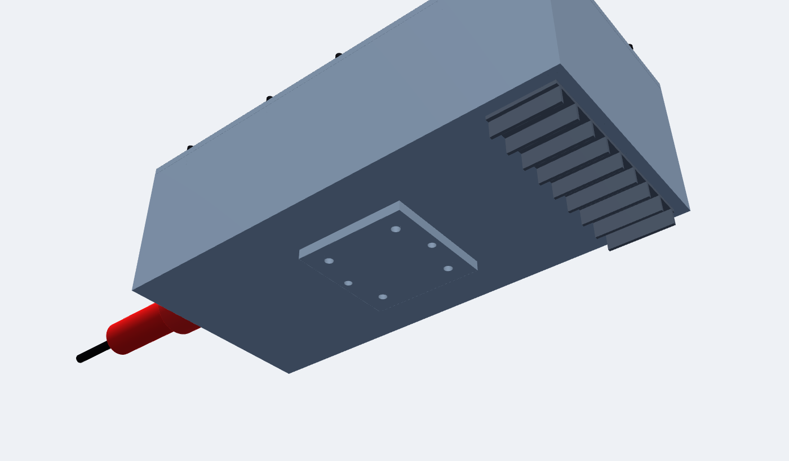

# 第 08 课 · 三｜结构审查与优化（v0.3）

> 日期：2026-11-03　·　起因：你问“这部分是什么？激光要不要准直扩束？先不要用示意图，直接导出三维，结构有没有要优化的？”
> 本次按你的要求**没有做示意图课件**，直接更新 CAD 和 3D：[在线 3D（已更新到 v0.3）](https://claude.ai/artifact/U6RcgpS4siF9UGpsYQbNPV)
> 📐 [设计/调焦头结构方案_v0.3.md](../设计/调焦头结构方案_v0.3.md)　·　🧊 [设计/CAD/调焦头_v0.3.step](../设计/CAD/调焦头_v0.3.step)

## 你圈的那部分

蓝色圆片 = **合束镜**（I07），黑环 = 合束镜座（I08），橙色环 = **入口光阑**（I06），旁边红色小圆柱 = 红光模组（I09）。v0.3 里合束镜和红光已去掉（红光由激光器自带）。

## 准直、扩束

准直由激光器的 QBH 准直输出头完成；扩束 ×5 由“动镜 + 物镜”完成，不需要另加扩束镜。准直头输出直径决定扩束倍数。

## 9 项优化

去掉合束镜 / 导轨垫高 / 电机后置 + 浮动接头 / 硬限位 / 窗片倾斜 3° / 密封条 + 透气阀 + 吹气嘴（并修正上盖螺孔 bug）/ 导热垫 + 散热鳍片 / 重心下的安装接口板 / 物镜非胶合

| | |
|---|---|
|  |  |
|  |  |

## 本次对项目的推进

- 🧊 结构 v0.3：59 种零件，**干涉 0、挡光 0**（新增光路通畅检查）
- 📌 激光器选型新增条件：**自带红光指示**；准直头输出直径一起定
