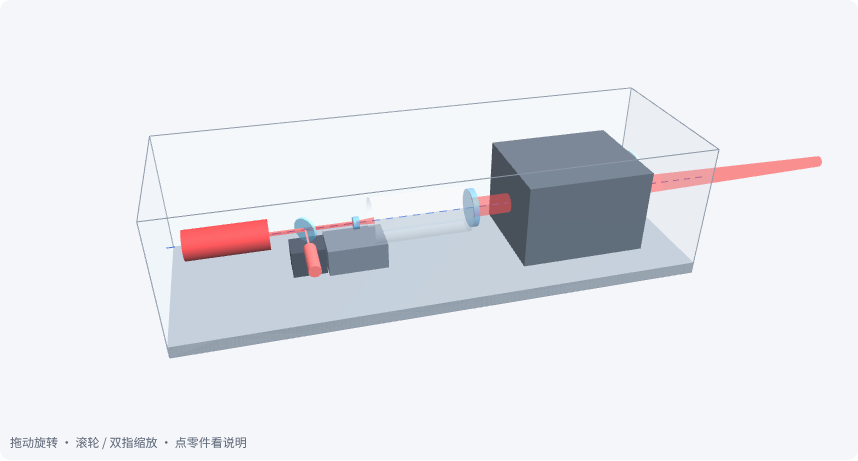
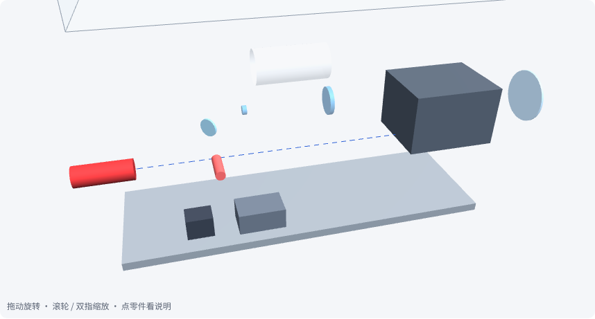
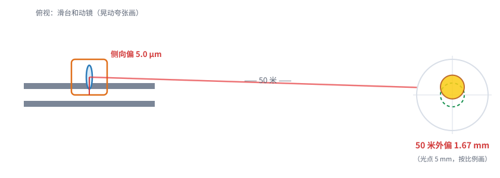
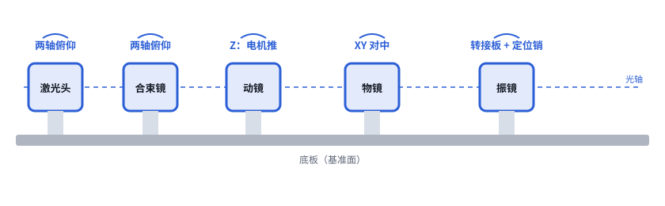

# 第 08 课｜调焦头结构布局

> 日期：2026-11-03　·　起因：你问“现在是不是可以设计结构了？”
>
> 🖐 **交互版**：[在线打开](https://claude.ai/artifact/XF6sLzU9saR76ccAgN2wN8)（3D 可旋转、可拆开、可点零件）。源文件见 [互动/第08课_结构布局.html](互动/第08课_结构布局.html)
> 📐 **结构方案**：[设计/调焦头结构方案_v0.1.md](../设计/调焦头结构方案_v0.1.md)　·　🧊 **CAD**：[设计/CAD/调焦头_概念_v0.1.step](../设计/CAD/调焦头_概念_v0.1.step)

## 问题 1：整台调焦头长什么样？

一条直线排开，总长约 520 mm：激光头 → 合束镜（红光）→ 丝杠滑台上的动镜 → 120 mm → 物镜 → XY 振镜 → 保护窗。

## 问题 2：动镜侧向晃一点，50 米外偏多少？

动镜横向偏 1 μm → 50 m 处偏 0.33 mm。能重复的偏移标定掉，不能重复的晃动靠好滑台（≤ 3 μm）。

## 问题 3：哪些地方要留调节？

激光头和合束镜：两轴俯仰；物镜：XY 对中；振镜：转接板 + 定位销；动镜：只由电机推 Z。

## 本课对项目的推进

- 📐 结构方案 v0.1、参数脚本（唯一数据源）、CadQuery 生成的 STEP 装配体
- 🔑 关键结构要求：**滑台不可重复横向晃动 ≤ 3 μm**；控制卡新增“XY 偏移补偿表（随 Z）”；热胀 28 μm/10 K 要补偿
