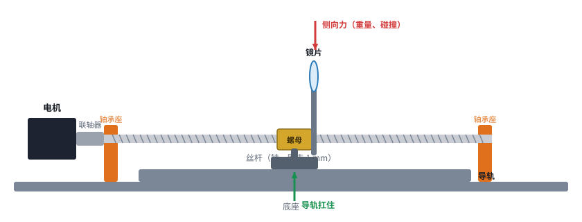
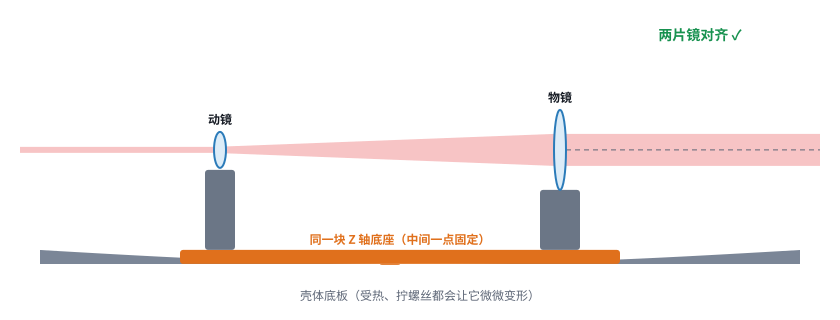
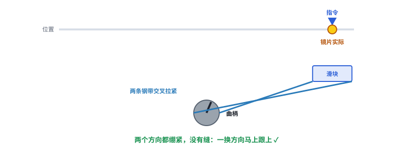
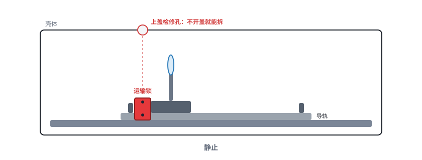
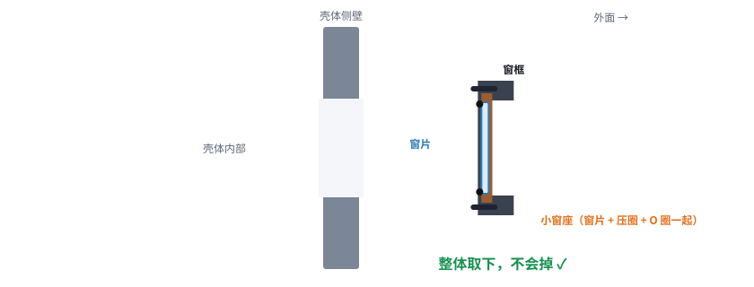
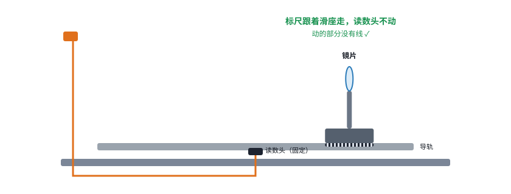

# 第 09 课｜54 份资料里，六个值得学的结构

> 日期：2026-11-03　·　起因：你说专利原图看不太懂，让我把和 Codex 讨论后认为有价值的结构画成可交互的图
>
> 🖐 **交互版**：[在线打开](https://claude.ai/artifact/RU594paxUJaZ2wMaNBo5qH)（每个都会动，分步讲解）。源文件见 [互动/第09课_值得学的结构.html](互动/第09课_值得学的结构.html)

| # | 结构 | 来源 | 一句话 | 我们 |
|---|---|---|---|---|
| 1 | 丝杆传动链 | R010 | 丝杆只管推，导轨扛侧向力 | ✅ 已经这样 |
| 2 | 共同底座 | R004 / R009 | 两片镜装同一块底座，壳体变形时一起动、不错开 | ✅ Z 轴底座；可再加三点支撑 |
| 3 | 回差与钢带预紧、两级运动 | R054 | 有缝就有回差（换方向时先空走）；钢带交叉预紧没有缝 | 预紧螺母 / 单向趋近；钢带、两级先不做 |
| 4 | 运输锁 | R031 AGV3D | 运输时把滑座锁住，开机前拆 | ➕ v0.4 加，上盖开检修孔 |
| 5 | 保护窗保持 | R031 AGV3D | 窗片 + 压圈 + O 圈进小窗座整体拆装，定位销复位 | ➕ v0.4 加 |
| 6 | 位置反馈与线缆 | S015 / R002 | 直线标尺直接量镜片；标尺在滑座、读数头固定，动的部分没有线 | ➕ v0.4 留位置 |

## 本课对项目的推进

- v0.4 结构改动：**运输锁（带上盖检修孔）、保护窗独立窗座 + 定位销、直线标尺预留位（标尺在滑座、读数头固定）**
- 新想法：Z 轴底座用**三点支撑**装到壳体上，彻底隔离壳体变形
