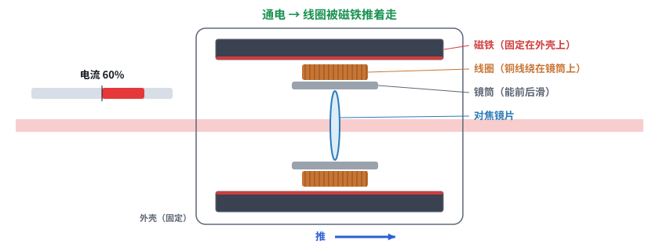
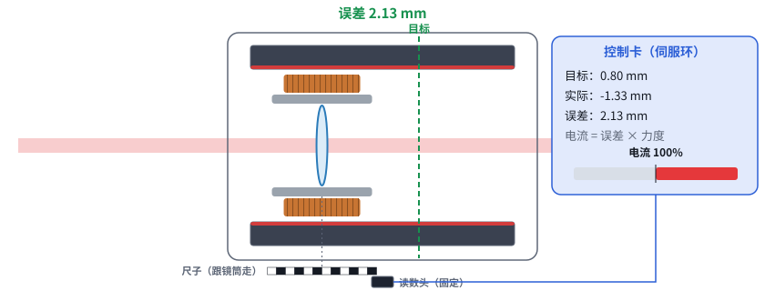
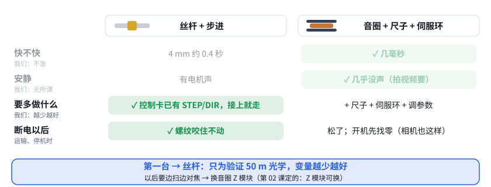

# 第 10 课补课：音圈马达

> 互动课件：[在线打开](https://claude.ai/artifact/7hGkN7BGe8ruuocLRjbtPY) · [源文件](互动/第10b课_音圈马达.html)
> 起因：用户指出“相机厂商的高端镜头都是音圈马达，你居然觉得音圈马达不好，而且没看懂音圈马达的示意图”。用户说得对：第 10 课把音圈说成“不好”是错的，图也画得不清楚（磁铁和线圈画成了分开的两块）。

## 问题 1：音圈马达是怎么推动镜片的？

- 对焦镜片装在**镜筒**里，镜筒外面绕着**线圈**，线圈夹在外壳上固定的**磁铁**中间
- 通电就被推，电流反过来就往回拉；没有齿轮、没有螺纹 → **快、安静**
- 没电就没有力：微单镜头关机摇一摇会“咔哒”响；手机摄像头用小弹簧把它拉回原位

## 问题 2：没弹簧的音圈，怎么停在想要的位置？

- 只给固定电流：一直加速，撞到头
- 加**尺子**（直线标尺 + 固定读数头）+ **伺服环**：电流 = 误差 × 力度，离得远推得猛，到了就不推；被振了马上推回来
- 力度（增益）太小走得慢，太大冲过头来回晃 → 要调参数。相机机身一直在跑这个环

## 问题 3：那我们的 Z，选音圈还是丝杆？

| | 丝杆 + 步进 | 音圈 + 尺子 + 伺服环 |
|---|---|---|
| 快 | 4 mm 约 0.4 s【推算】 | ✓ 几毫秒 |
| 安静 | 有电机声 | ✓ 几乎没声 |
| 要多做什么 | ✓ 控制卡已有 STEP/DIR | 尺子 + 伺服环 + 调参数 |
| 断电以后 | ✓ 咬住不动 | 松了，开机先找零 |

- 我们的动镜 Ø12.7 mm、几克、行程约 4 mm，和相机对焦镜组差不多大；S018 最小款行程 5 mm、动子 5 g【资料 S018】→ 音圈完全推得动
- 只设一次距离 → **第一台用丝杆**；要边扫边对焦（曲面、动目标）→ 换**音圈 Z 模块**

## 本课对项目的推进

- 更正第 10 课：音圈不是“不好”，而是第一台用不上它的快，还要多做位置传感器和伺服环（第 10 课课件已改措辞、重画音圈图、修复“自己玩”时说明文字不更新的问题）
- **Z 模块 v2 路线**：音圈 + 直线标尺 + 伺服环；样机仍用丝杆平移台
- 控制卡待办：Z 除 STEP/DIR/EN/HOME 外，再预留一路编码器输入（A/B）；也可以买能直接收 STEP/DIR 的音圈伺服驱动器【假设，选型时核实】
