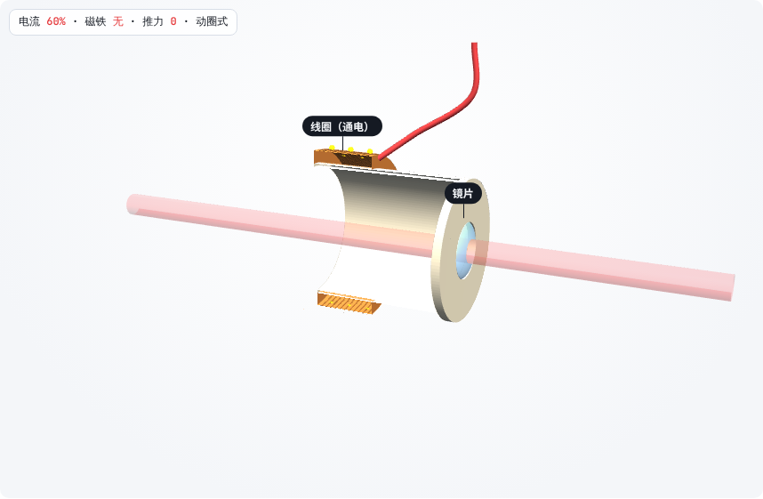
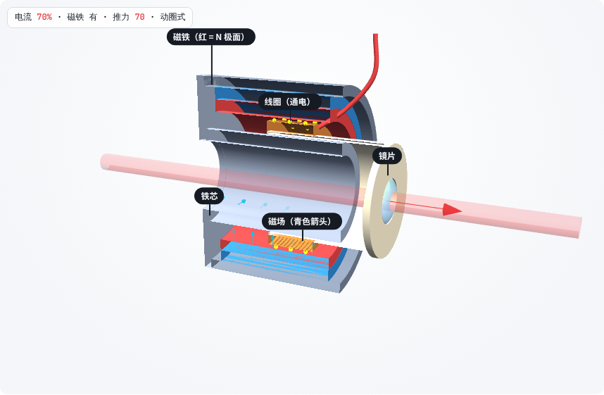
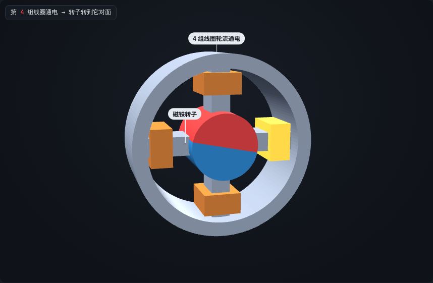
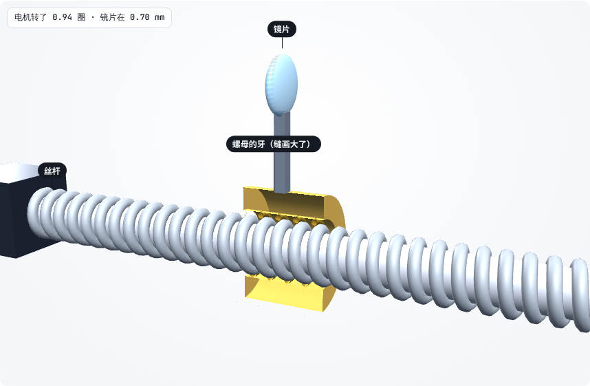
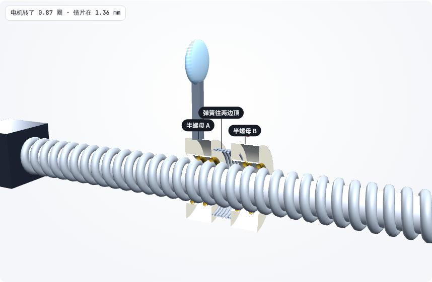
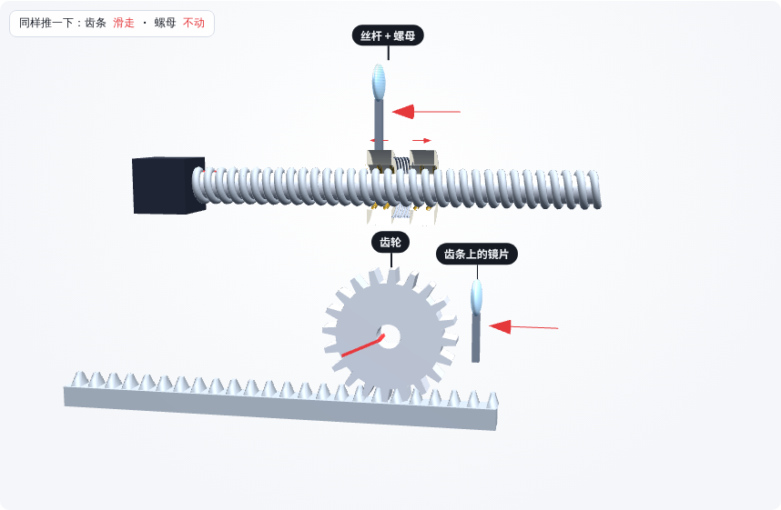
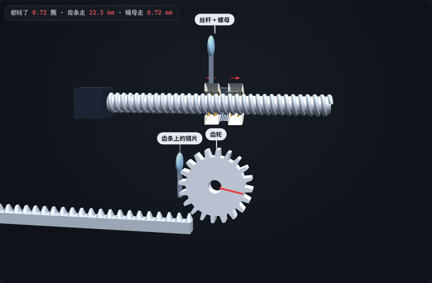

# 第 10 课补课（3D）：磁铁干什么用？丝杆的缝去哪了？

> 互动课件：[在线打开](https://claude.ai/artifact/WCf9mMFW31EpzLwBayLBox) · [源文件](互动/第10d课_磁铁和间隙_3D.html)
> 起因：用户看了第 11 课的 3D 说“这个 3D 做的确实可以”，想要的是把第 10 课问答里的两个问题（磁铁的作用、丝杆也有缝）也这样讲。文字版见 [第10c课问答](第10c课_问答_磁铁丝杆间隙.md)。

## 问题 1：电流加在线圈上，磁铁有什么用？（6 步）

| 没有磁铁：线圈通电也不动 | 有磁场才有推力 | 步进电机也是线圈 + 磁铁 |
|---|---|---|
|  |  |  |

- 磁铁在线圈待的缝里造出**磁场**；通电的导线泡在磁场里才被推。推力 = 磁场 × 电流 × 线长
- 电流反向 → 推力反向；永磁铁强弱改不了，所以只调电流
- 动磁式：线圈固定、磁铁带镜片走 → 动的部分没有电线
- 步进电机：四组线圈轮流通电，磁铁转子一格一格转；音圈 = 把它摊平

## 问题 2：丝杆螺母也有缝，为什么还选丝杆？（7 步）

| 普通螺母换向空转 | 消隙螺母 |
|---|---|
|  |  |

| 推一下：齿条滑走、螺母不动 | 都转一圈：31 mm 对 1 mm |
|---|---|
|  |  |

- 普通螺母：换向时牙要先走过槽里的缝 → 电机空转、镜片不动（回差）
- 消隙螺母：两个半螺母被弹簧顶开，各贴一边 → 不空转
- 齿轮也有缝也能消，**区别不在缝**：①推齿条齿轮会转（断电咬不住），推螺母丝杆不动（自锁）；②一圈：齿条约 31 mm，丝杆 1 mm

## 本课对项目的推进
- 确认 v0.4 的消隙螺母（Z08）和导程 1 mm 丝杆的选择
- Z 模块 v2（音圈）优先选**动磁式**：动的部分不拖线
