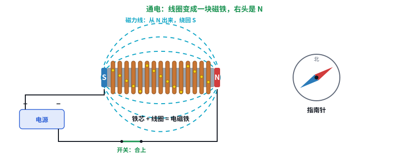
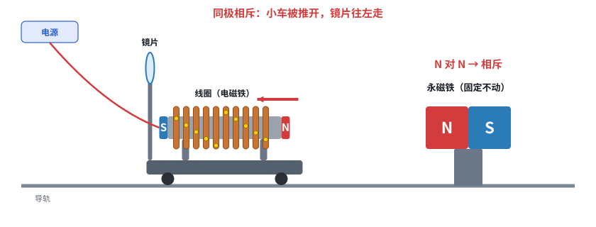
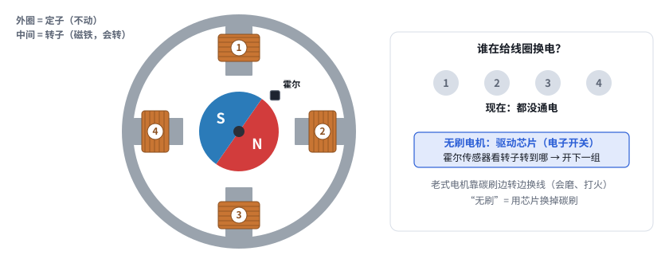

# 第 10 课补课：电磁铁、音圈、电机——一个道理讲到底

> 互动课件：[在线打开](https://claude.ai/artifact/YSi3hNcEd228V5Prrvfb5e) · [源文件](互动/第10f课_电磁铁和电机.html)
> 起因：用户说“磁铁这部分得用示意图……无刷电机那块我也没懂”（第10d课 3D 里的电机部分没讲明白）。改用平面分步示意图，处处标 N / S。

## 问题 1：线圈通了电，为什么就变成磁铁？

- 铁芯 + 线圈，旁边放指南针：没通电指北；通电后指南针转过来 → 线圈变成**电磁铁**（继电器就是它）
- 磁力线从 N 出来绕回 S，和条形磁铁一样；电源反接 → N/S 对调；断电 → 磁性消失

## 问题 2：有了电磁铁，为什么还要一块永磁铁？

- 线圈装在小车上（带镜片），右边固定永磁铁（左面 N）
- 线圈右头 N：N 对 N 相斥 → 推开；电流反向右头 S：S 对 N 相吸 → 拉回
- 拿走永磁铁：电磁铁没有对手 → 不动。音圈 = 把这套卷起来（喇叭同理）

## 问题 3：电机为什么会转？（无刷、步进）

- 从电机一头往里看：中间转子 = 磁铁，外圈定子 = 4 个线圈
- 线圈 1 通电（朝里是 S）→ 转子 N 被吸过去；1→2→3→4 轮流通电 → 一直转；换得越快转得越快
- **无刷电机**：芯片里的电子开关换电，霍尔传感器看转子位置（老式电机靠碳刷）
- **步进电机**：按 STEP 脉冲换，1 个脉冲 = 1 格；DIR = 顺着还是倒着换 → 数脉冲就知道转了多少（真电机一格 1.8°，再细分）

## 本课对项目的推进
- 看懂 Z 轴步进电机接口：STEP = 换下一组 = 走一格；DIR = 换的顺序（控制卡预留的两根线）
- 音圈（Z 模块 v2）和电机同一个道理：线圈当电磁铁，永磁铁当对手
