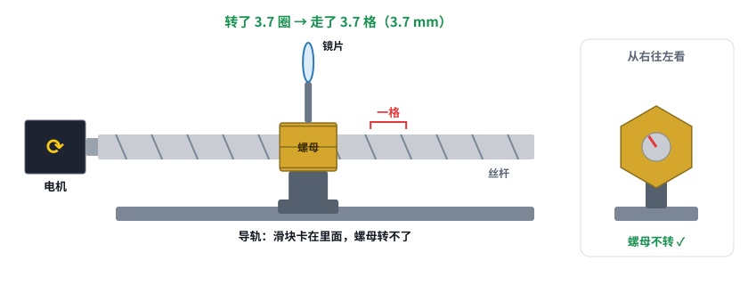
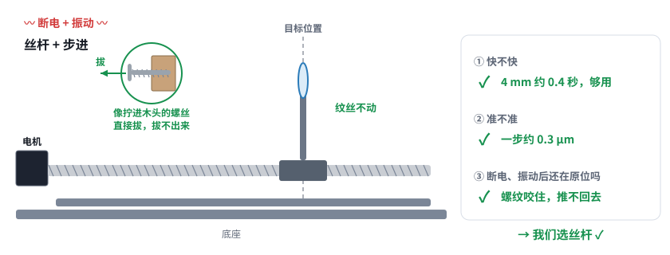
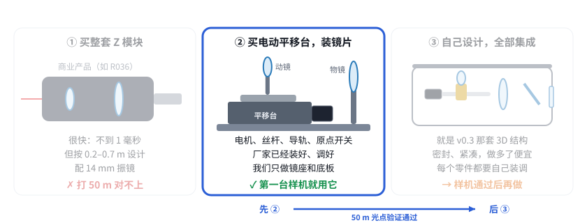

# 第 10 课：镜片怎么动起来？

> 互动课件：[在线打开](https://claude.ai/artifact/9vdKujSdCvS5GE3AmJuHuK) · [源文件](互动/第10课_镜片怎么动起来.html)
> 起因：用户问“这种东西有没有模块，要自己搭还是买一个调一调装一装？丝杆是电机带着转，怎么移动的？为什么不用音圈、齿轮？”

## 问题 1：电机明明在转，镜片为什么是直着走？

- 螺栓 + 螺母：**捏住螺母**不让它转，拧螺栓，螺母就直着走；松开手，螺母跟着一起转，原地不走
- 真零件：电机代替手拧，螺栓就是**丝杆**；**导轨**代替捏螺母的手（螺母连滑块，滑块卡在导轨里）
- 转一圈走一格（**导程**，我们 1 mm）；步进电机一圈 3200 小步，一个脉冲走约 0.3 μm【推算，BOM v0.3】

**记住一句：** 螺母被导轨卡住转不了，丝杆一转它只能直着走。

## 问题 2：为什么不用音圈、齿轮、皮带？

| 传动 | 快不快 | 准不准 | 断电、振动后还在原位吗 |
|---|---|---|---|
| 齿轮 + 齿条 | ✓ | ✗ 齿间有缝 | ✗ 在缝里晃 |
| 皮带 | ✓ | ✗ 有弹性 | ✗ 来回弹 |
| 音圈（S018） | ✓ 几毫秒【资料 S018：机械时间常数 4–17 ms】 | △ 要光栅尺 + 伺服板 | ✗ 断电没力 |
| **丝杆 + 步进** | ✓ 4 mm 约 0.4 s【推算】，设一次距离够用 | ✓ 0.3 μm/步 | ✓ 自锁（像拧进木头的螺丝，拔不出来） |

**记住一句：** 我们设一次距离就不动，不要求快但要稳 → 丝杆。要边扫边对焦时才换音圈（走 XY2-100 的 Z 通道，控制卡不用改）。

## 问题 3：Z 这部分，买现成的还是自己搭？

1. **买整套商业 Z 模块**（如 R036 RAYLASE AXIALSCAN RD14）：很快（跟随误差 < 1 ms），但按 0.2–0.7 m、14 mm 振镜设计【资料 R036】→ 打 50 m 对不上
2. **买电动平移台 + 自己装镜片**：电机、丝杆、导轨、原点开关厂家已装好调好；我们只做两个镜座 + 一块底板 → **第一台样机用它**
3. **自己设计、全部集成**（v0.3 的 3D 结构）：密封、紧凑、量产便宜，但每个零件都要自己装调 → 样机验证通过后再做

**记住一句：** 先 ② 搭样机验证 50 m 光点 ≤ 5 mm，通过了再做 ③。

## 本课对项目的推进

- Z 驱动确认：**丝杆 + 步进**（三个前提见进度.md 待决定 1d）
- **新建议：第一台样机的 Z 用现成电动平移台**（行程 ≥ 5 mm、步进电机、带原点开关、能接 STEP/DIR）+ 两个镜座 + 一块底板
- 集成壳体（v0.3 / v0.4 CAD）留到产品阶段；整套商业 Z 模块不适合 50 m
