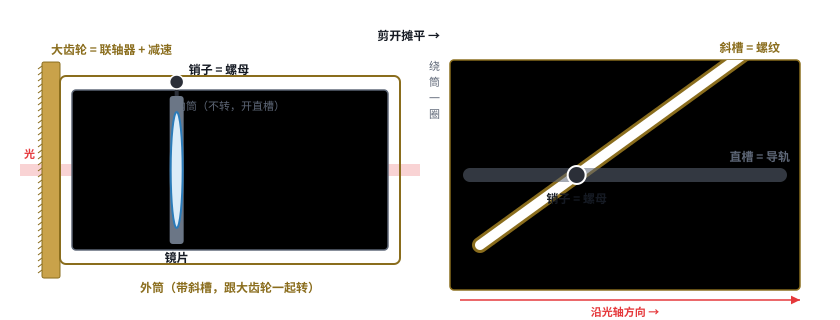
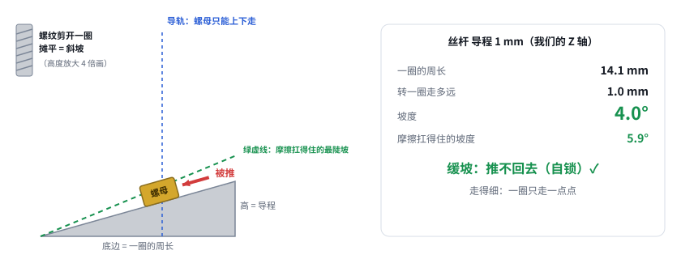

# 第 11 课补课：照片里的镜头怎么推镜片？丝杆为什么推不回去？

> 互动课件：[在线打开](https://claude.ai/artifact/L9KrFtBjnKCN1dJmJuFHvz) · [源文件](互动/第11b课_凸轮筒和斜坡.html)
> 起因：用户发来别人做的调焦镜头照片（镜筒外有铜色大齿轮、旁边小齿轮接电机），问“看样子像行星齿轮什么的”，并说上次丝杆与齿轮齿条没讲明白，要更好的原理图。

## 问题 1：小齿轮带大齿轮，为什么一大一小？

- 照片里是**一对普通外啮合齿轮**（示意：小 20 齿、大 100 齿），**不是行星齿轮**（行星齿轮 = 太阳轮 + 行星轮 + 内齿圈三层套在一起）
- 小齿轮转 5 圈、大齿轮转 1 圈 = 减速 5 倍 → 更细、力气更大
- 照片里第二个小齿轮【推测】：测转角的电位器 / 编码器，或两个小齿轮对顶消隙

## 问题 2：大齿轮一转，镜片怎么会前后走？

- 大齿轮固定在能转的**外筒**上（开斜槽 / 螺旋槽）；里面**不转的内筒**开直槽；镜片架上的**销子**同时插在两条槽里
- 剪开摊平：外筒转 → 斜槽滑动 → 交叉点只能沿直槽走 → 镜片沿光轴走
- **凸轮筒 = 绕在镜筒上的丝杆**：斜槽 = 螺纹，销子 = 螺母，直槽 = 导轨，大齿轮 = 联轴器 + 减速（相机镜头对焦环就是这样）

## 问题 3：丝杆和齿轮齿条，本质区别在哪？

- 把螺纹剪开摊平一圈 = **斜坡**：底边 = 一圈的周长，高 = 一圈走多远（导程）
- **坡度 = 一圈走多远 ÷ 周长**；坡度 < 摩擦角（5.9°，μ = 0.10【假设】）→ 推不回去（自锁）
- 丝杆 1 mm：4.0° 自锁、细；丝杆 4 mm：23° 推得回去；**齿轮齿条：一圈 31 mm = 周长 → 45° 陡坡**，一推就动、很粗；照片里的凸轮筒【假设 Ø60，转 3/4 圈走 10 mm】：约 4°，也自锁，再加 5:1 减速 → 电机一圈 2.7 mm
- 结论：区别不在“有没有缝”，而在**坡度**

## 本课对项目的推进
- 认出照片结构：齿轮减速 + 凸轮筒（同轴丝杆）：紧凑、对称、镜片靠镜筒对中；但凸轮槽要高精度加工、齿轮要消隙
- 统一判据“坡度 < 摩擦角 → 自锁”与 `Z轴传动计算.py` 一致（4.0° < 5.9°）
- 待定：Z 模块以后可考虑凸轮筒式；v0.4 先保持丝杆
