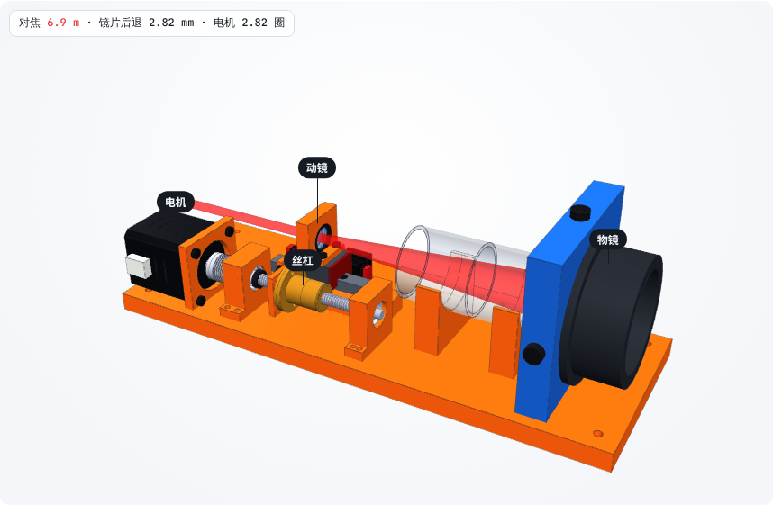
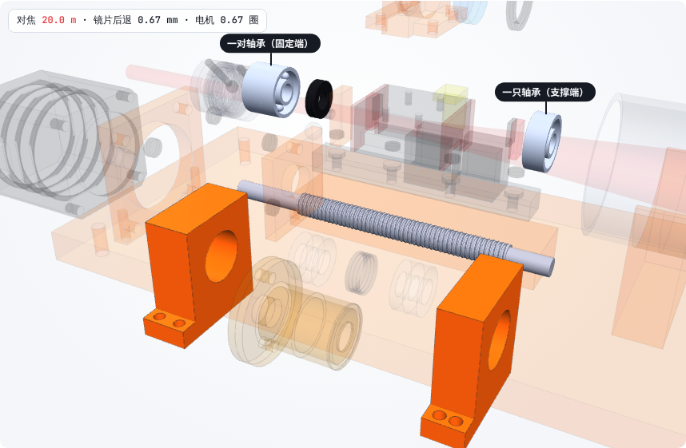
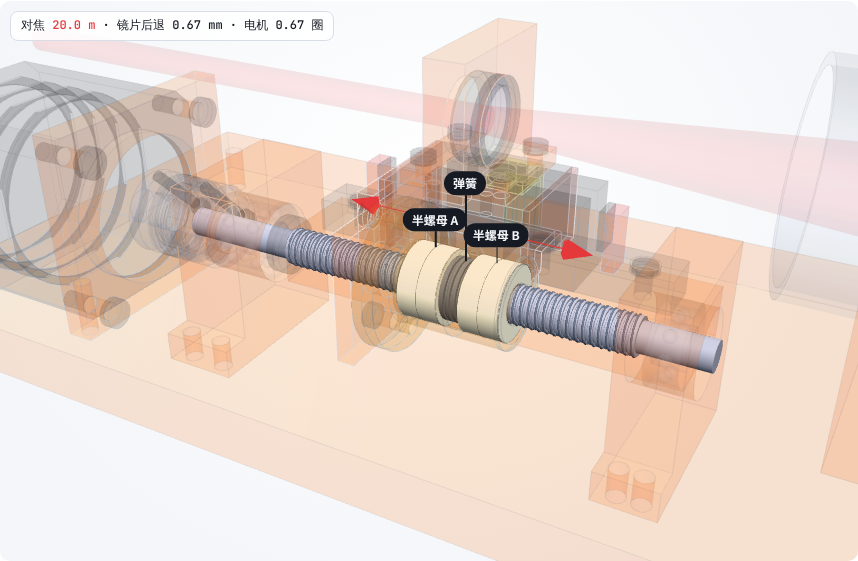
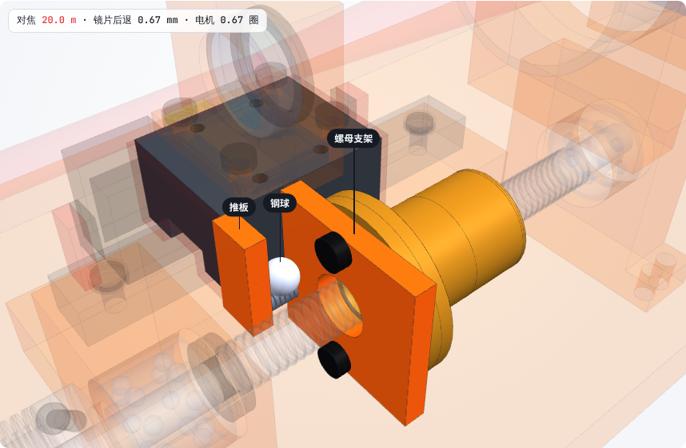
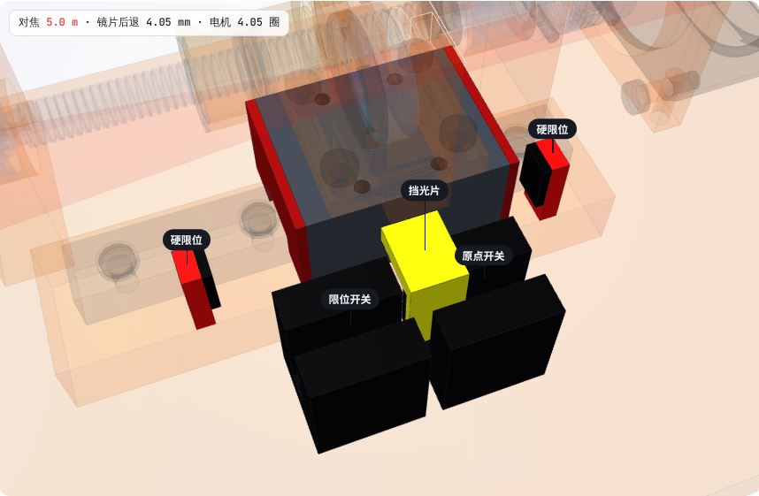
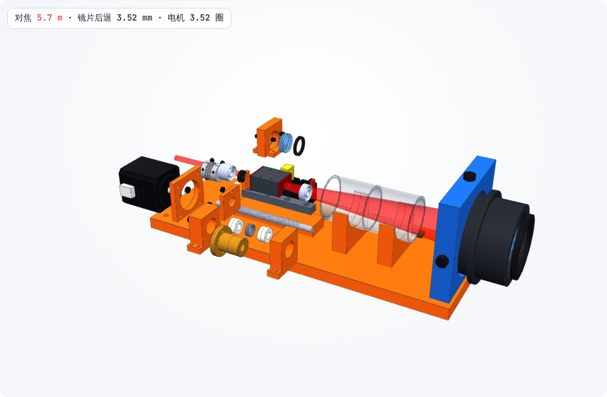

# 第 11 课：像机械设计师一样，把 Z 轴设计到位

> 互动课件（真实 3D 模型 + 11 步讲解）：[在线打开](https://claude.ai/artifact/6ESnYy7zLQC3N4tY4zoC1J) · [源文件](互动/第11课_Z轴传动设计.html)
> 起因：用户说“重新做一个好的、惊喜的示意图讲，我们要像一个机械设计师一样把东西设计好”。

本课不是示意图，而是 **v0.4 的真实 CAD 模型**（`设计/CAD/调焦头_v0.4.step`，77 种零件，干涉 0、挡光 0）。课件里可以：分步看每个零件为什么在那、拖“对焦距离”看丝杠转镜片走、爆炸图、剖开螺母、装运输锁、演示找原点、点零件看说明。

| 步 | 讲什么 | 截图 |
|---|---|---|
| 全貌 | 电机 → 丝杠 → 螺母 → 滑块 → 动镜 |  |
| 固定端 / 支撑端 | 一头一对轴承锁死，一头只托着让热胀 |  |
| 消隙螺母 | 两个半螺母 + 弹簧，分别贴住螺纹两侧 → 回差 0 |  |
| 浮动接头 | 钢球顶推板 + 拉簧：只传推力，零间隙 |  |
| 原点 / 限位 / 硬限位 | 开关在工作区外 2 mm，硬限位再外 |  |
| 爆炸图 | — |  |

## 设计校核（16 项全过，详见 `设计/工具/Z轴传动计算结果.md`）
一步 0.31 μm；全程 0.45 s；电机力矩安全系数 8；自锁（4.0° < 5.9°）；回差 0；热胀 1.6 μm / 28 μm。

## 本课对项目的推进
- **结构 v0.4**：Z 轴传动链重做，产出 `设计/Z轴传动设计_v0.1.md`、`工具/Z轴传动计算.py`、`CAD/调焦头_v0.4.step`
- 修正 v0.3 的错误：原点开关位置挡光片走不到；导轨短于滑块行程（滑块会探出导轨）；浮动接头只是占位，现在画成真实结构
- 下一步：按 BOM 选真实型号，把【假设】换成规格书数据再校核一遍
