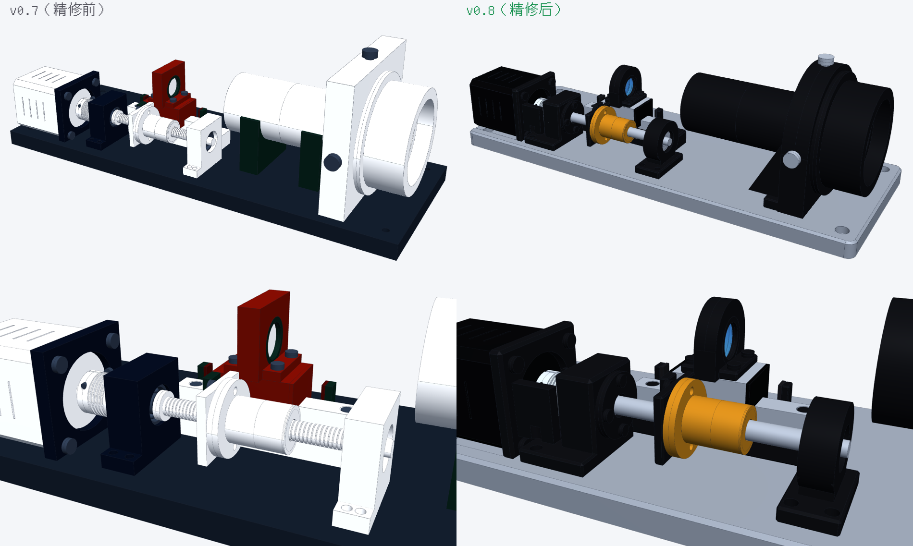
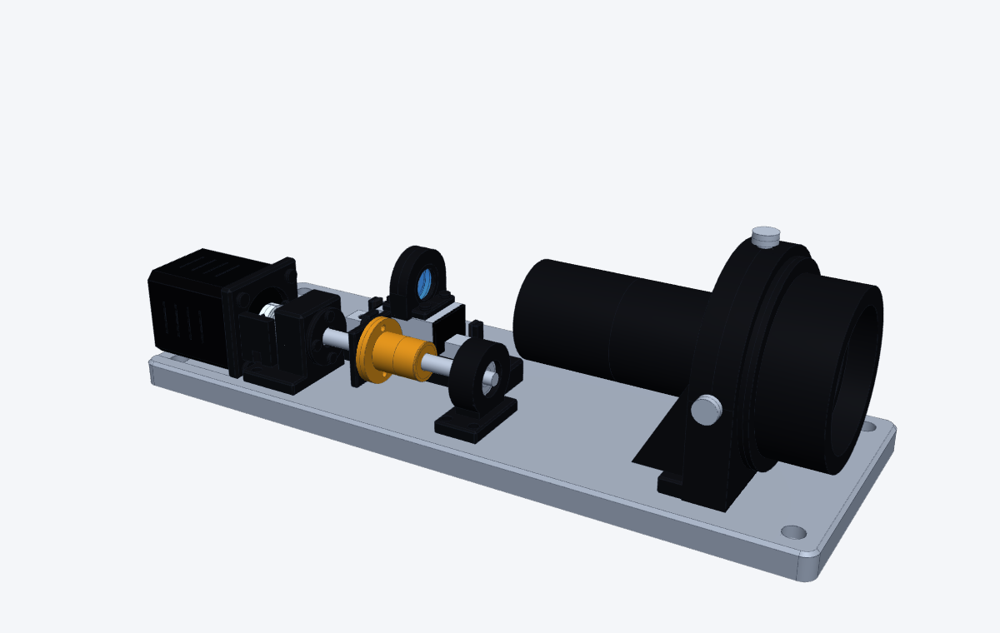
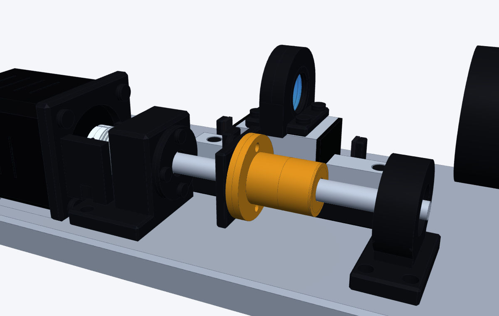

# 调焦主体精修 v0.8（记录，不做课件）

> 2026-11-05。用户：“我目前先不要外壳，你先把我这个做一个精修，符合一个正常设备的样子。”（直接出三维，按 CLAUDE.md 第 0 条只做记录）
> 详细改动表和检查结果见 [设计/审查/调焦主体_v0.7_审查.md](../设计/审查/调焦主体_v0.7_审查.md) 第 6 节。

| 轴测 | 传动近景 |
|---|---|
|  |  |

- 零件合并：电机座 + 固定端轴承座 → 一体支座；遮光筒去掉支座、法兰挂在物镜座上
- 修正审查发现的问题：固定端轴承（端盖 + 台阶 + 电机侧锁紧螺母）、电机过定位（1 mm 让位槽）
- 造型：墓碑形镜座 / 物镜座 + 加强筋、带底脚轴承座、底座圆角倒角、统一配色
- 检查：干涉 0、挡光 0、运动干涉 0；传动校核 16 项全过
- 文件：`设计/CAD/调焦主体_v0.8.step`（给 SolidWorks 用）
