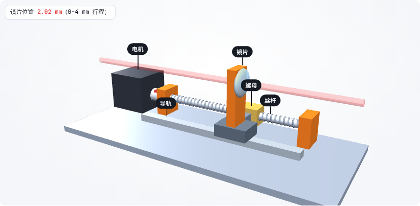
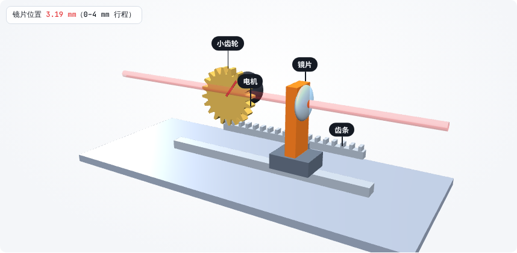
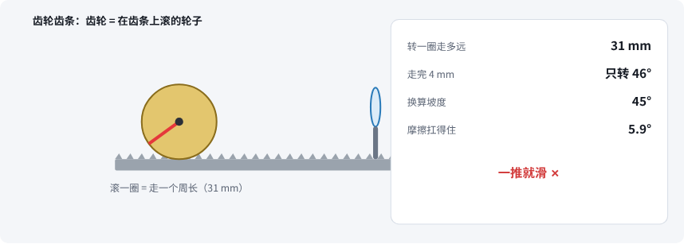
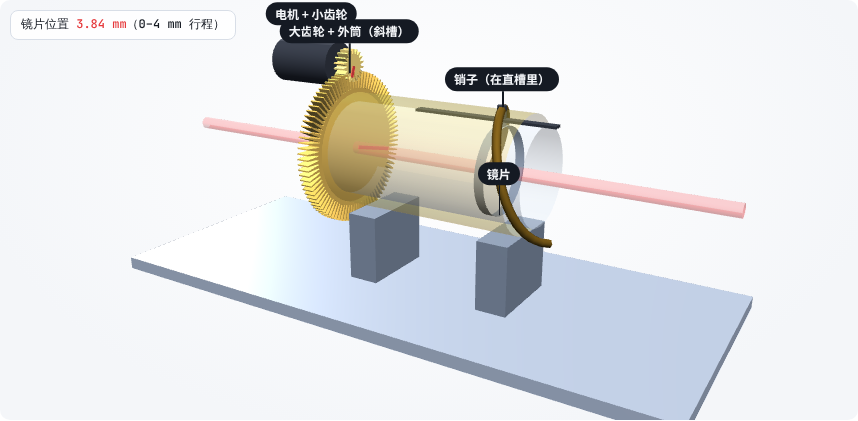
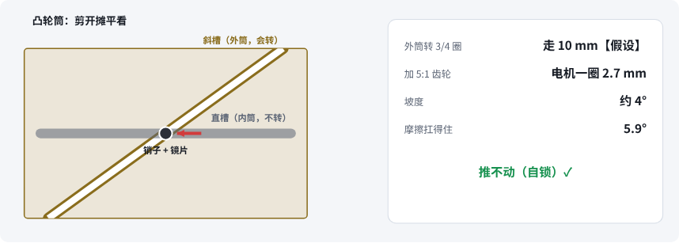
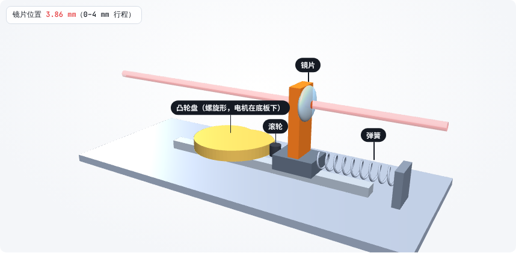
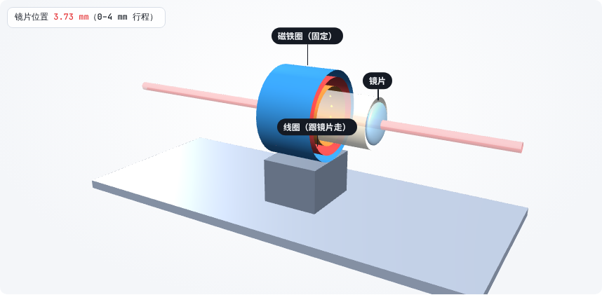
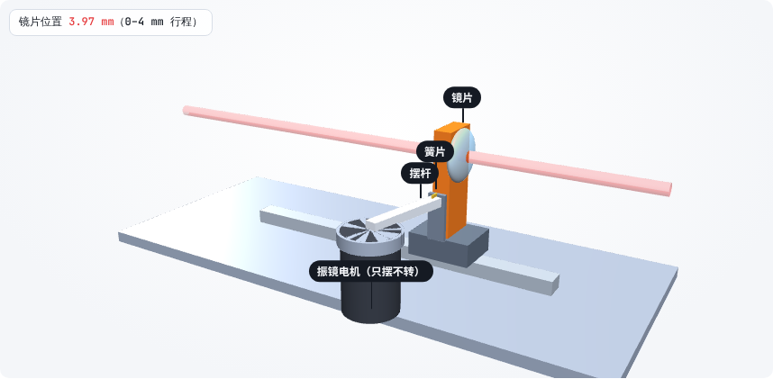

# 第 12 课：六种让镜片前后走的机构，放在一起评估

> 互动课件（3D + 2D 同步、评分卡）：[在线打开](https://claude.ai/artifact/EyVuQmcbdZ98r2qZsEoztT) · [源文件](互动/第12课_调焦机构对比.html)
> 起因：用户要求“丝杆、齿轮齿条、相机镜头的对焦环，这三种方式都用 3D 模型配合 2D 来讲，还有其他机构……都加上一样 3D+2D 我们来评估”。评估结论见 [设计/调焦机构评估_v0.1.md](../设计/调焦机构评估_v0.1.md)。

每种机构三步：① 认零件 ② 电机一转镜片走多少 ③ 断电推一下。

| 机构 | 3D | 2D 原理 | 一句话 |
|---|---|---|---|
| 丝杆 + 导轨 |  |  | 4° 缓坡：细、自锁 → **现在用** |
| 齿轮齿条 |  |  | 滚轮：一圈 31 mm，等效 45° → 粗、推得回去 |
| 凸轮筒 |  |  | 绕在镜筒上的丝杆：约 4°，同轴紧凑 → 以后可升级 |
| 盘形凸轮 + 弹簧 |  |  | 盘边摊平约 2.7°：自锁，零件少，弹簧常顶 |
| 音圈直驱 |  |  | 无坡：快，断电就松，要光栅尺 + 伺服 |
| 振镜电机 + 摆杆 |  |  | 摆 1° 走 0.5 mm：最快，最贵最难 |

## 本课对项目的推进
- 产出《设计/调焦机构评估_v0.1.md》：设一次距离 → 丝杆（现在），更紧凑 → 凸轮筒（以后），边扫边对焦 → 音圈 / 振镜摆杆
- 统一判据：自锁看“坡度 < 摩擦角”，快慢看“转动惯量 / 换向”
