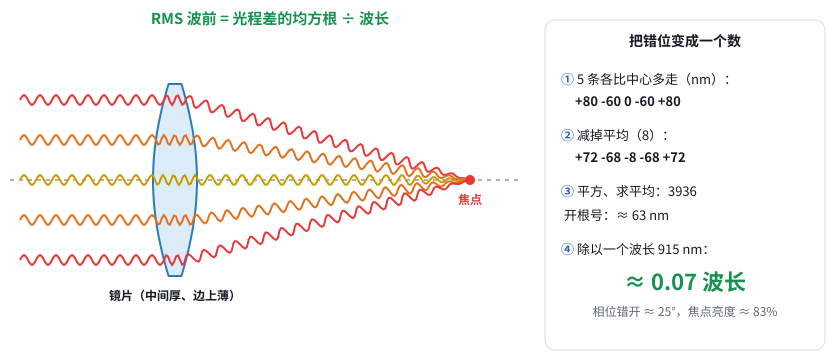

# 第 13c 课（问答）：“RMS 波前 0.07 waves”到底怎么算出来？

日期：2026-11-06 · 配图（用户要求）：[在线打开](https://claude.ai/artifact/QiLDuqXRN2yp6ce6pUHTwH) · [源文件](互动/第13c课_0.07波怎么算出来.html)

**用户：** 还是没想明白 RMS 波前 0.07 waves 是什么意思。如果它是误差，是怎么算出来的？

## 1. 量的是什么：每条光线到焦点的“路程”
- 光在玻璃里走得慢（n = 1.5），所以 1 mm 玻璃按 1.5 mm 算。这样折算出来的路程叫**光程**。
- **透镜能聚焦的根本原因**：中间的光线穿过的玻璃厚，被拖慢；边上的光线玻璃薄，但绕的路远。完美透镜让每条光线到焦点的光程**一模一样**。
- 真实镜片做不到完全相等，有的光线多走几十 nm，有的少走几十 nm。这个差值叫 **OPD**（光程差），Zemax 对每条光线都会算一次。

## 2. 为什么差几十 nm 就要紧：等于相位差
- 把每条光线当成一路**同频正弦信号**，周期就是一个波长（915 nm）。焦点上的亮度，就是所有信号叠加的结果。
- 光程差就是**相位差**：差 1 个波长等于差 360°，差半个波长就反相抵消。
- 所以误差用“几个波长”来量：0.07 waves 约等于相位差 25°，各路信号几乎同相，叠加后中心亮度约 83%。

## 3. 算一遍（举例数字，只取 5 条光线）
| 光线 | 边 | 中 | 心 | 中 | 边 |
|---|---|---|---|---|---|
| 比中心那条多走（nm） | +80 | −60 | 0 | −60 | +80 |

1. 求平均：(80 − 60 + 0 − 60 + 80) / 5 = 8 nm。整体一起早到或晚到不影响叠加，所以先把平均值减掉。
2. 各自减去平均：+72、−68、−8、−68、+72。
3. 平方后取平均：(5184 + 4624 + 64 + 4624 + 5184) / 5 = 3936。
4. 开根号：约 62.7 nm。这就是 RMS。
5. 除以波长：62.7 / 915 ≈ **0.07 waves**。

Zemax 的做法完全一样，只是取的光线多得多：整个光束截面上几百到几千条。

## 配图的 5 步
1. 一条光线就是一列波，进了玻璃波被挤密（慢 1.5 倍）→ 光程。
2. 完美透镜：中间路短但玻璃厚，边上玻璃薄但绕远 → 5 条光程一样长（镜片形状按这个条件反推）。
3. 光程一样 → 5 路同频信号同相到达 → 叠加最大、焦点最亮。
4. 真实镜片：多走 / 少走 → 相位错开 → 叠加变小（误差放大 2 倍时亮度约 43%）。
5. 均方根算法 → 63 nm ÷ 915 nm ≈ 0.07 波长 ≈ 25°，亮度约 83%。

## 追问：0.07 waves 不是加工导致的吗？（2026-11-06）
- **Zemax 给的设计值和加工无关**，是**形状本身**带来的误差。球面镜就算加工得完美无缺，也做不到每条光线光程相等：完美的形状不是球面，但球面最好磨，所以大家都用球面。
- **加工误差另外再加上去**：面形不准、半径偏差、偏心、倾斜、间距不对等。这部分靠公差分析来估（蒙特卡洛，属于统计）。
- **0.07 是总账的合格线**：设计误差 + 加工装配误差，加起来 ≤ 0.07 才算合格。所以设计阶段要把设计值压得比 0.07 小很多，给加工留余量。
- 更正：配图第 4 步原来写“真实镜片做不到完全相等”，容易被理解成加工误差，已改成“球面镜片，就算加工完美，形状本身也做不到”。
