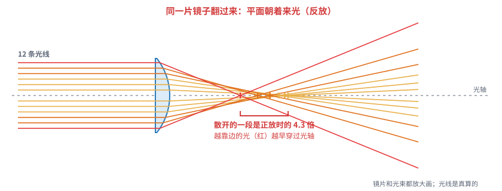
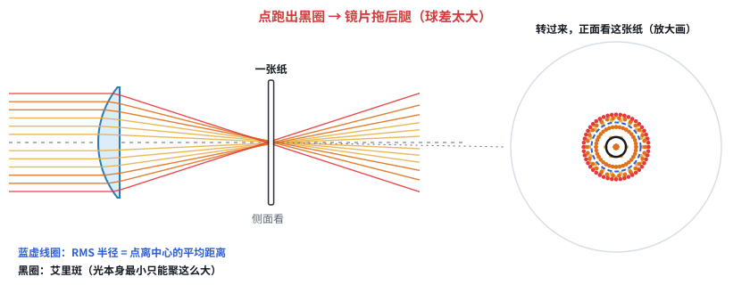
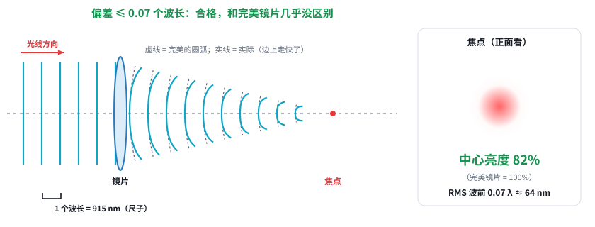

# 第 13 课：看懂 Zemax 的结果

日期：2026-11-06 · 交互课件：[在线打开](https://claude.ai/artifact/WwgLysVy12aCqYxuonWhya) · [源文件](互动/第13课_看懂Zemax结果.html)

起因：Codex 跑出了好几种结构，用户说“我什么知识都没有，直接看结果也看不懂”。这一课先把结果里最常见的三样东西讲清楚：光线图、点列图、RMS 波前。课件里的光线都按折射定律真实计算，只是把镜片画得特别“猛”，让误差看得清。

## 问题 1：Zemax 到底在算什么？

- Zemax 只做一件事：一条光线碰到镜面，按**折射定律**算它拐多大弯，然后一条一条算到底，这叫光线追迹。
- **理想透镜**（Zemax 里叫 Paraxial）能把光线全部汇到一点，现实中不存在，只用来检查表格填对没有。
- **真实球面镜**：越靠边的光线拐得越过头，聚不成一个点，这叫**球差**。同一片平凸镜放反，散开的范围约是正放的 4 倍。规律是**弯面朝着平行光那一侧**。

记住一句：Zemax 就是把光线一条一条按折射定律算到底；真实球面镜边上的光会拐过头（球差），所以聚不成一个点。

## 问题 2：点列图上那一团点是什么？

- 在焦点处竖一张纸，从正面看，每条光线在纸上留下一个点，这团点就是**点列图**。
- 把纸前后挪，点最挤的位置就是最佳焦点。**优化**就是让 Zemax 自动去找这个位置；在我们的系统里，挪的是动镜。
- **RMS 半径**：所有点离中心的平均距离，用来给点列图打分。
- **黑圈（艾里斑）**：光是波，就算镜片完美，光斑最小也只能这么大。点都落在黑圈里，说明镜片够好。

记住一句：点列图 = 在焦点放一张纸、正面看光线打的点；点都落在黑圈（艾里斑）里 = 镜片够好，再好也看不出区别。

## 问题 3：“RMS 波前 0.07 waves”是什么意思？

- 光是波。完美镜片会把波峰“掰”成以焦点为中心的圆弧，各处同时到达焦点，叠加后最亮。
- 真实镜片掰得不准，边上的波峰走快了一点，到焦点时对不齐，中心就变暗。
- 以 **1 个波长（915 nm）**为单位，把各处的偏差取平均，就是 **RMS 波前**。
- 合格线是 **0.07 个波长**（约 64 nm），这时中心亮度约 82%，和完美镜片几乎分不出来。0.15 个波长时，中心亮度只剩约 41%。

记住一句：RMS 波前 = 镜片把波峰“掰歪”了平均几个波长；≤ 0.07 波长，焦点亮度还有八成以上，算合格。

## 拿到 Codex 的结果，按这个顺序看
1. 先看**理想透镜**那一份：每个配置的 RMS 光斑都应接近 0，说明表填对了。
2. 再看每个方案的 **RMS 波前**：≤ 0.07 waves 打勾，超过打叉。只在打勾的方案里挑。
3. 最后看**动镜行程**：1 m 和 10 m 两个配置的间距差，跟现结构能走的 8 mm 比。

## 小测（答案）
1. Zemax 怎么算光斑？→ 一条条按折射定律算光线。
2. 点都在黑圈里说明什么？→ 镜片够好。
3. 0.05 和 0.20 waves，哪个合格？→ 0.05。
4. 平凸镜弯面朝哪？→ 朝平行光。

## 本课对项目的推进
- 用户能自己读 Codex 的结果，只看三样：理想透镜那份对不对、RMS 波前打不打勾、动镜行程够不够。
- 弄清了“正放 / 反放 / 双胶合 / 短焦”这几种结构都在比**谁的球差小**。
- 和激光器的关系：常见 915 nm 光纤激光器 M² ≈ 40，光斑本来就是完美光斑的 40 倍，镜片这点误差几乎看不出来。只有激光器接近单模时，才必须守住 0.07 波长这条线。
