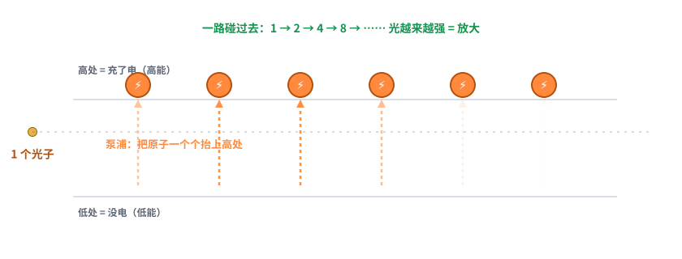
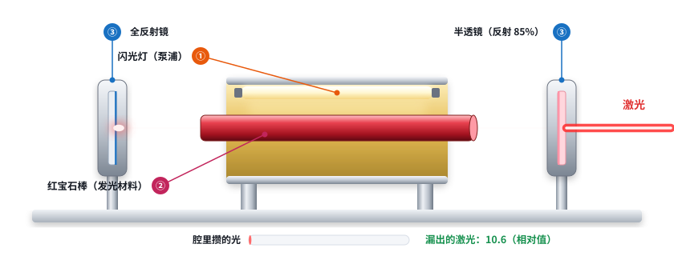
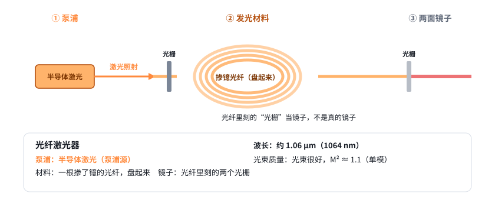

# 第 14 课：激光器是怎么把光“变出来”的（激光器基础 1/5）

日期：2026-11-11 · 交互课件：[在线打开](https://claude.ai/artifact/3xJvp3uYu4jxdDKfW4oJjE) · [源文件](互动/第14课_激光器怎么出光.html)

起因：用户去公司交流后发现光纤、半导体、CO₂、泵浦、光栅、盘光纤这些词都不懂，要求先补激光器基础，再回头设计镜片。

## 问题 1：光是怎么被“放大”的？

- 发光材料里有很多原子，像一节节小电池：没电时在低处。
- **泵浦** = 给原子充电，把它们抬到高处。
- 一个光子路过，碰到充了电的原子，原子掉回低处，同时多吐出一个光子；新光子和原来的**方向、颜色、步调都一样**。这叫**受激发射**。
- 一路碰过去：1 → 2 → 4 → 8……，光越来越强，这就是激光里的“放大”。没有泵浦，光子穿过去什么也不会多。

记住一句：原子先被“泵浦”充上电；一个光子路过，逼它把电放出来，放出的光子和原来的一模一样；一路连锁下去，光就越来越强。

## 问题 2：为什么激光器里要放两面镜子？

- 光穿过发光材料一次，只被放大一点点，出来的光很弱。
- 两头各放一面镜子，让光来回穿很多次，每穿一次放大一点，腔里的光一圈比一圈多。
- 右边镜子做成半透明：大部分反射回去继续放大，漏出一小部分，就是**激光**。
- 漏多少要拿捏：漏太多，每一圈放大的补不上漏掉的，起不了振；漏太少，攒得多但出得少。图里的模型是简化的示意（相对值），实际激光器靠设计找最佳点。

记住一句：一次穿过只放大一点点，所以用两面镜子让光来回穿很多次；右边镜子故意漏一点出来，就是激光。漏太多不起振，漏太少出得少。

## 问题 3：半导体、光纤、CO₂ 激光器，三件套各是什么？

| | 泵浦 | 发光材料 | 两面镜子 | 波长 | 光束 |
|---|---|---|---|---|---|
| 半导体 | 电流直接通 | 一小块芯片 | 芯片两个端面 | 约 0.8–1 μm（915 / 976 nm 在这里） | 一般较差；光纤耦合输出后 M² 常 10–40 |
| 光纤 | 半导体激光 | 掺镱光纤，盘起来 | 光纤里刻的两个光栅 | 约 1.06 μm | 很好，M² ≈ 1.1（单模） |
| CO₂ | 高压放电 | 一管 CO₂ 气体 | 管外两面镜子 | 10.6 μm | 好；玻璃不透这个波长，不能走普通光纤 |

记住一句：三种激光器都是“泵浦 + 增益介质 + 两面镜子”，只是材料不同：半导体是一块芯片，光纤是一根特殊光纤，CO₂ 是一管气体。

## 小测（答案）
1. 泵浦干什么？→ 给原子充电（供能）。
2. 为什么两面镜子？→ 让光来回穿很多次，一圈圈放大。
3. 激光从哪出来？→ 从半透明那面镜子漏出来。
4. 光栅相当于什么？→ 光纤激光器里的两面镜子。

## 本课对项目的推进
- 你在公司听到的“泵浦”就是图里给原子充电的东西；老师要的 915 nm 常见是半导体激光器，有时是给光纤激光器供能的泵浦源（第 15、16 课细讲）。
- 出光口是一束细光，因为它是从那面半透镜里漏出来的。
- 下一课（第 15 课）：半导体激光器和泵浦。
