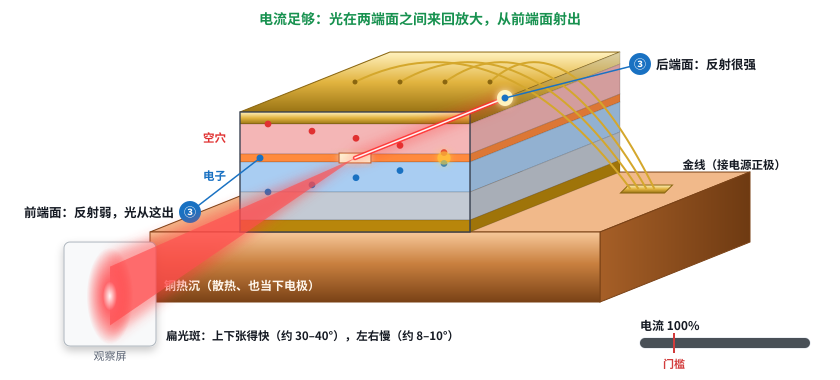
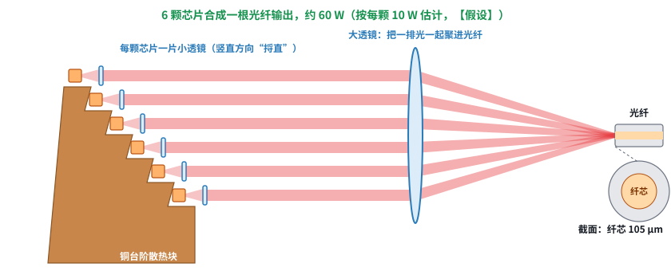
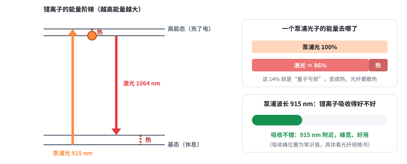

# 第 15 课：半导体激光器和泵浦（激光器基础 2/5）

日期：2026-11-11 · 交互课件：[在线打开](https://claude.ai/artifact/8RyGXAyY519qcpsmAkaBsX) · [源文件](互动/第15课_半导体激光器和泵浦.html)

用户要求“示意图至少跟实物类似”，这一课按实物样子画：切开的芯片、台阶泵浦模块。图中尺寸、功率都是【典型值】，不同型号会有差别，选型看规格书。

## 先答上一课的追问：三要素
泵浦、发光材料（增益介质）、谐振腔。发光材料在谐振腔里面（夹在两面镜子中间）；泵浦在谐振腔外面，只负责把能量送进材料。

## 问题 1：一块小芯片怎么把电直接变成光？

- 芯片约 3–4 mm 长（大功率单管，【典型值】），一层层叠起来：上电极、P 型层、发光层、N 型层、衬底、下电极。发光层只有约 0.1 μm 薄。
- 通电后，P 型层的空穴和 N 型层的电子挤进发光层，相遇就放出光子（和 LED 一样）。
- 电流超过**门槛**，光多到能互相“逼着”放出一样的光子（第 14 课），芯片两个切开的端面当镜子：后端面反射强，前端面反射弱，光从前端面窄缝出来。
- 窄缝只有约 1 μm × 100 μm，光一出来就快速张开：上下快（约 30–40°）、左右慢（约 8–10°），光斑是扁的。这是半导体激光器光束差的根源。

记住一句：芯片是几层材料叠起来的“三明治”，电流穿过中间那层极薄的发光层，电子和空穴相遇变成光；电流超过门槛，端面当镜子，才成激光。

## 问题 2：一颗芯片光不够，怎么凑成泵浦模块？

1. 一颗芯片约 10 W（【典型值】），光一出来就张开；
2. 每颗芯片前放小透镜，把快速张开的光“捋直”；
3. 多颗芯片装在**台阶**上，每束光在上下方向各占一个高度；
4. 用大透镜把一排光聚到一根光纤端面里。输出光纤：纤芯 105 μm（常见值）。

记住一句：每颗芯片先用小透镜“捋直”，再把一排芯片的光用大透镜一起聚进一根光纤；光纤纤芯越粗越好耦合，但出来的光束就越差（M² ≈ 40）。

## 问题 3：为什么光纤激光器的泵浦用 915 / 976 nm？

- 光纤里掺的镱离子，只有光子能量刚好对上台阶时才吸收，吸收峰在 915 和 976 nm 附近（常识值，具体看光纤规格书）。
- 泵浦光子把它抬到高能态，回落时放出 1064 nm 的激光光子。两者能量差 = 1 − 915/1064 ≈ **14%**，变成热（量子亏损），光纤要散热。
- 976 nm 吸收更强但很窄，对泵浦波长漂移敏感；915 nm 吸收宽、好用。

记住一句：光纤里的镱离子只“爱吃” 915 和 976 nm 左右的光，吃进去再吐出 1064 nm 的激光；两者的能量差（约 14%）变成热。

## 小测（答案）
1. 光在哪一层产生？→ 夹在 P 型层和 N 型层之间的发光层。
2. 电流太小发什么？→ 普通光（像 LED），不是激光。
3. 为什么聚进一根光纤？→ 单颗功率有限；光纤输出方便后面接准直、扩束。代价是光束质量变差。
4. 为什么选 915 / 976？→ 镱离子在这两个波长附近吸收得好。

## 本课对项目的推进
- 老师要的 915 nm：既是常见的半导体激光器波长，也是光纤激光器的泵浦波长。如果是直接拿来打东西，就是“光纤耦合半导体激光器”，M² 约 40 正来自纤芯粗；如果是光纤激光器里的泵浦，它是内部的零件，不会单独出来用。**要问老师：915 nm 是直接用来打东西，还是想做光纤激光器的泵浦？**
- 公司里说的“泵浦出来加准直扩束”：泵浦模块出光口就是一根光纤，后面接准直头、扩束镜，正是调焦头要做的一段。
- 下一课（第 16 课）：光纤激光器拆开看，仍用实物样子的图。
