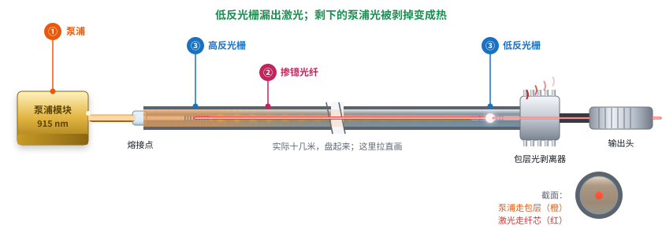
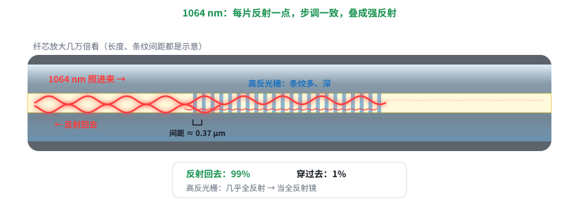
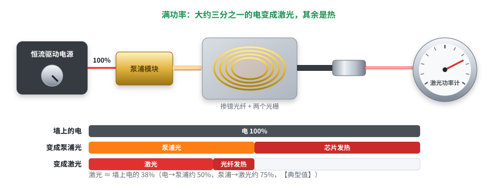

# 第 16 课补课：光纤激光器细讲——一个泵浦，从头走到尾

日期：2026-11-11 · 交互课件：[在线打开](https://claude.ai/artifact/DqRFBJgQumK1kLffy5kT78) · [源文件](互动/第16d课_光纤激光器细讲.html)

起因：用户说“有点懂但是不多，光纤激光器细讲，不要合束”。只留最简单的一台：一个泵浦模块 + 一根光纤，拉直画。

## 问题 1：光从泵浦走到输出头，一路上发生了什么？

1. 零件：泵浦模块（①）→ 熔接点 → 高反光栅（③）→ 十几米掺镱光纤（②，实际盘起来）→ 低反光栅（③）→ 包层光剥离器 → 输出头。
2. 915 nm 泵浦光经熔接点进入双包层光纤的**内包层**；高反光栅刻在纤芯里、只管 1064，泵浦光直接穿过。
3. 掺镱光纤里，泵浦光一路被吃掉，镱离子充上电。
4. 充了电的镱离子有的自己放光，顺着纤芯走的那一点是激光的“种子”。
5. 种子被两个光栅关住，来回放大，纤芯里 1064 nm 光越攒越强。
6. 低反光栅漏出激光；包层里没吃完的泵浦光被**包层光剥离器**剥掉、变成热，只让干净的激光走到输出头。

记住一句：泵浦光从包层进去、一路被镱离子吃掉；镱离子放出的 1064 nm 光被两个光栅关在纤芯里来回放大；从半透的光栅漏出来的就是激光，没吃完的泵浦光在出口前被剥掉。

## 问题 2：光栅凭什么只反射 1064、放 915 过去？

- 光栅 = 纤芯里每隔约 0.37 μm 玻璃稍“硬”一点（折射率高一点，用紫外光照出来），每一条像一面极淡的镜子。
- 1064 nm：间距正好对上，各条反射回来的光步调一致、越叠越强，高反光栅几乎全反射。
- 915 nm、1070 nm：步调对不上，互相抵消，直接穿过。光栅只认很窄一段（零点几到一两 nm，【典型值】），所以出什么波长由光栅定。
- 低反光栅：条纹少、浅，只反射约 10%（【典型值】），其余漏出 = 激光。

记住一句：光栅是刻在纤芯里的一排“很淡的镜子”，间距正好对上 1064 nm，每片反射回来的光步调一致、越叠越强；别的波长步调对不上，互相抵消，就直接穿过去了。

## 问题 3：激光功率是怎么调的？电都去哪了？

- 能量链：恒流驱动电源 → 泵浦模块 → 掺镱光纤 → 激光。
- 电流小、没过门槛：有泵浦光，没有激光；过了门槛，激光功率随电流几乎直线上升 → **调功率 = 调泵浦电流**。
- 满功率时：电 → 泵浦光约 50%，泵浦光 → 激光约 75%，合起来约 1/3 的电变成激光，其余是热（【典型值】）。

记住一句：激光功率是靠调泵浦电流来调的；过了门槛以后几乎是一条直线；墙上的电大约三分之一变成激光，其余都是热。

## 小测（答案）
1. 泵浦光走哪一层？→ 粗的内包层。
2. 种子从哪来？→ 充了电的镱离子自己放的光，顺着纤芯走的那一点。
3. 915 为什么能穿过高反光栅？→ 光栅间距只对上 1064，915 的反射步调对不上、互相抵消。
4. 功率怎么调？→ 调泵浦驱动电流。

## 本课对项目的推进
- 控制卡给激光器的“功率”（DB25 功率位或模拟量），在激光器里面最后就是泵浦电流；功率和设定值基本成正比，但有门槛，标定要从门槛以上开始。
- 调焦头接在输出头后面，拿到的只有干净的 1064 nm 激光。
