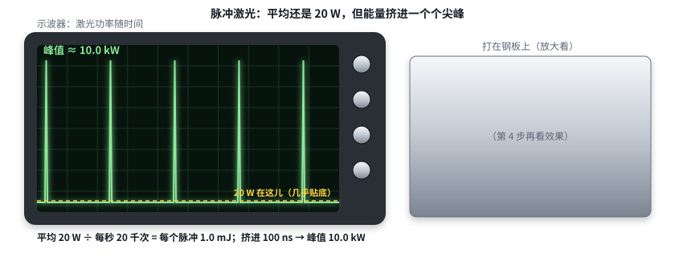
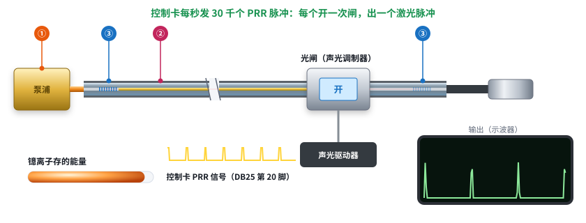
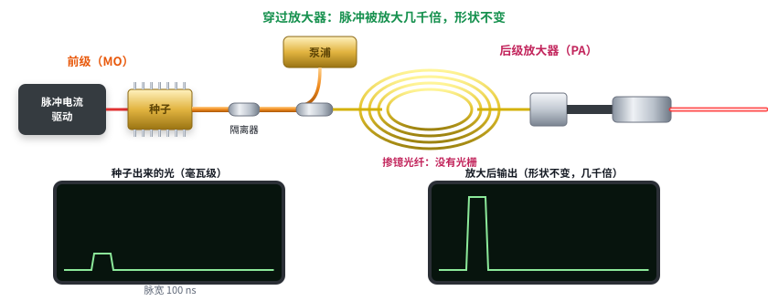

# 第 16 课续：光纤激光器怎么打出“脉冲”——调 Q 和 MOPA

日期：2026-11-11 · 交互课件：[在线打开](https://claude.ai/artifact/1JbqFjcpoDruLFm9RbN5hX) · [源文件](互动/第16f课_脉冲光纤激光器.html)

## 问题 1：同样 20 W，为什么打标要用脉冲？

- 连续：一直 20 W。
- 脉冲：平均 20 W，每秒 2 万下 → 每个脉冲 1 mJ；挤进约 100 ns → 峰值约 10 kW，是平均功率的 500 倍（【典型值】）。
- 效果：连续光热量往四周传，烧蓝发黄；脉冲瞬间汽化，热来不及传开，边缘干净、线条细。频率越高，每下越弱、越密。

记住一句：平均功率一样，把能量挤进一个个 100 ns 的脉冲里，瞬间功率能到上万瓦，材料来不及传热就被汽化，打得又干净又细。

## 问题 2：调 Q 激光器怎么闪起来？

- 在两个光栅之间加一个“光闸”：声光调制器（晶体 + 射频驱动，极快切换透光 / 挡光）。
- 光闸关：正反馈断了，激光起不来，泵浦一直充电，镱离子越存越多。
- 光闸开：存的能量一下子放成一个又短又猛的脉冲。
- 控制卡每发一个 PRR 脉冲（DB25 第 20 脚），开一次闸；频率越高，每个脉冲越弱。调 Q 脉宽由腔决定，基本固定（约 100 ns 量级，【典型值】）。

记住一句：光闸关着，激光起不来，镱离子一直充电把能量存着；光闸一开，存的能量一下子放成一个又短又猛的脉冲。控制卡每发一个 PRR 脉冲，就开一次闸。

## 问题 3：MOPA 有什么不一样？

- **前级（MO，主振荡器）**：种子，一颗小半导体激光器，被脉冲电流直接驱动，电流什么形状光就什么形状，但只有毫瓦级。
- **后级（PA，功率放大器）**：泵浦 + 掺镱光纤，**没有光栅**，自己不起振，只放大。耦合器把泵浦并进来，隔离器防止光倒流。
- 种子脉冲被放大几千倍，形状不变。
- 调 Q 脉宽固定；MOPA 脉宽由种子电流决定，2–500 ns 可调（【典型值】），能打黑、打阳极氧化铝变黑，所以更贵。

记住一句：MOPA = 前级种子（小半导体激光器，电流什么形状光就什么形状）+ 后级放大器（泵浦 + 掺镱光纤，没有光栅、只放大）。脉宽想多宽就多宽，这是它比调 Q 贵的原因。

## 小测（答案）
1. 脉冲强在哪？→ 能量挤进极短脉冲，瞬间功率高。
2. 光闸关时？→ 激光起不来，镱离子充电存能量。
3. 后级为什么没光栅？→ 只放大，不需要自己起振。
4. DB25 第 20 脚？→ 重复频率（PRR）。

## 本课对项目的推进：控制卡 DB25（J3）的线原来是干这个的
| 脚 | 方案草案里的名字 | 实际意思 |
|---|---|---|
| 18 | LASER_MO | 主振荡器（前级种子）/ 出光使能 |
| 19 | LASER_PA | 功率放大器使能，常是“这一刻出不出光” |
| 20 | LASER_PWM | 其实是 PRR / Sync，重复频率 |
| 1–8 | LASER_IP0–IP7 | 8 位功率值，最后变成泵浦电流 |
| 9 | LASER_LATCH | 把 8 位功率锁进去 |
| 22 | LASER_RED | 红光指示；部分 MOPA 在红光有效时用 D1 / D2 写脉宽（参考 PewPew 资料，以激光器手册为准） |

振镜每走一个点、激光开不开、开多久，都要和这几根线对时，所以控制卡方案里由 FPGA 统一管“激光事件执行”。
