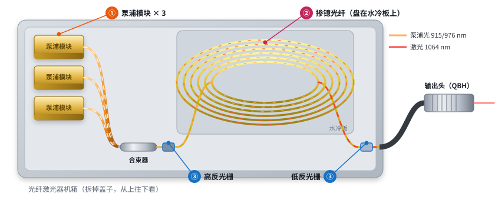
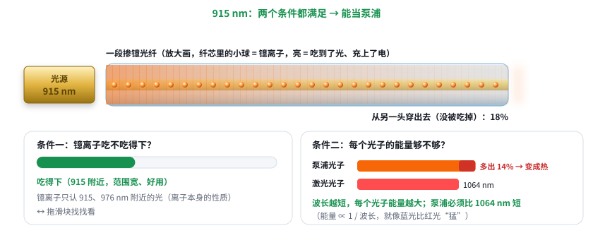
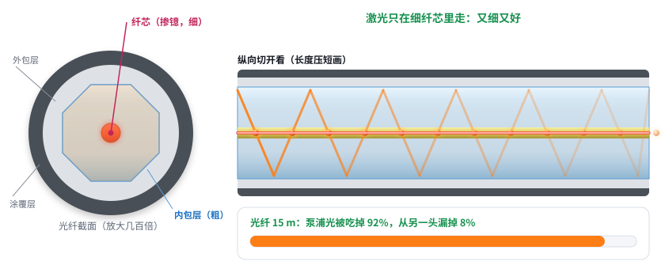

# 第 16 课：光纤激光器拆开看（激光器基础 3/5）

日期：2026-11-11 · 交互课件：[在线打开](https://claude.ai/artifact/786k11VFceRSNMxeauBPgf) · [源文件](互动/第16课_光纤激光器拆开看.html)

## 问题 1：打开机箱，每个零件干什么？

光走的顺序：
1. **泵浦模块**（①）：一排半导体芯片，送出 915 / 976 nm 泵浦光；
2. **合束器**：几根泵浦尾纤熔成一根；
3. **高反光栅**（③）：刻在光纤芯里的“全反射镜”，只反射 1064 nm；
4. **掺镱光纤**（②）：十几米，盘在水冷板上，把泵浦光变成 1064 nm 并来回放大；
5. **低反光栅**（③）：半透，漏出来的就是激光；
6. **输出光缆 + 输出头（QBH）**：之后接准直头，再接我们的调焦头。

记住一句：泵浦模块的光经合束器并进一根光纤，在两个光栅之间那段盘起来的掺镱光纤里变成 1064 nm 激光，从半透的光栅漏出，经输出头出来。

## 问题 2：为什么泵浦偏偏用 915 / 976 nm？（第 15 课没讲懂，换成照光实验）

拿一段掺镱光纤，照进不同波长的光：

| 波长 | 结果 |
|---|---|
| 808 nm | 几乎全穿过去，镱离子不吃 |
| 915 nm | 一路被吃掉，离子充上电；吃得下的波长范围宽，好用 |
| 976 nm | 吃得更猛，但范围很窄，芯片波长随温度漂就吃不下，要控温 |
| 1080 nm | 比 1064 还长，每个光子能量比激光光子小，不能用 |

两个条件：① 镱离子吃得下；② 光子能量比 1064 nm 大（波长更短）。两条都满足的就是 915 和 976 nm。多出来的能量（915 时约 14%）变成热，所以要水冷。吸收快慢为示意，具体看光纤规格书。

记住一句：泵浦光要同时满足两条：镱离子“吃得下”（只吃 915、976 nm 附近），而且每个光子的能量比 1064 nm 激光大（波长更短）。两条都满足的就是 915 和 976 nm。

## 问题 3：光纤为什么要十几米长、盘起来？出来的光为什么好？

- 双包层光纤：细纤芯（掺镱，如 20 μm）+ 粗内包层（如 400 μm，常为八角形）+ 外包层 + 涂覆层【典型值】。
- 泵浦光光束差，塞不进细纤芯，就走粗内包层，来回反射着前进；只有穿过纤芯那一下才被吃掉一点，所以要十几米长、盘起来放，顺便贴水冷板散热。
- 激光只在细纤芯里放大、从纤芯出来，所以又细又好（单模 M² ≈ 1.1）。

记住一句：泵浦光在粗的“内包层”里乱跑，只有穿过细纤芯时才被吃掉一点，所以光纤要很长、盘起来放；激光只在细纤芯里走，所以出来的光又细又好——差的泵浦光被“洗”成了好激光。

## 小测（答案）
1. 光栅是什么？→ 刻在光纤芯里的镜子，只反射 1064 nm。
2. 为什么不用 1080 nm 泵浦？→ 比 1064 长，光子能量不够，镱也不吃。
3. 为什么光纤要十几米？→ 泵浦光只有穿过纤芯时才被吃掉一点。
4. 为什么光好？→ 激光只在细纤芯里走。

## 本课对项目的推进
- 光纤激光器 = 把 M² ≈ 40 的泵浦光“洗”成 M² ≈ 1.1 的激光；远处要小光斑就选它（呼应第 13g 课）。
- 老师的 915 nm：做光纤激光器时它是泵浦，不直接打东西；直接用 915 打东西就是半导体激光器，光束差。**仍要问老师是哪一种。**
- 调焦头接在输出头后面：输出头 → 准直头 → 动镜 / 物镜 → 振镜（第 18 课细讲）。
