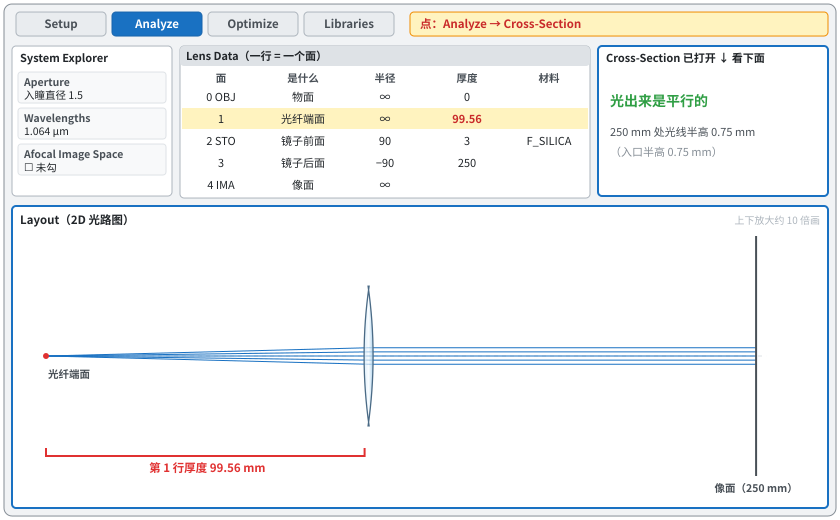

# 第 17c 课 拿 Codex 的模型练 Zemax：五个练习（2026-11-18）

**交互课件：** [在线打开](https://claude.ai/artifact/QqNpCmsc5dM45b7b9PvS62) · [源文件](互动/第17c课_Zemax练手五步.html)

用户：“没必要完全跟设计一样，能模拟仿真、熟悉 Zemax 就行” → 直接用 Codex 文件 A（双凸 R ±90、f ≈ 100、光纤到镜 99.56、入瞳 1.5、像面 250 mm）。

| 练习 | 点哪里 / 改哪格 | 看到什么 |
|---|---|---|
| 1 认表格 | Lens Data | 一行一个面；第 1 行厚度 = 光纤到镜子 |
| 2 看光路 | Analyze → Cross-Section；厚度改 90 / 110 | 平行 / 发散 / 会聚 |
| 3 看光斑 | Spot Diagram；Physical Optics → POP（Gaussian Waist 0.05） | 点列 = 光线落点；POP 1/e² ≈ 1.37 mm【推算】 |
| 4 优化 | 厚度改 80 → Ctrl+Z（V）→ 勾 Afocal → Optimize! | 自动回到 ≈ 99.57 |
| 5 换镜子 | 半径改 45.2 / ∞；Wavefront Map；入瞳改 12 | 1.5 mm 时三种都 ≈ 0；12 mm 时 等凸 0.042、平凸放对 0.033、放反 0.121 λ【推算，均匀口径】 |

## 本课对项目的推进
- 会了 Zemax 五个基本动作。
- 发现：像差和“光用了镜子多大一块”关系很大；Codex 的 1.5 mm 光束看不出镜子形状的差别，我们的 4 mm / f 40 要认真选朝向。
