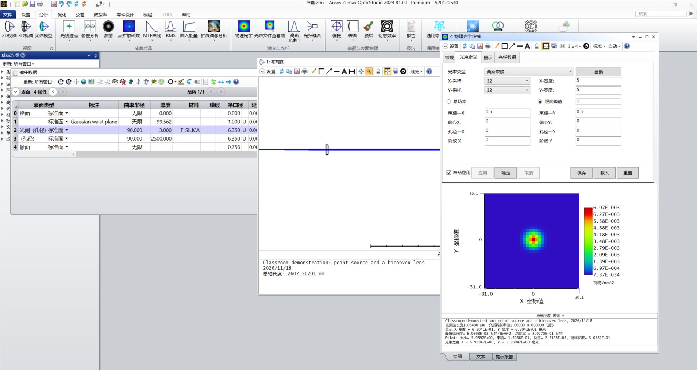

# 第 17d 课 照着你的 Zemax 截图一步步点（2026-11-18）

**交互课件：** [在线打开](https://claude.ai/artifact/FSX3hcAtPA1kdWNJ7yHKNd) · [源文件](互动/第17d课_Zemax界面跟我点.html)

用户反馈：“你能不能根据 zemax 的界面一步步教我？你这样我们怎么看得懂？”→ 以后讲 Zemax **用用户自己的截图标红框**，不再画仿制界面。

## 截图里的两个问题
1. 物理光学 → 设置 → 光束定义：**束腰 X/Y 填了 0.5**，应为 **0.05** mm（Codex 文件说明）。0.5 mm 的光几乎不散，被镜子聚焦后再散开，2.5 m 处光束宽度 5.99 mm（半径）。
2. 第 3 面厚度改成 **2500**，布局图总长 2602 mm，光路看着像一条线 → 改回 250，用布局图工具条的放大镜拉框。

## 17 步要点
镜头数据表（一行一个面，厚度 = 到下一面距离）→ 分析 → 2D视图 → 放大镜 → 分析 → 物理光学 → 窗口左上“设置” → “光束定义”页 → 束腰 0.05、采样 128、点“自动”、确定 → 看文本“光束宽度 X”（改后 2.5 m 处约 1.4 mm【推算】）。
