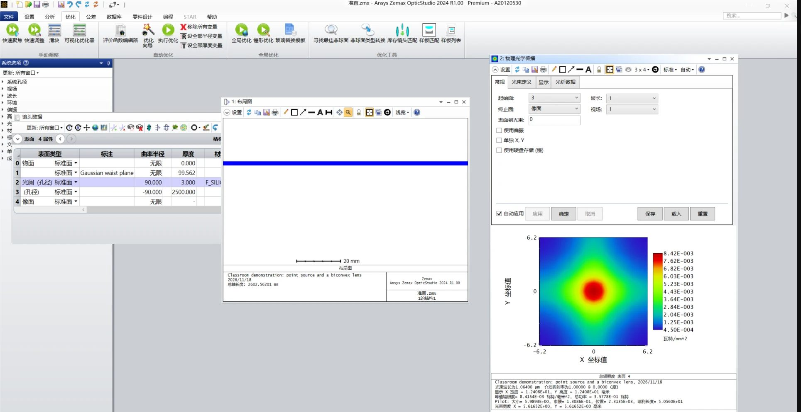

# 第 17e 课 用滑块拖着看不同距离的光斑（2026-11-18）

**交互课件：** [在线打开](https://claude.ai/artifact/PvH11BGF8ZGKgdQZtHijyA) · [源文件](互动/第17e课_Zemax滑块.html)

- 用户问能否像课件一样拖滑条 → Zemax 自带：**优化 → 手动调整 → 滑块**。填：表面 3、参数 厚度、200–5000、窗口 2（物理光学传播）。
- 截图诊断：物理光学 → 设置 → 常规 **起始面 = 3**，应为 **1**（否则镜子被跳过）。
- 束腰用户决定保持 0.5（仿真演示“聚焦”）：镜后约 0.19 m 最细，2.5 m 半径约 6 mm（Zemax Pilot 数据）。
