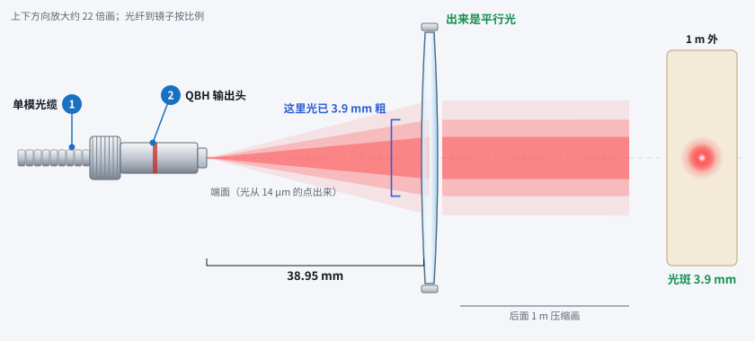
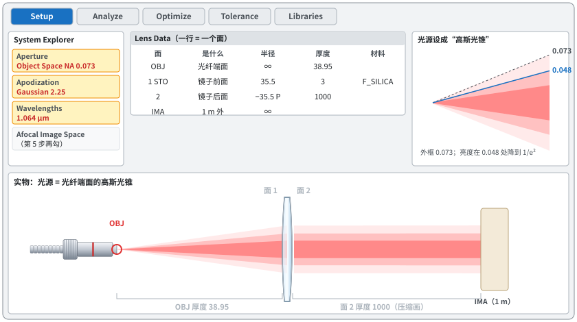
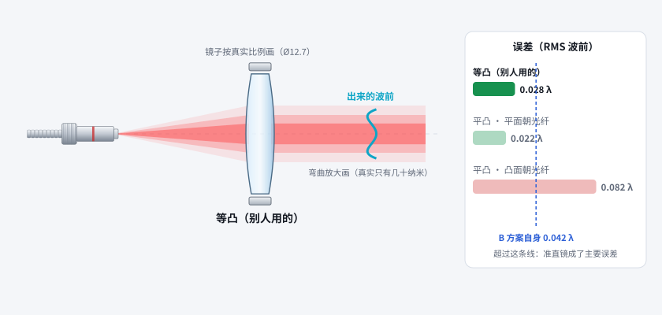

# 第 17 课 准直镜：从光纤口到 4 mm 平行光（2026-11-18）

**交互课件：** [在线打开](https://claude.ai/artifact/HKdQa47swVkbr6Vm9y6Bf9) · [源文件](互动/第17课_准直镜实操.html)

## 先纠正一句
“双凸镜是准直加扩束”不准确：
- **4 mm 是光在空气里自己散出来的**：单模光纤出光半角约 48 mrad，走 39 mm 就到 4 mm 粗；准直镜放在一个焦距处，只负责把光**掰直、定住**。
- **真正的扩束**（4 → 20 mm）是后面的动镜 + 物镜。
- 用**双凸**而不用平凸，是为了**装不反**（防呆），不是为了扩束。

## 图 1 准直镜为什么放在一个焦距处

- 放对（38.95 mm）：1 m 外约 3.9 mm；近 5 mm：继续发散，1 m 外约 15 mm；远 5 mm：先会聚再发散，约 8 mm【推算：高斯光束】。
- 记住一句：粗细 = 出光角 × 焦距；位置差 1 mm 远处就差很多，装配要能前后微调。

## 图 2 Zemax 里怎么填

1. System Explorer：Object Space NA 0.073 + Apodization Gaussian 2.25（单模高斯光锥），波长 1.064。
2. OBJ 行厚度 = 光纤到镜面（38.95，变量）。
3. 第 1 面：R +35.5、厚 3、F_SILICA。
4. 第 2 面：R 用 Pickup ×(−1)（永远等凸），厚 1000（走 1 m）。
5. 勾 Afocal Image Space；评价函数 EFFL = 40 + RMS 波前；Optimize。
6. 看 Layout 和 POP（1 m 外真实光斑）。
- 记住一句：一行 = 一个面，“厚度”= 到下一面的距离。

## 图 3 为什么用双凸

| 镜子 | RMS 波前【推算】 |
|---|---|
| 等凸 | 0.028 λ |
| 平凸 · 平面朝光纤 | 0.022 λ |
| 平凸 · 凸面朝光纤（装反） | 0.082 λ |
- 等凸翻过来还是等凸；平凸翻过来误差变 4 倍，超过 B 方案自身 0.042 λ。

## 本课对项目的推进
1. 准直镜：熔石英等凸 f ≈ 40 mm（MFD 14 μm），光纤到镜面约 39 mm。
2. Codex 任务单：`设计/工具/zemax/给Codex的任务说明_准直镜.md`，顺序同图 2。
3. 光纤轴向误差 → Z 光学零点偏置参数（见进度.md 已发现）。
