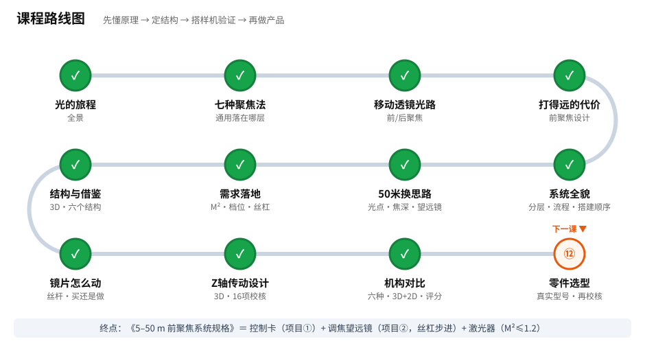

# 学习与推进进度（存档）

> 每次对话结束都会更新这个文件，并推送到 GitHub。新会话请先读它。

## 已完成

| 课 | 日期 | 学到了什么 | 项目推进 | 互动课件 |
|---|---|---|---|---|
| 01 光的旅程 | 2026-11-03 | 光路组成；焦点和焦深；为什么曲面需要动态聚焦 | 确认：控制卡 + Z 聚焦头 = 一套三轴系统 | [在线打开](https://claude.ai/artifact/53B7CDuZLfboDfLbvTbyhE) · [源文件](互动/第01课_光的旅程.html) |
| 02 聚焦的七种办法 | 2026-11-03 | 两个旋钮（发散/镜片强度）；七类方法对比；速度与口径的取舍 | 决定：通用 = 控制卡通用 + Z 模块可换，Z 通道传“焦点位置” | [在线打开](https://claude.ai/artifact/4213vkHZumNDdnoEYyriZi) · [源文件](互动/第02课_聚焦的七种办法.html) |
| 02 加餐 移动透镜拆开看 | 2026-11-03 | 零件组成；焦移倍率把误差放大；跟随延迟与补偿 | 确认主力走移动透镜；控制卡需要“Z 指令提前量” | [在线打开](https://claude.ai/artifact/Du8JuUiMjnaPGwLHwfe2J3) · [源文件](互动/第02b课_移动透镜拆开看.html) |
| 03 移动透镜光路 | 2026-11-03 | FT/PR 两种摆法；参数链（光斑、焦深、焦移倍率、行程）；PR 场曲 | 定下 v0 光路（FT，f163）；产出《设计/移动透镜输出光路_v0.1.md》 | [在线打开](https://claude.ai/artifact/ThzcVtA8iNZQ3bpnmmYXRk) · [源文件](互动/第03课_移动透镜光路.html) |
| 03 补课 前聚焦与后聚焦 | 2026-11-03 | 后聚焦 = 先拐弯后聚焦（FT）；前聚焦 = 先聚焦后拐弯（PR）；曲面 + 工件前后移动时 Z 要走多少 | 发现：Z 行程 = 曲面高低 + 工件前后位置变化（PR 还要加弧面补偿） | [在线打开](https://claude.ai/artifact/QyiFp7nGcvWaans3wjH13T) · [源文件](互动/第03b课_前聚焦与后聚焦.html) |
| 03 之三 怎么选 | 2026-11-03 | 工作距离决定能否用后聚焦；四问选择器；动镜模块两种都能用 | 规则：近/小/精细 → 后聚焦；远/大/大功率 → 前聚焦。艾思兰远距离产品属前聚焦一类（R008） | [在线打开](https://claude.ai/artifact/A5Z4Qp4B2JZs248yZ4tffX) · [源文件](互动/第03c课_怎么选.html) |
| 04 打得远的代价 | 2026-11-03 | 光斑 ∝ 距离 ÷ 光束；动镜行程 ∝ 1/距离；精度占焦深比例和距离无关；角度换位置要用距离 | **决定：前聚焦**；产出《设计/移动透镜输出光路_v0.2_前聚焦.md》 | [在线打开](https://claude.ai/artifact/9ce6eXXBtSDoLAv2gFGGtT) · [源文件](互动/第04课_打得远的代价.html) |
| 04 补课 三个比方 | 2026-11-03 | 手电筒（远 → 光点大）、相机对焦环（远处挤成一堆）、绳子和墙（为什么要知道距离），分步讲解 | 同第 04 课，换成分步比方的讲法 | [在线打开](https://claude.ai/artifact/P2mKC5bnHci67HTqa4jfEo) · [源文件](互动/第04b课_三个比方.html) |
| 05 前聚焦系统全貌 | 2026-11-03 | 系统分层与买/做；一个点的处理流程；6 阶段搭建顺序 | 产出《设计/前聚焦系统方案_v0.3.md》和一阶计算脚本：动镜行程 5.3 mm、定镜通光 ≥ 31 mm、振镜 30 mm | [在线打开](https://claude.ai/artifact/LzwfqPStY189xaK3EbZbRq) · [源文件](互动/第05课_前聚焦系统全貌.html) |
| 06 50 米换思路 | 2026-11-03 | 50 m 处光点毫米级；焦深约 ±5 m，扫描时 Z 基本不动；调焦 = 反着用的望远镜 | 产出《设计/远距离系统方案_v0.4.md》和《远距离方案对比.py》；推荐方案 A；M² 是激光器第一指标 | [在线打开](https://claude.ai/artifact/QMTPHw9T3jmaqYxgq8EsKN) · [源文件](互动/第06课_50米换思路.html) |
| 07 需求落地 | 2026-11-03 | 激光器 M² 上限；6 档焦距覆盖 5–50 m，扫描时 Z 不动；Z 公差宽 100 倍 → 丝杠步进 | 产出《设计/远距离系统方案_v0.5.md》和《需求落地计算.py》 | [在线打开](https://claude.ai/artifact/W4zrcEN9t83GJVXteUqvRg) · [源文件](互动/第07课_需求落地.html) |
| 07 补课 M² 是什么 | 2026-11-03 | M² = 光有多整齐（1 完美）；光点 ∝ M²；规格书看 M² 或 BPP（M² = BPP ÷ 0.34） | 激光器标准：M² ≤ 1.2 / BPP ≤ 0.41 mm·mrad | [在线打开](https://claude.ai/artifact/Csop4noC9ZxHZVxRcywFvM) · [源文件](互动/第07b课_M2是什么.html) |
| 07 补课二 光点是圆的 | 2026-11-03 | 光点形状是圆的；“小山包”是沿中间切一刀的亮度；多模光点有亮斑、散得大 | 澄清图示；修改 07b 图标题 | [在线打开](https://claude.ai/artifact/AYSK3SGDtY6c6VVvQMiwPo) · [源文件](互动/第07c课_光点是圆的.html) |
| 08 结构布局 | 2026-11-03 | 3D 整机布局；动镜横向晃动被 50 m 放大（1 μm → 0.33 mm）；各安装座调节点 | 产出《设计/调焦头结构方案_v0.1.md》、结构参数脚本、CadQuery 生成的 STEP | [在线打开](https://claude.ai/artifact/XF6sLzU9saR76ccAgN2wN8) · [源文件](互动/第08课_结构布局.html) |
| 08 重做 详细结构 | 2026-11-03 | 参考 CN213163617U / CN205899130U / CN120928524B / varioSCAN 做出每个结构；3D 可剖开、拆开 | **结构 v0.2：55 种零件，干涉 0 处**；STEP + BOM + 网页 3D | [在线打开](https://claude.ai/artifact/U6RcgpS4siF9UGpsYQbNPV) · [源文件](互动/第08b课_详细结构.html) |
| 08 之三 结构优化 | 2026-11-03 | 合束镜 / 光阑是什么；准直由 QBH 头、扩束由调焦模块完成；结构审查 9 项优化（按用户要求不做示意图，直接出 3D） | **结构 v0.3：59 种零件，干涉 0、挡光 0**；激光器须自带红光 | [3D（已更新）](https://claude.ai/artifact/U6RcgpS4siF9UGpsYQbNPV) · [记录](第08c课_结构优化.md) |
| 参考 同类结构图鉴 | 2026-11-03 | 资料库里 13 台同类设备的专利附图 / 产品原图，逐个对比 | 确认：布局≈R004 思特，壳体≈R009，光学≈R046，驱动≈R062 清模机 → v0.3 方向没问题 | [在线图鉴](https://claude.ai/artifact/KjtwSAJXPibvsmLh1VshDm) · [对比文档](../设计/同类结构对比.md) |
| 讨论 改进思路 | 2026-11-03 | 50 m 处真正的短板是“指向稳不稳”（抖 50 μrad → 偏 2.5 mm），不是对焦（允许 ±3 m）；13 条改进想法 | 产出《设计/改进思路_v0.1.md》，建议 v0.4：测距、Z 编码器、同轴相机、IMU 防抖、接口升级 | [文档](../设计/改进思路_v0.1.md) |
| 核对 Codex 审阅 | 2026-11-03 | 核对 Codex 54 份审阅的 12 份精选：采纳 R010 丝杆传动链、R054 两级运动 + 钢带预紧（修正了我图鉴里的错配）、R031 运输夹 + 保护窗保持、R002 镜座冷却 | 产出《设计/改进思路_v0.2.md》（合并清单 + v0.4 范围）；图鉴已修正 | [改进思路 v0.2](../设计/改进思路_v0.2.md) · [图鉴](https://claude.ai/artifact/KjtwSAJXPibvsmLh1VshDm) |
| 09 值得学的结构 | 2026-11-03 | 六个会动的结构图：丝杆导轨分工（R010）、共同底座（R004/R009）、回差与钢带预紧 + 两级运动（R054）、运输锁 / 保护窗保持（R031）、位置反馈与线缆（S015/R002） | v0.4 结构改动确定方向；新增想法：Z 轴底座三点支撑 | [在线打开](https://claude.ai/artifact/RU594paxUJaZ2wMaNBo5qH) · [源文件](互动/第09课_值得学的结构.html) |
| 10 镜片怎么动起来 | 2026-11-04 | 丝杆：螺母被导轨卡住才会直着走，转一圈走一个导程；齿轮有缝、皮带有弹性、音圈断电没力 → 丝杆自锁最稳；Z 有三条路：整套买 / 买平移台装镜片 / 自己集成 | Z 驱动确认丝杆 + 步进；**建议样机用现成电动平移台**，集成壳体留到产品阶段；商业 Z 模块按 0.2–0.7 m 设计，不适合 50 m（R036） | [在线打开](https://claude.ai/artifact/9vdKujSdCvS5GE3AmJuHuK) · [源文件](互动/第10课_镜片怎么动起来.html) |
| 10 补课 音圈马达 | 2026-11-04 | 音圈 = 线圈绕在镜筒上、夹在磁铁中间，通电就推（相机镜头就用它）；没弹簧时要“尺子 + 伺服环”才能停住；增益小慢、大晃 | 更正第 10 课（音圈不是不好，是第一台用不上）；**Z 模块 v2 = 音圈 + 标尺 + 伺服环**；控制卡 Z 再预留编码器输入 | [在线打开](https://claude.ai/artifact/7hGkN7BGe8ruuocLRjbtPY) · [源文件](互动/第10b课_音圈马达.html) |
| 10 问答 磁铁 / 丝杆速度 / 间隙 | 2026-11-04 | 磁铁提供磁场，电流在线圈上；丝杆换伺服 + 大导程可到几十毫秒，但自锁变差；丝杆也有间隙，齿轮不行的真正原因是不自锁、太粗 | 更正第 10 课齿轮段；CLAUDE.md 加“先答问题、再画图”规则 | [记录](第10c课_问答_磁铁丝杆间隙.md) |
| 10 补课 3D 磁铁和间隙 | 2026-11-04 | 切开的音圈：没磁铁不动、磁场 × 电流 = 推力、电流反向、动圈 / 动磁、步进电机同理；切开的丝杆螺母：换向空转、消隙螺母；和齿轮齿条比：推一下谁滑、一圈各走多远 | 确认消隙螺母 + 导程 1 mm；音圈 v2 优先动磁式 | [在线打开](https://claude.ai/artifact/WCf9mMFW31EpzLwBayLBox) · [源文件](互动/第10d课_磁铁和间隙_3D.html) |
| 10 问答 再讲一遍（更基础） | 2026-11-04 | 线圈通电 = 电磁铁，要有永磁铁当对手（继电器、喇叭）；缝 = 螺母能轴向晃一点，换向死区约 160 个脉冲；消隙 = 双螺母防松的思路；丝杆像千斤顶（推不回去、一圈走一点），齿轮像自行车 / 转向机 | 无新决定 | [记录](第10e课_问答_更基础的讲法.md) |
| 10 补课 电磁铁和电机 | 2026-11-04 | 平面分步图：线圈通电 = 电磁铁（指南针转、反接对调）；两块磁铁才推得动（小车：相斥推开、相吸拉回、拿走永磁铁不动）；电机 = 定子线圈轮流通电吸着转子转，无刷靠芯片 + 霍尔换，步进按脉冲换 | 看懂 STEP / DIR 的物理意义；后加问题 4：音圈切开看，磁场横穿导线 → 左手定则 → 推力沿光轴（接上第 10d 课 3D） | [在线打开](https://claude.ai/artifact/YSi3hNcEd228V5Prrvfb5e) · [源文件](互动/第10f课_电磁铁和电机.html) |
| 10 问答 右手定则 | 2026-11-04 | 通电线圈：右手握线圈、四指顺电流，大拇指 = N；右手管“电生磁”，左手管“磁场里的电流受力” | 无新决定 | [记录](第10g课_问答_右手定则.md) |
| 11 Z 轴传动设计 | 2026-11-04 | 真实 3D 模型分步看：基准、滑块镜座、电机止口 + 波纹管联轴器、固定—支撑轴承、消隙螺母（剖开）、球头浮动接头、自锁、原点 / 限位 / 硬限位、运输锁；16 项设计校核 | **结构 v0.4**（77 种零件，干涉 0、挡光 0）；《设计/Z轴传动设计_v0.1.md》《Z轴传动计算.py》；修正 v0.3 原点开关位置、导轨长度 | [在线打开](https://claude.ai/artifact/6ESnYy7zLQC3N4tY4zoC1J) · [源文件](互动/第11课_Z轴传动设计.html) |
| 11 补课 凸轮筒和斜坡 | 2026-11-04 | 用户照片里的镜头 = 齿轮减速（不是行星齿轮）+ 凸轮筒（斜槽 + 直槽 + 销子 = 绕在镜筒上的丝杆）；螺纹摊平 = 斜坡，坡度 = 一圈行程 ÷ 周长，坡度 < 摩擦角 → 自锁；齿轮齿条 ≈ 45° 陡坡 | 统一了丝杆 / 齿轮齿条 / 凸轮筒的判据；凸轮筒式 Z 模块记为以后的选项 | [在线打开](https://claude.ai/artifact/L9KrFtBjnKCN1dJmJuFHvz) · [源文件](互动/第11b课_凸轮筒和斜坡.html) |
| 12 调焦机构对比 | 2026-11-04 | 六种机构 3D + 2D 同步三步看：丝杆、齿轮齿条、凸轮筒、盘形凸轮 + 弹簧、音圈直驱、振镜电机 + 摆杆；评分卡（细 / 自锁 / 快 / 紧凑 / 好做 / 控制简单） | 产出《设计/调焦机构评估_v0.1.md》：设一次距离 → 丝杆（现在）；更紧凑 → 凸轮筒；边扫边对焦 → 音圈 / 振镜摆杆 | [在线打开](https://claude.ai/artifact/EyVuQmcbdZ98r2qZsEoztT) · [源文件](互动/第12课_调焦机构对比.html) |
| 审查 用户 v0.7 | 2026-11-05 | 用户在 SolidWorks 把 v0.4 Z 模块分成“移动组件 / 转动组件”两个子装配（分组正确，尺寸未变）；干涉 0、挡光 0、行程两端运动干涉 0 | 发现：少了原点 / 限位开关、挡光片、运输锁；**v0.4 固定端轴承没真正夹紧**、电机过定位；建议买成品消隙螺母、补螺钉、加强物镜座 | [审查报告](../设计/审查/调焦主体_v0.7_审查.md) |
| 精修 调焦主体 v0.8 | 2026-11-05 | 用户选“开放式精修、先不要外壳”：零件合并（一体支座）、墓碑形镜座 / 物镜座 + 加强筋、带底脚轴承座、底座圆角倒角、统一配色 | **修正固定端轴承夹紧与电机过定位**；干涉 0、挡光 0、运动干涉 0；传动校核 16 项全过；`设计/CAD/调焦主体_v0.8.step` | [记录](第12c课_调焦主体精修v0.8.md) |
| 问答 物镜对中座 | 2026-11-05 | 物镜组件 = 镜筒 + 墓碑形对中座 + 对中顶丝；物镜偏 10 μm → 50 m 外偏约 3.3 mm，所以装配后要调一次再锁死；调法：动镜两端来回走，光点不漂为止 | 待办：第三点改成弹簧顶销 | [记录](第12d课_问答_物镜对中座.md) |
| 问答 物镜有什么用 | 2026-11-05 | 动镜撒开、物镜收拢 → 20 mm 粗光束（5 倍扩束）；扩束让 50 m 光点从约 22 mm 降到约 4.4 mm；物镜定大方向、动镜微调焦点 | 无新决定 | [记录](第12e课_问答_物镜有什么用.md) |
| 问答 扩束位置 / 915 nm | 2026-11-05 | 准直在准直头、扩束兼调焦在 Z 模块：调焦要在光细处做、扩束要在振镜前、一套镜片两用；915 nm：机械和控制通用，光学换镀膜 + 重标定，能否达标取决于激光器光束质量 | 待老师给出 915 nm 激光器参数和工作距离 | [记录](第12f课_问答_扩束位置与915nm.md) |
| 评估 915 nm（1–10 m） | 2026-11-05 | 光斑表（5 种常见 915 光源 × 1–10 m）、焦深表、现结构行程检查 | 产出《设计/915nm评估_v0.1.md》《工具/915nm评估.py》：能做；1–2.8 m 现结构够不着，以后加长行程或换短焦物镜 | [评估](../设计/915nm评估_v0.1.md) |
| 汇报 给老师的 3 页 PPT | 2026-11-05 | 原理（光路调焦动图）、调焦模块结构（v0.9 3D 传动动图）、激光器怎么选（M² 与光斑曲线 + 要求表：10 m ≤ 5 mm → M² ≤ 8.6） | 产出《设计/汇报/动态聚焦系统汇报_v1.pptx》；审查用户 v0.9：外形已用 v0.8，但固定端轴承夹紧和电机让位两项修正没带过去 | [汇报](../设计/汇报/README.md) |
| 12 问答 两块参考控制板 | 2026-11-05 | STM32H7+Tang25K 开发板：MCU↔FPGA 用 FMC 16 位并口、FPGA 用可拆核心板；PewPew LaserBoard：DB25 对照表、门禁走硬件门、上电下拉防误出光、出光时不改频率、XY2-100 = 同步串口（I2S 生成）、步进 / 原点输入调理 | 控制卡草案要改 4 处：PE7/PE8 让给 FMC、PUDC_B 接高、加 Z 的 STEP/DIR/EN/HOME、DB25 第 11/17 针（`jiguang-zhenjing/参考设计/两块参考板对照_2026-11-05.md`） | [记录](第12g课_问答_两块参考控制板.md) |
| 13 问答 镜片怎么选出来的 | 2026-11-06 | 链条：出口粗细（光斑 ∝ 1/D，受振镜限）→ 5 倍 → 负 + 正伽利略 → f2 长短取舍（像差 vs 行程 ∝ f²）→ 形状由焦距 + 玻璃算出（R = (n−1)f，LA1907 回算 151.86 mm 与 Zemax 一致；−15 用 N-SF11 避免弯太猛）→ 现货型号 → Zemax 比 | 新增 `设计/工具/镜片形状核算.py`；配图推算出 **f2 ≈ 92–106 mm 双胶合可能行程、误差两头都满足**（待 Zemax） | [配图](https://claude.ai/artifact/Ra8QAhHxpnjnc5zTqCXMdG) · [记录](第13e课_问答_镜片是怎么选出来的.md) |
| 13 问答 镜片方案怎么搭配 | 2026-11-06 | 两片镜骨架（负动镜 + 正物镜，5 倍）× 两个旋钮：焦距对（长 −30/150、短 −15/75，行程 ∝ f²）、物镜平凸 / 双胶合（冕牌凸 + 火石凹抵消球差）；朝向 2×2 试；Thorlabs 型号读法（LC/LA/AC、254/508、-B 膜） | 无新决定 | [记录](第13d课_问答_镜片方案怎么搭配.md) |
| 审查 Zemax 首轮结果 | 2026-11-06 | Codex 跑了 2 理想 + 4 真实镜组（长 / 短焦 × 平凸 / 双胶合，各试 4 种朝向）；按三步读：理想≈0 ✓ → 只有长焦双胶合全程 ≤ 0.07 λ，短焦双胶合 1.5 m 起合格 → 短焦行程 5.3 mm 放得下 | **建议短焦双胶合（LC2265-B + AC254-075-B）为 915 基线**；更正：可用总行程 11.6 mm（不是 8）；新发现：Ø25.4 物镜可能挡掉 5–7% 光 | [审查](../设计/审查/Zemax结果_v0.1_审查.md) · [结果包](../设计/Zemax/结果_v0.1_Codex/) |
| 13 看懂 Zemax 结果 | 2026-11-06 | 真实光线追迹分步图：Zemax = 一条条按折射定律算光线；理想透镜 vs 球面镜（球差，反放约 4 倍）；点列图 = 焦点处放纸正面看，优化 = 自动找最挤处，RMS 半径、艾里斑；RMS 波前 = 波峰掰歪几个波长，≤ 0.07 λ 中心亮度约 82% | 读结果三步：理想透镜那份≈0 → RMS 波前打勾 → 行程跟 8 mm 比 | [在线打开](https://claude.ai/artifact/WwgLysVy12aCqYxuonWhya) · [源文件](互动/第13课_看懂Zemax结果.html) |
| 13 问答 0.07 waves 怎么算 | 2026-11-06 | 每条光线到焦点的光程（玻璃按 n 折算）；完美透镜各光线光程相等；光程差 OPD = 相位差（同频正弦叠加）；5 条光线算例：减平均 → 平方平均 → 开根号 62.7 nm ÷ 915 nm ≈ 0.07 waves ≈ 25° | 无新决定 | [配图](https://claude.ai/artifact/QiLDuqXRN2yp6ce6pUHTwH) · [记录](第13c课_问答_0.07波怎么算出来.md) |
| 13 问答 RMS 波前是误差吗 | 2026-11-06 | 是：镜片设计的像差误差（和完美圆弧差几个波长），算法同 RMS 纹波；不含激光器 M²、不含加工装配误差（公差分析另算） | 无新决定 | [记录](第13b课_问答_RMS波前是误差吗.md) |
| 14 激光器怎么出光 | 2026-11-11 | 受激发射：泵浦把原子充电，光子路过逼它放出一模一样的光子，1→2→4 连锁放大；两面镜子让光来回穿，右边半透镜漏出一点 = 激光（漏太多起不了振）；半导体 / 光纤 / CO₂ 都是“泵浦 + 材料 + 两面镜子”，只是材料不同 | 听懂公司讨论里的“泵浦”“光栅”；915 nm 常见是半导体激光器 | [在线打开](https://claude.ai/artifact/3xJvp3uYu4jxdDKfW4oJjE) · [源文件](互动/第14课_激光器怎么出光.html) |
| 15 半导体激光器和泵浦 | 2026-11-11 | 实物样子的图：切开的芯片（三明治、发光层 ≈ 0.1 μm、电流过门槛才成激光、端面当镜子、窄缝出光上下张得快）；泵浦模块 = 小透镜捋直 + 台阶叠光束 + 大透镜聚进光纤（纤芯 105 μm → M² ≈ 40）（第 14、15 课由 Opus 按实物重画；915 / 976 挪到第 16 课） | 要问老师：915 nm 是直接打东西，还是想做光纤激光器的泵浦？ | [在线打开](https://claude.ai/artifact/8RyGXAyY519qcpsmAkaBsX) · [源文件](互动/第15课_半导体激光器和泵浦.html) |
| 16 光纤激光器拆开看 | 2026-11-11 | 机箱零件（泵浦模块 → 合束器 → 高反光栅 → 盘在水冷板上的掺镱光纤 → 低反光栅 → 输出头）；为什么泵浦是 915 / 976（照光实验：镱吃得下 + 光子能量比 1064 大）；双包层光纤（泵浦走内包层、只有穿过纤芯才被吃 → 十几米、盘起来；激光只走纤芯 → 光好） | 光纤激光器 = 把差的泵浦光“洗”成好激光；仍要问老师 915 是泵浦还是直接用 | [在线打开](https://claude.ai/artifact/786k11VFceRSNMxeauBPgf) · [源文件](互动/第16课_光纤激光器拆开看.html) |
| 16 补课 光纤激光器细讲 | 2026-11-11 | 单泵浦、不要合束、拉直画：泵浦走内包层穿过高反光栅 → 掺镱光纤里被吃掉 → 自发光当种子 → 两光栅间来回放大 → 低反光栅漏出、包层光剥离器除掉剩余泵浦；光栅 = 纤芯里一排很淡的镜子，间距对上 1064 才叠成强反射；调功率 = 调泵浦电流（有门槛，约 1/3 电变激光） | 控制卡的功率设定最终就是泵浦电流，标定从门槛以上开始 | [在线打开](https://claude.ai/artifact/DqRFBJgQumK1kLffy5kT78) · [源文件](互动/第16d课_光纤激光器细讲.html) |
| 16 续 调 Q 和 MOPA | 2026-11-11 | 脉冲：平均 20 W，挤进 100 ns 脉冲峰值约 10 kW，瞬间汽化、边缘干净；调 Q = 腔里加光闸（声光调制器），关时存能量、开时放成脉冲，PRR 每个脉冲开一次闸；MOPA = 前级种子（电流直接调形状）+ 后级放大器（无光栅），脉宽 2–500 ns 可调 | **对上控制卡 DB25**：18 MO、19 PA、20 PRR（草案名 PWM）、1–8 功率位 + 9 LATCH、22 红光 | [在线打开](https://claude.ai/artifact/1JbqFjcpoDruLFm9RbN5hX) · [源文件](互动/第16f课_脉冲光纤激光器.html) |
| 快速 01 光的三个量 | 2026-11-11 | 波长（看得见 400–700 nm；915 / 1064 近红外、10.6 μm 远红外，都看不见要戴防护镜）；光子能量 ∝ 1/波长（915 比 1064 大 16%，大换小差的变热）；功率 vs 功率密度（阳光 0.1 W/cm²，20 W 聚到 0.05 mm 约 100 万 W/cm²，直径缩 10 倍密度涨 100 倍） | 光斑指标本质是保功率密度 | [在线打开](https://claude.ai/artifact/U25s2FeBPwzAgBRs4b3AmK) · [源文件](互动/快速01课_光的三个量.html) |
| 快速 02 透镜和光纤 | 2026-11-11 | 凸透镜聚 / 凹透镜散 / 焦距（越弯越短），一凹一凸 = 扩束（调焦头）；全反射（临界角约 43°），光纤 = 纤芯 + 包层，弯太急漏光；光纤出光是锥（NA），准直后粗细 ≈ 2fNA，纤芯越粗散得越快 | 105 μm / 0.22 准直后每米多散约 11.5 mm | [在线打开](https://claude.ai/artifact/XHL9Kg1kx99Uz5ma8D8183) · [源文件](互动/快速02课_透镜和光纤.html) |
| 快速 03 激光器原理 | 2026-11-11 | 吸收 / 自发辐射（噪声）/ 受激辐射（放大），充电原子多于一半才放大（粒子数反转）；激光器 = 光的振荡器（增益介质 = 放大器，泵浦 = 电源，谐振腔 = 正反馈带选频，自发辐射 = 起振噪声，半透镜 = 输出）；环路增益 < 1 不起振、= 1 门槛、> 1 指数长大、增益饱和后稳定 | 功率标定从门槛以上开始 | [在线打开](https://claude.ai/artifact/Ve49mwuBmj8wsZWSDPCqzf) · [源文件](互动/快速03课_激光器原理.html) |
| 快速 04 常见激光器怎么选 | 2026-11-11 | 半导体（便宜省电光束差）/ 光纤（光束好免维护，1 μm 主力）/ CO₂（10.6 μm 吃非金属，不能走光纤）；材料吃不吃这个波长（金属吃 1 μm，非金属透明材料吃 10.6 μm）；选型三步：材料 → 光斑 → 功率预算 | 要问老师打什么材料 | [在线打开](https://claude.ai/artifact/H9rd8JGgQTeeUYZgTa8xWL) · [源文件](互动/快速04课_常见激光器怎么选.html) |
| 快速 05 光纤激光器和控制卡 | 2026-11-11 | 单泵浦从头到尾；调功率 = 调泵浦电流（门槛、约 1/3 电变激光）；DB25 时序（逻辑分析仪）：写功率 1–8 + 锁存 9 → 18 出光使能 → 20 重复频率 → 19 跟着振镜开关光（画线开、跳转关） | J3 信号名对上；FPGA 管开关光与振镜对时 | [在线打开](https://claude.ai/artifact/Tpx9jyuD8aRCLuAFSV4Tzk) · [源文件](互动/快速05课_光纤激光器和控制卡.html) |
| 快速 06 从出光口到工件 | 2026-11-11 | 光斑不能无限小（衍射），M² = 比理想差几倍，远处光斑 ≈ 4M²λL/(πD)；焦深；出光口后一串（输出头 → 准直 → 动镜 + 物镜 → 振镜 → 目标），控制卡管 DB25 / XY2-100 / STEP-DIR；不调焦 3 m 光斑糊成约 15 mm，动镜后退 10 m 2.3 / 3 m 7.9 / 1 m 26.5 mm | 快速入门 6 课结束，回到项目 | [在线打开](https://claude.ai/artifact/AchjDwkg57nngHXnqdiso2) · [源文件](互动/快速06课_从出光口到工件.html) |
| 12 问答 Zemax 怎么用 | 2026-11-06 | Zemax = 光学 SPICE（光线追迹）；界面认 4 样：镜头数据表、多重结构、2D 光路图、点列 / 波前图；“好几种结构”各回答一个问题：理想透镜 = 验证、平凸 vs 双胶合 = 球差值不值得花钱、正反放 = 弯面朝平行光、短焦 = 解决行程（∝ f2²） | 结果只看两个数：RMS 波前 ≤ 0.07 λ、1–10 m 行程；等 Codex 结果回来解读 | [记录](第12h课_问答_Zemax怎么用.md) |
| 12 问答 光学设计软件 | 2026-11-04 | 一阶设计脚本够用；像差 / 容差 / 两端合格要光线追迹（Zemax / CODE V，或开源 rayoptics / Optiland）；定型前镜片厂复核 | 用户决定：光路自己用 Zemax 做；结构做完交给 Claude 审查 | [记录](第12b课_问答_光学设计软件.md) |

## 下一课

**当前：Zemax 首轮结果已审查**（`设计/审查/Zemax结果_v0.1_审查.md`），建议短焦双胶合；等用户决定 + 老师给激光器参数（束径定义、M²、功率），再按选定方案改结构（物镜座前移、镜间距 53–59 mm）。

**⭐ 激光快速入门（2026-11-11：用户要求从头讲、但“不要特别基础，要快速掌握”）**
6 课，每课把一组相关知识一次讲清（知识点比之前多，但按顺序、新词先解释、图画实物）。第 14–16 课和补课当参考：

- ✓ **快速 01 光的三个量**（已完成）：波长（看得见 / 看不见，915、1064、10.6 μm 在哪）、光子能量（波长越短每份越大）、功率 / 能量 / 功率密度（为什么聚焦能烧东西）
- ✓ **快速 02 透镜和光纤怎么“管住”光**（已完成）：焦距、凸透镜聚、凹透镜散；全反射，光纤的纤芯 / 包层 / NA
- ✓ **快速 03 激光器原理一课讲透**（已完成）：自发辐射、受激辐射、放大器 + 正反馈、泵浦 / 增益介质 / 谐振腔、门槛、靠“噪声”起振
- ✓ **快速 04 常见激光器怎么选**（已完成）：半导体、光纤、CO₂ 的结构、波长、光束好坏、用途；按材料选波长
- ✓ **快速 05 光纤激光器和控制卡**（已完成）：单泵浦从头到尾、功率怎么调、连续 / 脉冲（浅讲）、DB25 那几根线
- ✓ **快速 06 从出光口到工件**（已完成）：光束质量 M²、光斑为什么不能无限小、准直 / 扩束 / 聚焦 / 振镜 → 接回动态聚焦头

**快速入门 6 课已完成（2026-11-11）。下一步回到项目：** ① 等老师回答三个问题（915 nm 是什么激光器——裸半导体模块还是光纤激光器泵浦 / 打什么材料 / 光斑要求）；② Zemax 第二轮定光学方案（加 f2 ≈ 100 双胶合）；③ 按选定方案改 Z 轴结构；④ 控制卡 J3 补模拟输出 + TTL（若是裸半导体）。

补完再回到：镜片设计（Zemax 第二轮）和 Z 轴零件选型。

**（顺延）Z 轴零件选型**：按 BOM v0.4 挑真实型号（Ø5 导程 1 精密丝杠 + 消隙螺母、MGN7C 预压导轨、NEMA 11 电机（力矩富余 8 倍，可选更短）、694 轴承、Ø12 波纹管联轴器、槽型光耦），把 `Z轴传动计算.py` 里的【假设】换成规格书数据再校核；真实尺寸填回 `结构参数.py` 重新生成 CAD。（是否先买电动平移台验证光路，仍可并行考虑）

## 待你决定（不急，想好了告诉我）

00. **⭐ v0.4 做哪些改进**：见 `设计/改进思路_v0.1.md` 的建议范围（必做：测距、Z 编码器、同轴相机、IMU 防抖位、接口升级）

0. ~~主要用途~~ → 已回答：**前聚焦，想打得远一点**（第 04 课）
1. ~~工作距离~~ → 已定：**50 m**（第 06 课）
1a. ~~光斑和距离~~ → 已定：**5–50 m，光斑 ≤ 5 mm**（第 07 课）→ 方案 A
1a2. **应用 / 功率**：决定激光器功率等级和安全措施
1a3. **50 m 处要扫多大面积**：决定振镜扫描角
1e. **指向**：振镜（快，沿用控制卡）还是云台（慢，镜子可以很大）
1b. ~~测距~~ → 已定：**先不做**，v0 由上位机手动输入距离（第 05 课）
1c. **Z 驱动板**：先买现成的验证，还是直接自研？
1d. **Z 用丝杆的前提**（2026-11-04 用户问“确定用丝杆？”）：①光斑要求 ≤ 5 mm（一个焦距在 5 m 处也能覆盖 5.0–6.2 m）；②距离由上位机设一次，扫描时 Z 不动；③要断电锁住、抗振。三条中任一条不成立（目标在动 / 一帧里深度变化超过约 1 m / 要求光斑小得多）→ 改用音圈（S018），走 XY2-100 的 Z 通道（已预留），控制卡不用改

1. ~~主要用途~~ → 已回答：**做通用的**，不限于加工（第 02 课据此定下“控制卡通用 + 模块可换”）
2. **激光器**：暂无型号。要求 **M² ≤ 1.2（或 BPP ≤ 0.41 mm·mrad，1064 nm）**、**自带红光指示**；准直头输出直径决定动镜 f1（4 mm → f1 −30，7 mm → 约 −50），一般是“单模”光纤激光器（第 07 课补课）。（30 mm 振镜方案，留余量）；买不到就改成 25 mm 光束 + 约 38 mm 振镜（第 07 课）
3. **振镜口径**：14 mm 还是 20 mm？
4. **曲面工件的高低差，以及工件前后会移动多少**：决定 Z 行程够不够（第 03 课补课）
5. **第一批想覆盖的 2–3 个用途**：用来确定第一个 Z 模块的指标（行程、速度、功率）
6. **样机的 Z**：用户要求“像机械设计师一样设计好” → 已按自研做出 v0.4 Z 轴（第 11 课）；是否另外先买电动平移台验证光路，待定

7. **Z 机构形式**：v0.4 用侧置丝杆；以后可考虑**凸轮筒式**（像用户照片里的镜头：齿轮减速 + 凸轮筒，同轴、紧凑、对中好；但凸轮槽要高精度加工、齿轮要消隙）（第 11 课补课）

8. ~~光路像差检查~~ → 已定：**用户自己用 Zemax 做光路**（物镜单片 / 双片、5 m 与 50 m 两端光斑、动镜容差），结果交给 Claude 核对；**结构用户做完后交给 Claude 审查优化**（第 12 课问答）

9. **老师的 915 nm 动态聚焦（1–10 m）**：已评估（`设计/915nm评估_v0.1.md`）——能做；机械 / 控制通用、光学换 915 nm 镀膜；光斑取决于激光器（常见 105 μm/NA 0.22：1 m 约 2.3 mm、10 m 约 23 mm）；现结构最近只能对焦约 2.8 m，要到 1 m 需加长行程（A）或物镜换短焦（B）。**待老师给**：激光器型号 / 光纤参数、功率、光斑要求、扫描面积

11. **915 nm 光学方案**（Zemax 首轮，2026-11-06；另有推算的第三条路：f2 ≈ 100 / f1 ≈ −20 双胶合，行程约 10 mm、误差约 0.06 λ，需下一轮 Zemax 验证）：建议**短焦双胶合**（行程 5.3 mm，现结构放得下；1 m 处 0.109 λ 稍超，1.5 m 起合格）；激光器接近单模且 1 m 要求严时改**长焦双胶合**（像质最好，但行程 24.5 mm 要加长导轨、物镜 Ø50.8）。物镜口径 Ø25.4 偏紧，等激光器束径定义再定是否换 Ø30–38

## 已发现、需要后面处理的事

- **控制卡接口（快速 05b）**：如果老师的 915 nm 是只有正负极的裸半导体模块，需要外配 LD 恒流驱动（带模拟调制输入 + TTL 使能），控制卡要预留一路模拟功率输出（DAC）+ 一路 TTL 开关光；现有 J3 只适配商用光纤激光器的 DB25

- **控制卡 DB25 命名（第 16 课续）**：方案草案里 J3 第 20 脚叫 LASER_PWM，实际含义是 PRR / Sync（重复频率），建议改名，免得以后误当成功率 PWM；MOPA 脉宽写入方式要按具体激光器手册确认

- **更正（2026-11-06，Codex 指出）**：v0.9 硬限位总行程 11.6 mm（−7.8 ~ +3.8）；我说的“8 mm”只是镜片不挪位时从无穷远往后退的余量，换镜片重排镜座后整段都能用
- 短焦双胶合方案的镜间空气隙 53–59 mm（原中心距 120 mm）→ 改结构时物镜座要前移重排

- **更正（2026-11-05）**：动镜后退量原来用近似式 f2²/L，近处偏小；精确式 f2²/(L − f2)（L 从物镜量起）。915 nm：1–10 m 行程 20.2 → **24.2 mm**，现结构最近对焦 2.8 → **3.0 m**（评估、PPT 已更新）。主方案 5–50 m 行程 4.05 → 4.19 mm、5 m 位置差 0.14 mm，仍在限位内；`结构参数.py` 暂不改（模型不动），下次改结构时一起换成精确式

- **控制卡引脚草案要改（参考板对照，2026-11-05）**：① PROGRAM_B / DONE 别占 PE7 / PE8（FMC_D4 / D5），整组 FMC 脚留作升级；② Artix-7 PUDC_B 接高 + 激光线外部按关光电平上下拉 + 4245 OE 默认关；③ 加 Z 调焦头 STEP / DIR / EN / HOME（5 V 缓冲，HOME 用 RC + 施密特）；④ DB25 第 11 针（报警 / 地）、第 17 针（Raycus 要 5 V）用跳线 → 详见 `jiguang-zhenjing/参考设计/两块参考板对照_2026-11-05.md`

- ✓（v0.8 已改）v0.4 / v0.7 固定端轴承没夹紧、电机过定位 → v0.8 加端盖 + 丝杠台阶 + 电机侧锁紧螺母、电机下 1 mm 让位槽

- 控制卡 FPGA 需要“各轴独立延迟补偿”（Z 轴比 XY 慢）→ 第 ⑤ 课细讲
- 三维以后点数据更多，USB FS 带宽更紧张 → 第 ⑦ 课细讲
- Z 通道应传“焦点位置 mm”，各模块自带标定表（第 02 课）→ 写进系统规格
- 控制卡需要“Z 指令提前量”（延迟补偿，毫秒级、可调）（第 02 课加餐）→ 第 ⑤ 课细讲，写进系统规格
- **认识转变**：50 m 处焦点允许 43–53 m，测距 ±3 m 就够 → 便宜测距模块即可；最大误差是支架抖动（50 μrad → 2.5 mm）→ 用控制卡预留的 IMU 接口做振镜防抖（`设计/改进思路_v0.1.md`）
- **同类结构对比**（`设计/同类结构对比.md`）：最像我们的是 CN205899130U 思特（前聚焦、Z 轴底座、内支架、侧壁窗）；R046 同为负透镜动 + 正透镜固定；R062 清模机同为丝杠推调焦镜
- **结构方案 v0.3**（`设计/调焦头结构方案_v0.3.md`）：结构审查 9 项优化：去合束镜（激光器自带红光）、导轨垫高、电机后置 + 浮动接头、硬限位、窗片倾斜 3°、密封 / 透气 / 吹气、导热 + 散热鳍片、重心下安装板、物镜非胶合；干涉 0、挡光 0
- **结构方案 v0.2 详细结构**（`设计/调焦头结构方案_v0.2.md`，取代 v0.1）：参考专利设备，55 种零件、干涉 0 处；壳体 360×170×120，隔断分 Z 调焦腔 / 振镜腔，侧面出光；STEP / BOM 在 `设计/CAD/`
- **结构方案 v0.1**（`设计/调焦头结构方案_v0.1.md`，已作废）：一条直线布局，总长约 520 mm；**滑台不可重复横向晃动 ≤ 3 μm**（1 μm → 50 m 处 0.33 mm）；控制卡新增 XY 偏移补偿表（随 Z）；CAD 由 `设计/工具/生成CAD.py` 生成 STEP
- **需求定为 5–50 m、光斑 ≤ 5 mm → 方案 v0.5**（`设计/远距离系统方案_v0.5.md`）：扫描时 Z 不动；调焦物镜 f2 = 150 mm、行程 4 mm、公差 ±50 μm → **丝杠 + 步进 + 原点开关**（音圈、光栅尺、伺服板都不要了）；注意丝杠回差和镜筒热胀
- 📌 控制卡待办：引脚草案里预留 STEP/DIR/EN/HOME 4 个 IO（jiguang-zhenjing 仓库）；Z 不需要提前量和弧面补偿
- 📌 控制卡待办（第 10 课补课）：Z 再预留一路编码器输入（A/B），给将来的音圈 Z 模块 v2 跑伺服环；或选能直接收 STEP/DIR 的音圈伺服驱动器（选型时核实）
- **工作距离改为 50 m → 方案 v0.4**（`设计/远距离系统方案_v0.4.md`）：推荐方案 A（30 mm 振镜 + 调焦望远镜，f2 150–300 mm），光斑约 4.5 mm；焦深约 ±5 m，扫描时 Z 基本不动；Z 驱动可改为精密丝杠 + 步进
- ⚠️ **50 m 开放光束的激光安全**是头号风险 → **用户要求暂缓**（2026-11-03），风险条目保留在设计文档，后面再做
- **系统方案 v0.3**（取代 v0.2）：`设计/前聚焦系统方案_v0.3.md`；一阶计算脚本 `设计/工具/前聚焦一阶计算.py`
- 一阶计算：动镜行程 5.3 mm（机械留 8 mm）、定镜通光 ≥ 31 mm、振镜 30 mm 余量 ×1.5、动镜速度只需约 12 mm/s，难点在延迟
- **光路改为前聚焦**（v0.2）：固定扩束 ×2 + 动态模块 ×2.5 → 20 mm 光束，30 mm 口径振镜，f2 = 60 mm → `设计/移动透镜输出光路_v0.2_前聚焦.md`（v0.1 后聚焦方案作废）
- 控制卡新要求（前聚焦）：Z 永远在动；XY 角度换算成位置要用距离；目标距离不固定就要测距；远距离开放光束要做安全防护
- Z 行程 = 曲面高低 + 工件前后位置变化（PR 还要加弧面补偿）；v0 的 ±20 mm 可能不够 → 待你给出工件数据（第 03 课补课）
- 动镜模块要设计成**定镜可换**：同一模块既能做后聚焦（配场镜），也能做前聚焦（R030）
- 艾思兰：除冰 / 除障 / 驱鸟都是“先调焦、后指向”（R007/R008/R014）；洗模机专利看不出光路顺序（R063）
- Z 模块方向：主力用**移动透镜**；导轨、音圈电机、光栅尺直接买，光学、伺服、标定自研
- 若要支持 TAG 这类周期扫描模块，控制卡需要“按相位触发开光”→ 第 ⑤ 课提一下

## 设计文档

- [设计/远距离系统方案_v0.5.md](../设计/远距离系统方案_v0.5.md)（**当前**：5–50 m，≤ 5 mm）
- [设计/工具/需求落地计算.py](../设计/工具/需求落地计算.py)
- [设计/远距离系统方案_v0.4.md](../设计/远距离系统方案_v0.4.md)（50 m 架构对比）
- [设计/工具/远距离方案对比.py](../设计/工具/远距离方案对比.py)
- [设计/前聚焦系统方案_v0.3.md](../设计/前聚焦系统方案_v0.3.md)（系统结构仍适用；距离数字只作近距离参考）
- [设计/工具/前聚焦一阶计算.py](../设计/工具/前聚焦一阶计算.py)（改参数重新跑）
- [设计/移动透镜输出光路_v0.2_前聚焦.md](../设计/移动透镜输出光路_v0.2_前聚焦.md)（已并入 v0.3）
- [设计/移动透镜输出光路_v0.1.md](../设计/移动透镜输出光路_v0.1.md)（已作废，后聚焦参考）

## 工具

- `../设计/工具/结构参数.py`：结构尺寸唯一数据源 → `结构参数.json`
- `../设计/工具/生成CAD.py`：读 json 生成 STEP / GLB / BOM（需要 `pip install cadquery`，可放在 venv 里）
- `../设计/工具/干涉检查.py`：零件两两求交，必须 0 处
- `../设计/工具/glb转json.py`：GLB → 内嵌 glTF JSON（网页发布只支持 .json）

- `_工具/导出静态图.js`：从交互课件导出静态 SVG（`node _工具/导出静态图.js 互动/第NN课_xx.html 图`）
- `_工具/路线图.py`：改 `STATIONS`/`DONE` 后运行，生成 `图/00_课程路线图.svg`

## 学习者画像

- 2026-11-04：同一件事用两种模型讲（简化版 + 真实结构）时，**要画一张“桥”把两者接起来**，否则用户会看懂一个、看不懂另一个（小车图懂、3D 音圈不懂）

- 2026-11-04：**原理类（磁、电）用平面示意图更清楚**，3D 适合看零件结构；平面图上处处标 N / S、一步只变一样东西

- 2026-11-04：看完 3D 课件仍说“没懂”时，换成**亲手碰过的东西**讲更有效（继电器、喇叭、螺母晃动、双螺母、千斤顶、自行车），并把概念换成控制卡开发者熟悉的说法（回差 = 死区 N 个脉冲）

- 2026-11-04：**3D 分步讲解最受认可**（第 11 课：“这个 3D 做的确实可以”）。讲机构、零件怎么动时，优先做切开的 3D 模型 + 分步 + 可拖动

- 2026-11-04：问具体问题时想要**文字直接答**；嫌示意图做多了、不是想要的。讲错要直接认（第 10 课把音圈说成不好、齿轮“有缝不行”都讲得不对）

- 对激光基本零基础，有 STM32/FPGA 硬件背景（已有 H723 振镜卡在工作）
- 目标：做**通用**设备（不只加工工件）
- 讲课注意：**缩写和行话第一次出现时一定要配图解释**（第 03 课里直接用了 FT/PR，结果没看懂，后来补了一课）
- 讲课注意：**用户有嵌入式/控制卡背景，系统逻辑（如“要知道距离”）不用比方去讲，否则会嫌啰嗦**；比方只用在光学这些陌生的地方（第 05 课）
- 讲课注意：用户说“先不要用示意图”时，**只做设计 + 3D 渲染**，不做课件（第 08 课之三）
- 讲课注意：**专利附图 / 原图用户看不太懂**，要重新画成会动的简化侧视图（第 09 课）
- 讲课注意：**做设计要参考资料里的真实设备，完整、精细**（第 08 课 v0.1 被评“太粗糙”）。每个结构都要有，并注明参考来源
- 讲课注意：**亮度曲线（剖面图）不能单独出现**，要先画出真实的圆形光点，再切一刀得到曲线（第 07 课补课二）
- 讲课注意：**对数坐标、公式曲线、刻度尺这类工程图表看不懂**（第 04 课）。有效的是：一张图只答一个问题 + 生活比方 + 点“下一步”分步讲（第 04 课补课）
- 偏好：示意图为主、文字少、一次推进一部分；**示意图要直观、可以交互操作**（拖动/点击/动画）
