# 资料库里的同类结构对比

> 2026-11-03 · 图鉴（在线，可点图放大）：https://claude.ai/artifact/KjtwSAJXPibvsmLh1VshDm
> 附图从资料库 PDF 提取，放在 `参考结构图/`（专利附图 / 厂家公开资料，仅作设计参考；借鉴前要逐条核对权利要求，不构成法律意见）

## 一句话结论

**整体最像我们的是 CN205899130U（思特）**：前聚焦、Z 轴底座保证同轴、内支架装振镜、侧壁保护窗、驱动板在壳内。区别在于它为了高速打标，用双电机加连杆；我们打 50 m、焦深大，用丝杠加步进。

## A. 一体化“动态聚焦 + 振镜”头

| 编号 | 设备 | 怎么做的 | 和我们比 |
|---|---|---|---|
| R004 | CN205899130U 思特 高速动态聚焦振镜模组 | 两件式壳体 + 内支架装 XY；Z 轴底座上装导轨、滑座（变焦镜）、遮光座、聚焦镜筒；**双电机竖装 + 连杆**；无场镜（前聚焦）；侧壁保护窗 | **布局一致**；驱动不同（连杆求快 vs 丝杠求准） |
| R009 | CN213163617U 三维动态聚焦振镜系统 | 底座 + 上盖密封，**隔断分两腔**；电机 + 摆臂 + 连杆推调焦镜；底部出光带场镜 | 我们的壳体和隔断照它做；它是后聚焦、底部出光 |
| R054 | CN107315247B 预览模块及动态聚焦振镜 | 电机带摆杆，把**红光发射器摆进 / 摆出**光路 | 红光的另一种做法；我们选“激光器自带红光” |

| 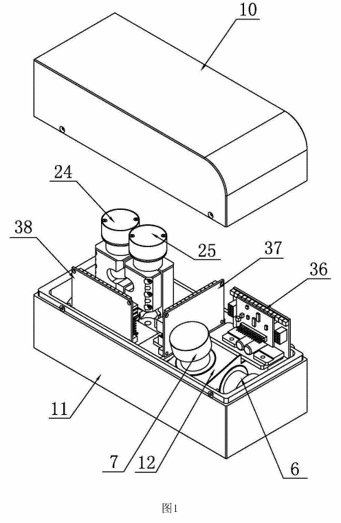 | 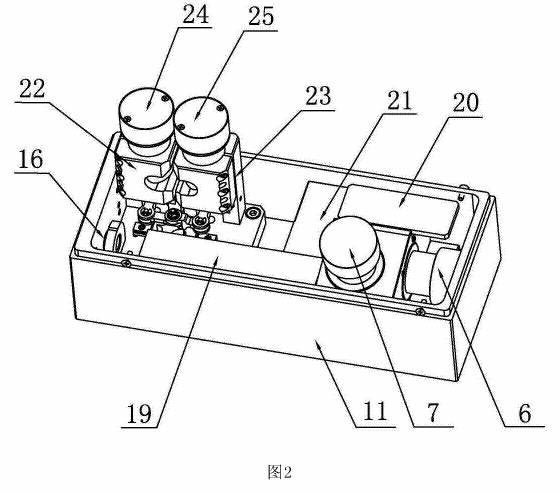 | 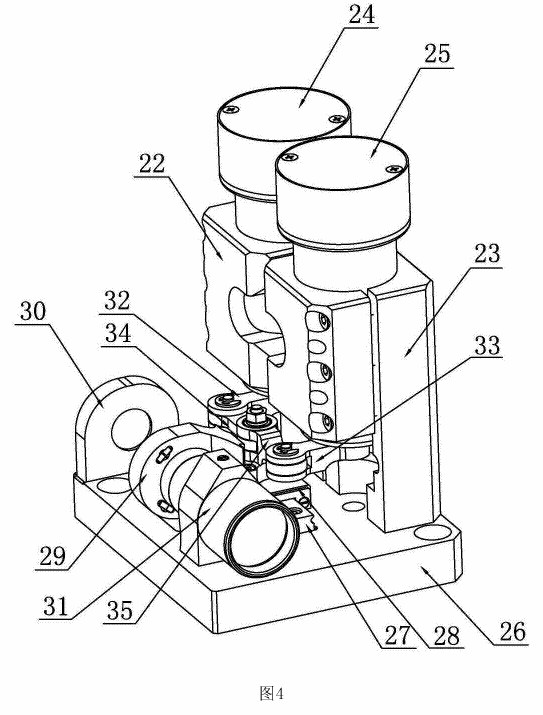 |
|---|---|---|
| 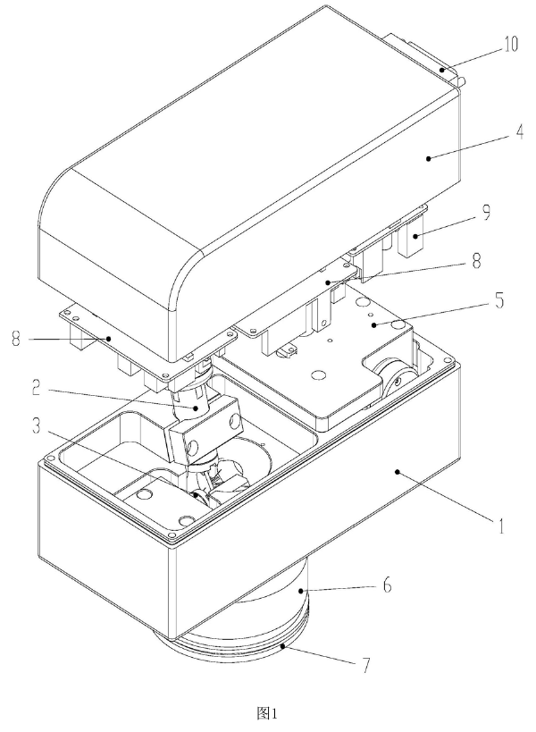 | 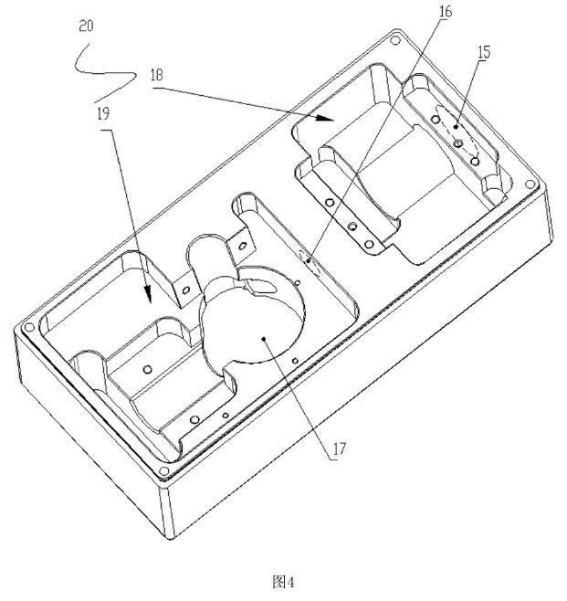 | 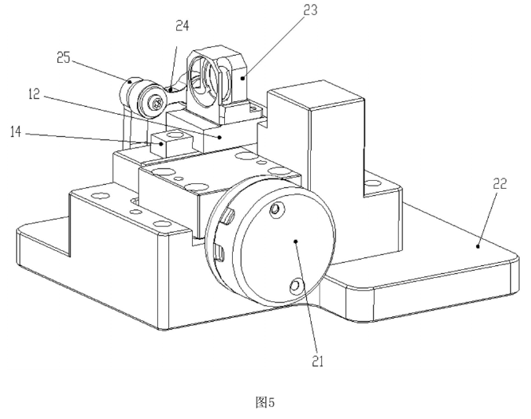 |

## B. 光路排法

| 编号 | 设备 | 怎么做的 | 和我们比 |
|---|---|---|---|
| R046 | CN222866943U 动态聚焦光学系统 | **负透镜动（f −113.2 / −60.7）+ 正透镜固定（f 147.2）** → 振镜 → 场镜 | **同一种结构**；我们扩束更大（f −30 / 150，×5） |
| R002 | US12265207B2（II-VI） | 固定负透镜 → **可动正透镜** → 固定正输出透镜（f3 ≥ 2·f2） | 它动正透镜、三片；我们动负透镜、两片 |
| R043 | CN104191089B（菲镭泰克） | 激光器 → Z 镜组 → 两片聚焦镜 → XY | 光路顺序一致 |

| 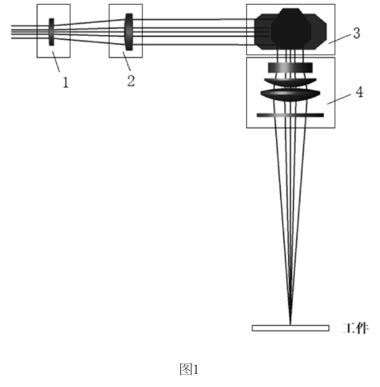 | 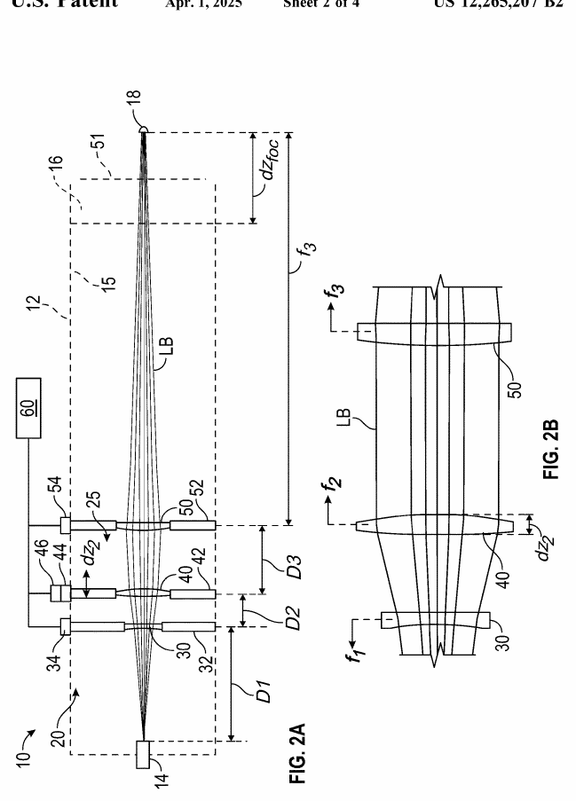 | 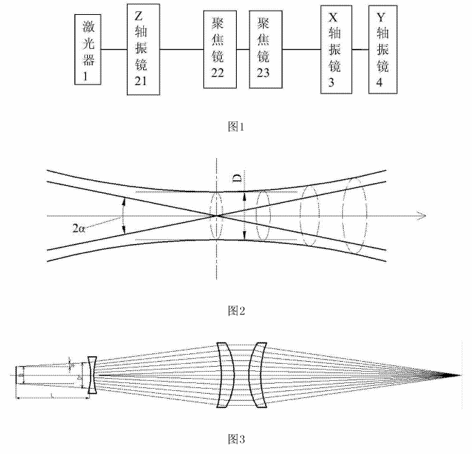 |
|---|---|---|

## C. 独立 Z 模块 / 整机产品

| 编号 | 产品 | 要点 | 和我们比 |
|---|---|---|---|
| R030 | SCANLAB varioSCAN II | 电机块 + 动镜 + 定镜；换定镜可在 FT / PR 之间切换；可选水冷入口光阑 | 入口光阑、动镜 / 定镜分工参考它；它是独立模块，我们是一体化 |
| R036 | RAYLASE AXIALSCAN RD-14 | 前聚焦一体化 3D 头，幅面 200–600 mm | 整机概念最接近，但工作距离 ≤ 0.7 m |
| R031 | Aerotech AGV3D | 直驱聚焦的三轴扫描头，手册有完整外形尺寸图 | 参考它做我们的安装接口图 |

## D. 电机推调焦镜 / 远距离

| 编号 | 设备 | 要点 | 和我们比 |
|---|---|---|---|
| R062 | CN110883020A 清模机（钛昇） | 聚焦透镜由**伺服电机 + 螺杆**推动改变焦距 | **驱动方式和我们一样** |
| R010 | CN222626476U 自动调焦加工装置 | 场镜整体在驱动模组上移动 + **检测器实时测距** | 对应我们以后的“测距”阶段 |
| R008 | CN111181117A 一字除冰（艾思兰） | 三脚架 + 电动转台；平凹 + 平凸柱面镜调间距 | 远距离用法一样；它用转台，我们用振镜 |
| R007 | CN111130015A 除障仪（艾思兰） | 箱体 + 云台 + 发射头（准直器 + 相机） | 以后可上云台（我们已有重心安装板） |

| 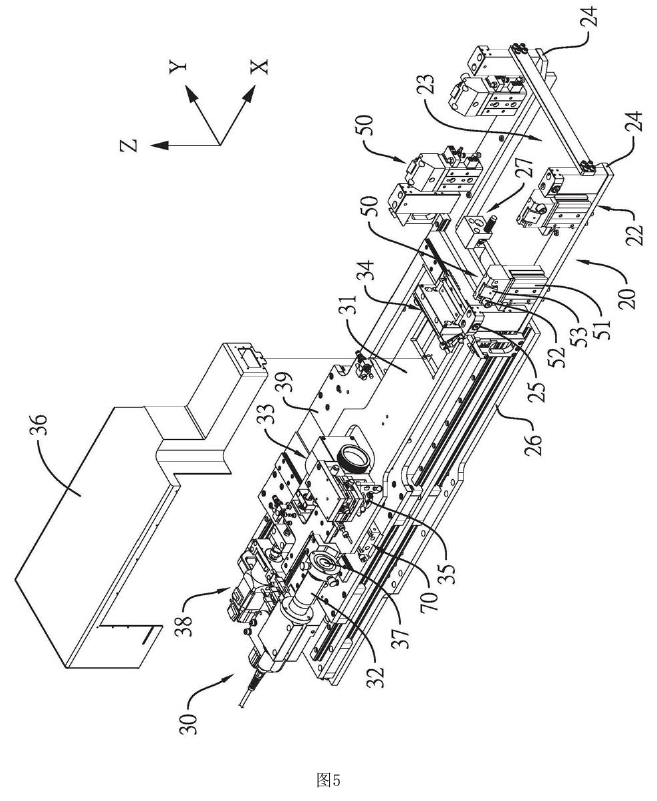 | 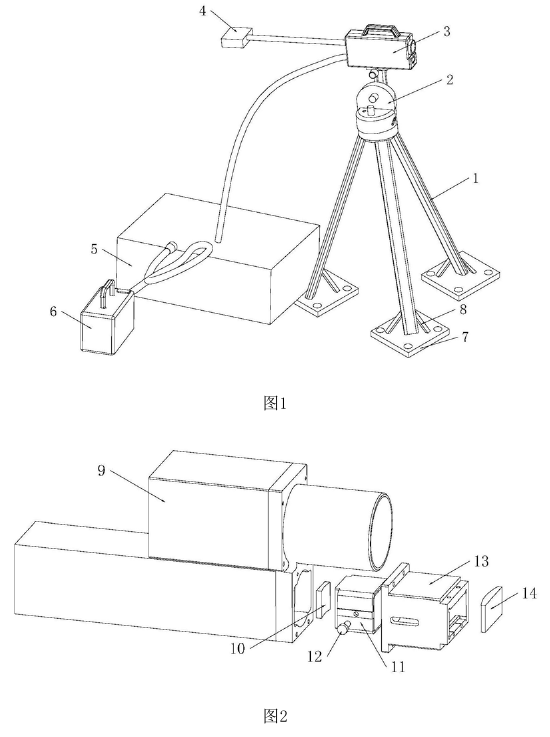 | 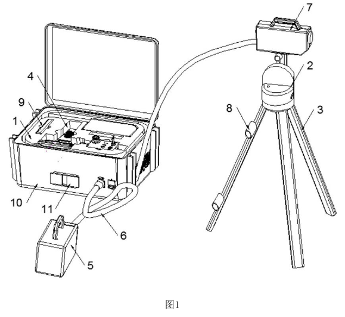 |
|---|---|---|

## 对我们设计的启发

1. 布局（R004 / R009）与我们 v0.3 一致，**方向没问题**
2. 光学（R046）同类，我们扩束倍数更大，是因为要打 50 m
3. 驱动选丝杠有先例（R062）；高速连杆（R004 / R009）是打标设备追求速度用的，我们不需要
4. 以后可以借鉴的：红光摆入式预览（R054，作为备选）、实时测距自动调焦（R010）、云台安装（R007 / R008）
