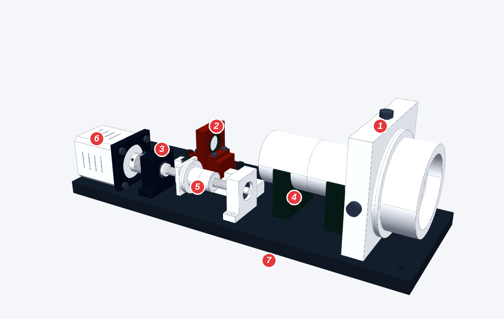

# 调焦主体 v0.7（用户 SolidWorks 版）审查

> 2026-11-05。文件：`设计/CAD/用户提交/调焦主体_v0.7.step`（SolidWorks 2024 导出）。检查工具：`设计/工具/外部STEP检查.py`（对照 `设计/CAD/调焦头_v0.4.step`）。

## 1. 这一版做了什么
- 把 v0.4 的 Z 轴模块 + 物镜组件导进 SolidWorks，**重新组织成两个子装配**：
  - 移动镜座与螺母组件（滑块、密封、镜座、动镜、压圈、推板、螺母支架、钢球、拉簧、消隙螺母全套）——**分组正确**，正好是一起平移的那 15 个零件
  - 丝杆与联轴器组件（丝杆、联轴器、夹紧螺钉、锁紧螺母、电机轴）——**分组正确**，正好是一起转动的零件
- 40 种零件的**位置和体积与 v0.4 完全一致**（没有改尺寸）

## 2. 检查结果
| 项目 | 结果 |
|---|---|
| 静态干涉 | 0 处 ✓ |
| 光路挡光 | 0 处 ✓ |
| 运动干涉（滑座在后硬限位 / 5 m / 50 m / 前硬限位 四个位置） | 0 处 ✓ |
| 比 v0.4 少的零件 | 原点开关 Z15、限位开关 Z16、挡光片 Z17、运输锁 Z24、电机接线头 Z13c、温度传感器 Z20 |

## 3. 需要处理的问题（按重要程度）
1. **少了原点开关 + 挡光片（必须补）**：步进电机是开环的，开机必须找一次零点，否则不知道镜片在哪。限位开关也建议补回（硬限位是最后一道保护，不该天天撞）。运输锁：台架样机可以先不装，运输 / 户外前要有。温度传感器、接线头可后补。
2. **固定端轴承其实没有被“固定”（v0.4 设计错误，Claude 的错）**：
   - 外圈：轴承座只在电机一侧有 1 mm 挡肩，另一侧（+X）是开口的 → 往 +X 推时外圈会滑出来
   - 内圈：丝杠轴颈是一整段 Ø4，内圈两侧都没有挡肩；锁紧螺母在 X 75–77，和轴承（到 X 74）之间还空 1 mm → 内圈也没夹住
   - 改法：丝杠在轴承**内侧（+X）做一个台阶**顶住内圈，**锁紧螺母放到电机一侧**把内圈压在台阶上；轴承座 +X 侧加一个**轴承端盖**（2–3 颗 M2）压住外圈。锁紧螺母需要约 2 mm 位置 → 电机 + 联轴器整体往后挪约 2 mm（Z 底座加长 3 mm）或固定端座做薄 2 mm
3. **电机被“两头托着”（过定位）**：电机法兰锁在座板上，同时机身底面又正好贴在 Z 底座上（都在 Z = 16）。拧螺钉时会别着劲，可能把座板拉歪、电机轴和丝杠不同心。改法：电机底下留 0.5–1 mm 空隙（或在底座上铣一个浅槽）
4. **半螺母 B 的防转没画**：它要“只能前后滑、不能转”，需要键或销。建议直接**买成品消隙螺母**，把 Z08 / Z08a / Z08b / Z08c 换成一个外购件的真实外形
5. **很多孔没有配螺钉**（轴承座安装脚、电机座底面螺纹孔、Z 底座安装孔、物镜座 O01）：出图前要补齐螺钉或在图纸上标螺纹
6. **物镜座 O01 偏“单薄”**：12 mm 板立起 64 mm 高，只靠底面连接。振动是我们最大的误差来源，建议加一块加强筋或 L 形底脚

## 4. SolidWorks 里可以顺手做的
- 移动组件设为“柔性”，加一个带上下限的距离配合（滑座中心 X 88–100，工作区 91.5–95.6），拖动时开“碰撞检查”
- 丝杠用“装饰螺纹线”标 Tr5×1（或所选丝杠型号）
- 每个零件赋材料（铝 6061 / 不锈钢 / 黄铜 / POM），用“质量属性”复核运动质量（脚本算的是 51 g）

## 附：工具输出
```
# 外部 STEP 检查：调焦主体_v0.7.step

零件 40 种（40 个实体）
缺少（对照里有）： ['Z13c_MotorConn', 'Z15_HomeSensor', 'Z16_LimitSensor', 'Z17_Flag', 'Z20_TempSensor', 'Z24_TransportLock']
新增（对照里没有）： 无
位置 / 体积有变化： 无

静态干涉：0 处

光路挡光：0 处

运动干涉（移动组件 15 个实体整体沿光轴平移）：
- 滑座中心 X = 88.00（后硬限位）：0 处
- 滑座中心 X = 91.50（对焦 5 m）：0 处
- 滑座中心 X = 95.55（对焦 50 m）：0 处
- 滑座中心 X = 100.00（前硬限位）：0 处
```

## 5. 建模与外观问题（2026-11-05，用户：“这个模型有点丑，怎么改？”）



| # | 问题 | 为什么显得丑 / 有什么坏处 |
|---|---|---|
| 1 | 物镜座是一块 70 mm 见方的大板 + Ø50 镜筒 | 和左边细小的传动部分比例失衡；板立着只靠底面连，刚性也差 |
| 2 | 动镜座是一块方板立在滑块上 | 光学件是圆的、座子是方的；它高高立在丝杆上方，像“插”上去的 |
| 3 | 电机座、两个轴承座、垫高块、限位块全是独立的小方块 | 零件碎、形状各不相同、没有倒角圆角 → “积木堆”感；装调基准也多 |
| 4 | 遮光筒架在两个支座上 | 像一根管子搁在架子上；光路本该被一个主体包住 |
| 5 | 丝杆、螺母、弹簧全露在外面 | 不防尘，外观也乱；商业产品都把传动包起来 |
| 6 | 电机、联轴器、轴承是“示意形状”，不是厂家模型 | 细节不真实；外购件应直接用厂家 STEP（HIWIN / 上银 MGN7、电机厂、MISUMI 联轴器） |
| 7 | 底板很长，中间大片空着 | 结构松散；整机可以更短更紧凑 |
| — | 模型是导入的“死实体”（没有特征历史） | SolidWorks 里没法改尺寸；应按“布局草图”自顶向下重建：先画光轴、丝杆轴、关键 X 位置，所有零件参照它 |
| — | 螺纹画成一圈圈槽、弹簧画成一叠圆环、轴承画出钢珠 | 网格大、看着乱；改用装饰螺纹线、弹簧外形包络、轴承用厂家简化模型 |

### 两个改法（待用户选）
- **A 开放式精修**：保持现在的布局，只改细节——零件合并（电机座 + 固定端轴承座一体；支撑端座 + 前端板一体）、全部倒角圆角、动镜座改成圆形镜框 + 法兰、物镜座缩小并加筋、去掉遮光筒支座、统一配色（黑色阳极氧化主体 + 银色轴类 + 黄铜螺母）。改动小
- **B 一体式光学主体（推荐）**：像商业 Z 模块 / 用户照片里的镜头——一根铣削的铝主体沿光轴把光路包起来，导轨和动镜在主体里面，丝杆和电机贴在主体侧面或下面，外面只看到一个干净的黑盒子 + 电机。更好看、更刚（振动是最大误差）、防尘；顺带解决固定端轴承和电机过定位
