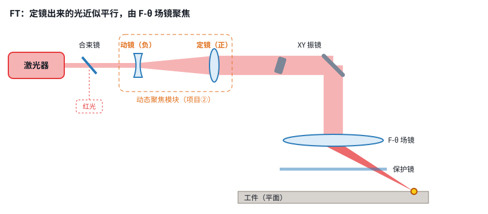

# 移动透镜动态聚焦：输出光路 v0.1

> 状态：**草案**（2026-11-03）· 决策依据见 [第 02 课](../学习推进记录/第02课_聚焦的七种办法.md)、[第 02 课加餐](../学习推进记录/第02b课_移动透镜拆开看.md)、[第 03 课](../学习推进记录/第03课_移动透镜光路.md)
> 交互计算器：[第 03 课 · 参数链](https://claude.ai/artifact/ThzcVtA8iNZQ3bpnmmYXRk)
>
> 标记说明：**【资料】**＝来自资料库，带编号；**【推算】**＝近轴公式算出；**【假设】**＝暂定，待你确认

## 1. 已定方向

| 项 | 决定 | 依据 |
|---|---|---|
| Z 调焦方式 | **移动透镜**（动镜负透镜 + 定镜正透镜） | 第 02 课、02b 课 |
| v0 摆法 | **FT**：带 F-θ 场镜（后聚焦）—— **暂定**，取决于主要用途 | 光斑小；平面上 Z 不用动，可以先单独调通 XY。如果主要用途是清洗、远距离或大幅面，就改成 PR（第 03 课之三） |
| 二期摆法 | **PR**：前聚焦，无场镜 | 用于大幅面（200–600 mm）、大功率 |
| 系统架构 | 控制卡通用，Z 模块可换；Z 通道传“焦点位置 mm” | 第 02 课 |

## 2. 光路总图（v0，FT 摆法）



```
激光器(1064nm 准直输出) → 合束镜(+红光指示) → [动镜(负,音圈推动) → 定镜(正)] → X 振镜 → Y 振镜 → F-θ 场镜 → 保护镜 → 工件
                                              └──── 动态聚焦模块（项目②）────┘   └──── 由控制卡（项目①）XY2-100 驱动 ────┘
```

## 3. v0 推荐参数（初值）

| 环节 | 参数 | 初值 | 来源 / 状态 |
|---|---|---|---|
| 激光器 | 波长 / 功率 | 1064 nm，20–100 W 光纤激光器 | 【资料】自研方案与选型表 |
| | 出光直径 d0 | 4 mm | **【假设】待你提供激光器型号** |
| | M² | 1.3 | 【资料】验证清单示例 |
| 动态聚焦模块 | 扩束倍数 | ×2（D = 8 mm） | 【推算】；SCANLAB 同类配置为 ×2.0–2.8（R030） |
| | 定镜焦距 f2 | ≈ 40 mm | 【推算】由目标倍率反推 |
| | 动镜焦距 f1 | ≈ −20 mm | 【推算】f1 = −f2 / 扩束倍数 |
| | 焦移倍率 | ≈ (163/40)² ≈ 17 | 【推算】；SCANLAB 20-20 FT 为 17.1（R030） |
| | 镜片行程 | ±1.2 mm（对应 Z ±20 mm） | 【推算】；U008 指出典型最大移动量约 10 mm |
| | 镜片速度 / 重复性 | ≤ 280 mm/s / < 0.5 μm | 【资料】SCANLAB 20i（R030） |
| | 跟随延迟 | 0.7–0.9 ms | 【资料】VCM F1（R038）、RD-14（S009） |
| XY 振镜 | 口径 | **14 mm**（8 mm 光束的 1.75 倍）或 20 mm | 【推算】经验值 ≥ 1.4 倍；RD-14 就是 14 mm 口径 |
| F-θ 场镜 | 焦距 / 幅面 | f = 163 mm，幅面约 100–120 mm | 【资料】RD-14：f163 对应 120×120（S009）；SCANLAB：95 mm（R030） |
| 结果 | 光斑（1/e²） | ≈ 36 μm（M² 1.3）；M² = 1 时约 26 μm | 【推算】；RD-14 f163 实标 26.1 μm（M² = 1，S009），两者吻合 |
| | 焦深 | ≈ ±0.33 mm（光斑变粗 ≤ 10%） | 【推算】第 01 课 |
| | Z 范围 | 目标 ±20 mm | 【资料】自研方案建议 ±20–40 mm；RD-14 f163 实标 −16…+14 mm。**注意**：Z 范围要同时容纳“曲面高低 + 工件前后位置变化”（第 03 课补课） |
| | 焦点速度上限 | ≈ 17 × 280 mm/s ≈ 4.8 m/s | 【推算】远高于 02b 课的需求 0.63 m/s |

## 4. 关键公式（近轴初算，用于定方向）

| 关系 | 公式 | 说明 |
|---|---|---|
| 光斑直径 | d = 4·M²·λ·F / (π·D) | D 是到达场镜的光束直径 |
| 瑞利长度 / 焦深 | z_R = π·w0² / (M²·λ)；焦深 ≈ ±0.46·z_R | 按“光斑变粗不超过 10%”取 |
| 扩束倍数 | M = f2 / \|f1\| | 动镜（负）加定镜（正）构成伽利略扩束 |
| 焦移倍率（FT） | Δz_焦点 ≈ (F / f2)² · Δ_镜片 | 动镜偏离“平行出光”位置 δ，出射光的会聚度 ≈ δ/f2²，再经场镜放大 F² 倍 |
| PR 场曲补偿 | Δz = √(L² + r²) − L | 以振镜为圆心粗估；L 是工作距离，r 是离中心的距离 |
| 延迟离焦 | 误差 ≈ v_z · τ，其中 v_z = 坡度 × 扫描速度 | 控制卡需要做 Z 指令提前量补偿 |

> 这些只是近轴估算。真实设计要用 Zemax 等软件把动镜、定镜和场镜放在一起优化（U003、U008 都这样做）。

## 5. FT 与 PR 对比（资料实测/标称）

| | FT（带场镜） | PR（前聚焦） |
|---|---|---|
| 也叫 | 后聚焦：聚焦镜在振镜**后面**（先拐弯，后聚焦） | 前聚焦：聚焦镜在振镜**前面**（先聚焦，后拐弯） |
| 代表产品 | RAYLASE FOCUSSHIFTER RD-14；SCANLAB varioSCAN II 20-20 FT | RAYLASE AXIALSCAN RD-14；SCANLAB varioSCAN II 40-116 PR |
| 幅面 | 95–120 mm（f163） | 200–600 mm |
| 1064 nm 光斑 | 26.1 μm（f163，M² = 1） | 45–136 μm（随幅面变大） |
| Z 范围 | −16…+14 mm（f163，RD-14） | 工作体积 36–1000 mm（AXIALSCAN 标称） |
| 平面加工时 Z | 不用动 | 必须一直补偿场曲（400 幅面角落约 80 mm【推算】） |
| 功率 | 中低（20i：IR ≤ 250 W） | 高（40i：IR ≤ 3000 W） |
| 适合 | v0 验证、打标、精细加工 | 大幅面、清洗、增材；远距离（> 1 m）只能用这种 |
| 选择规则 | 距离 < 0.3 m、幅面 < 150 mm、光斑 < 40 μm、功率 < 100 W | 距离 > 0.3 m、幅面 150–600 mm 以上、功率 > 100 W |


## 6. 各环节选型要问的问题

| 环节 | 要问清楚 / 要核算 |
|---|---|
| 激光器 | 出光直径（1/e²）、M²、功率、准直器型号、接口（第 ⑥ 课） |
| 合束镜 + 红光 | 1064 高透 / 红光高反镀膜；红光和主光的同轴度 |
| 动镜 / 定镜 | 焦距、口径、1064 增透膜、损伤阈值；动镜要轻 |
| 导轨 / 音圈 / 光栅尺 | 直接买：THK / IKO 交叉滚柱、Akribis 音圈、Renishaw ATOM DX（S015–S019） |
| XY 振镜 | 口径 ≥ 1.4 × D；XY2-100；阶跃响应、漂移 |
| F-θ 场镜 | 焦距、幅面、入瞳位置与振镜间距、是否远心、镀膜 |
| 保护镜 | 易耗件，做成快拆 |

## 7. 风险与待验证

1. **F-θ 只对一个平面做了优化**：大离焦（±20 mm）时，光斑质量和幅面比例都会变。要用仿真或实测得到“三维光斑地图”。
2. **误差被倍率放大**：倍率 17 时，镜片 0.5 μm 的误差 → 焦点约 8.6 μm（第 02b 课）。温漂和机械刚度要一起算。
3. **裁光**：模块出光直径会随 Z 位置变化，振镜口径要留余量。
4. **热透镜**：功率高时，镜片受热会让焦点漂移，静态标定可能失效。
5. **专利**：US12265207B2 的权利要求 1 为“固定输入透镜 + 移动正透镜 + 固定正输出透镜，且 f3 ≥ 2·f2”；CN104191089B 涉及 Z 镜组、两片聚焦镜，并依据束腰 / 发散角调整。本方案的结构需要逐条对照权利要求（**不构成法律意见**，见资料验证清单）。

## 8. 待你确认

- [ ] **主要用途**：近距离精细加工 → FT；清洗、远距离、大幅面 → PR。动镜模块两种都能用，只换定镜和场镜（R030）

- [ ] 激光器型号（出光直径、M²、功率）：参数链的起点
- [ ] 振镜口径：14 mm 还是 20 mm？（原选型表写的是 20 mm）
- [ ] v0 的 Z 范围目标：±20 mm 够不够？需要你给出：曲面最大高低差 + 工件前后移动范围
- [ ] 是否先买现成模块（如 VCM F1，XY2-100 接口）验证控制卡，再自研光学部分

## 9. 与控制卡（项目①）的接口要点

- Z 通过 XY2-100 第三通道下发（引脚草案 `GALVO_Z → FPGA AB6`），内容是“焦点位置”，经模块标定表换算成镜片位置
- FPGA 需要 **Z 指令提前量**（可调，毫秒级），补偿 0.7–0.9 ms 的跟随延迟
- FT 摆法在平面上 Z 恒定，**可以先只调 XY**，再加 Z
