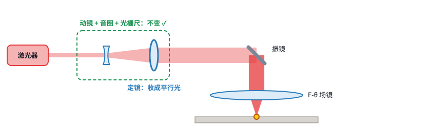

# 移动透镜动态聚焦：输出光路 v0.2（前聚焦）

> 状态：**草案**（2026-11-03）· **取代 v0.1**（v0.1 是后聚焦方案，已作废）
> 决策依据：[第 03 课之三](../学习推进记录/第03c课_怎么选.md)、[第 04 课](../学习推进记录/第04课_打得远的代价.md)
> 交互计算：[第 04 课课件](https://claude.ai/artifact/9ce6eXXBtSDoLAv2gFGGtT)
>
> 标记：**【资料】** 带编号 ·**【推算】** 近轴公式 ·**【假设】** 暂定，待确认

## 1. 已定方向

| 项 | 决定 | 依据 |
|---|---|---|
| Z 调焦方式 | 移动透镜（动镜负透镜 + 定镜正透镜） | 第 02 课 |
| 摆法 | **前聚焦（PR）**：先聚焦、后拐弯，没有场镜 | 用户要求“打得远一点”；工作距离 > 0.3 m 时后聚焦不现实（第 03 课之三） |
| 模块 | 动镜部分与后聚焦通用，定镜负责直接聚焦 | SCANLAB 同一产品系列两种都做（R030） |

## 2. 光路总图

```
激光器 → 合束镜(+红光) → 固定扩束 ×2 → [动镜(负,音圈) → 定镜(正,直接聚焦)] → XY 振镜(大口径) → 保护窗 → 目标
                                      └──────── 动态聚焦模块（项目②）────────┘   └── 控制卡 XY2-100 ──┘
```



## 3. 初值

| 环节 | 参数 | 初值 | 来源 / 状态 |
|---|---|---|---|
| 激光器 | 1064 nm 光纤，出光 d0 / M² | 4 mm / 1.3 | **【假设】待你提供型号** |
| 固定扩束 | 倍数 | ×2（4 → 8 mm） | 【推算】让模块入口和 SCANLAB 40i 一致（入口 16 mm 级，R030） |
| 动态模块 | 扩束倍数 | ×2.5（8 → 20 mm） | 【资料】SCANLAB 40i 为 ×1.4–3.8（R030） |
| | 定镜 f2 / 动镜 f1 | 60 mm / −24 mm | 【假设】f2 可调；f1 = −f2 / 2.5 |
| | 镜片速度 / 重复性 | ≤ 140 mm/s / < 0.5 μm | 【资料】SCANLAB 40i（R030） |
| XY 振镜 | 口径 | **30 mm**（20 mm 光束的 1.5 倍） | 【资料】SCANLAB PR 配置典型扫描头口径 30 mm（R030） |
| | 扫描角 | 单边约 ±24° | 【推算】由 AXIALSCAN“工作距离 448 mm → 幅面 400 mm”反推（R036） |
| | 角重复性 | 8 μrad | 【资料】Sino-Galvo FL8220（R001） |
| 功率 | 等级 | 前聚焦可到 IR 3000 W | 【资料】SCANLAB 40i（R030） |

## 4. 不同距离下的结果（光束 20 mm，M² 1.3）【推算】

| 工作距离 | 光斑 | 焦深 ± | 扫描宽度（±24°） | 边上弧面要补 | 8 μrad → 位置误差 | 动镜离平行光位置 |
|---|---|---|---|---|---|---|
| 0.5 m | 44 μm | 0.5 mm | 0.44 m | 46 mm | 4 μm | 7.2 mm |
| 1 m | 88 μm | 2.0 mm | 0.88 m | 93 mm | 8 μm | 3.6 mm |
| 2 m | 176 μm | 8.1 mm | 1.76 m | 185 mm | 16 μm | 1.8 mm |
| 5 m | 0.44 mm | 50 mm | 4.4 m | 463 mm | 40 μm | 0.72 mm |
| 10 m | 0.88 mm | 202 mm | 8.8 m | 925 mm | 80 μm | 0.36 mm |

对照：AXIALSCAN 在 0.2–0.7 m 时光斑 45–136 μm（R036），和本表同一量级。

**读法**：
- **动镜行程 = f2² × (1/最近距离 − 1/最远距离)**。例如 0.5 m 到无穷远需要 7.2 mm，1 m 到无穷远需要 3.6 mm。近处最占行程。
- **对焦精度和距离无关**：镜片 0.5 μm 的误差约占焦深的 6.9%，在任何距离都一样（第 04 课图 02）。
- **要光斑小，只能加大光束和振镜口径**：代价是振镜镜片更重、更慢、更贵。

## 5. 距离分区（决定架构）

| 区间 | 资料里的做法 | 对我们意味着什么 |
|---|---|---|
| 0.2–0.7 m | AXIALSCAN RD-14 前聚焦振镜（R036） | 直接对标，最成熟 |
| 0.4–2 m | SCANLAB varioSCAN 40i FLEX，后焦距 370–2015 mm，幅面 180–1400 mm（R030） | 仍可用振镜 + 动镜 |
| 几十米到 150 m | 艾思兰除冰、除障：扩束 / 柱面镜调焦 + **云台**指向（R007、R008） | 振镜不再合适，要换成云台，光斑到毫米级甚至几十毫米 |

## 6. 对控制卡（项目①）的新要求

1. **Z 永远在动**：每个点的 Z = 到目标的距离 + 弧面补偿 + 曲面起伏
2. **XY 换算要用距离**：振镜给出的是角度，打在目标上的位置 = 距离 × tan(角度)
3. **需要知道目标有多远**：目标距离不固定时，要加测距（激光测距或视觉），作为 Z 的输入（对应第 02 课里预留的“测高传感器”）
4. **延迟补偿**：Z 指令提前量（第 02b 课）仍然需要
5. **远距离开放光束的安全**：联锁、急停、区域防护（第 ⑦ 课）

## 7. 待你确认

- [ ] **⭐ “远一点”是多远**：最近和最远对焦距离各是多少？对应第 5 节的哪个区间？
- [ ] 激光器型号（出光直径、M²、功率）
- [ ] 目标距离是固定的（装好后基本不变），还是每次都不同（需要测距）？
- [ ] 能接受的最大光斑（例如清洗允许 0.5 mm 以上，精细加工要 0.1 mm 以下）

## 8. 风险

- 30 mm 大口径振镜比 14 mm 的慢，扫描速度要重新评估
- 弧面补偿量很大（1 m 时边上约 93 mm），Z 的动态性能要能跟上扫描
- 远距离对准、热漂移、空气扰动会放大误差
- 专利：前聚焦动态模块同样要对照 US12265207B2、CN104191089B 等的权利要求（**不构成法律意见**）
