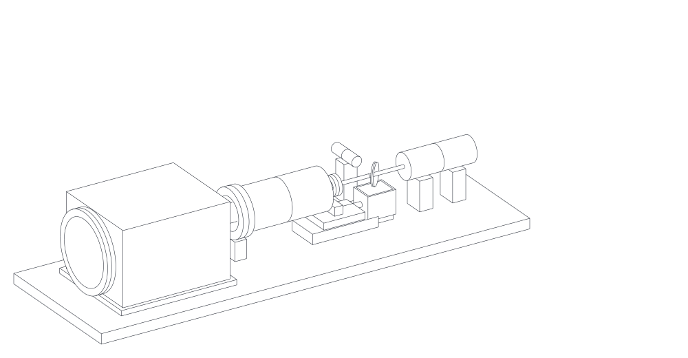

# 调焦头结构方案 v0.1（概念布局）

> ⚠️ 已被 [v0.2 详细结构](调焦头结构方案_v0.2.md) 取代（用户反馈：太粗糙，要参考文献里的设备、每个结构都要有）。

> 状态：**概念草案**（2026-11-03）· 光学依据：[远距离系统方案_v0.5](远距离系统方案_v0.5.md)
> 唯一数据源：[工具/结构参数.py](工具/结构参数.py) → [结构参数.json](工具/结构参数.json)、[布局与公差结果](工具/结构参数结果.md)
> CAD：[CAD/调焦头_概念_v0.1.step](CAD/调焦头_概念_v0.1.step)（由 [工具/生成CAD.py](工具/生成CAD.py) 生成，可用 SolidWorks / FreeCAD 打开）
> 课件：[第 08 课](../学习推进记录/第08课_结构布局.md)（3D 可旋转）
>
> 标记：【推算】·【假设】（激光器、振镜、镜片型号未定，相关尺寸都是占位）



## 1. 布局（光轴沿 +X，光轴高 50 mm）

```
 X(mm): 5      45      120        ~165  170          290        395          468
        ├激光准直器┤  合束镜(45°)   电机  [滑台+动镜]──遮光筒──物镜    [XY 振镜头]   保护窗 → 5–50 m
                      ↑红光                ←4 mm→     120 mm      Ø40
 底板 520 × 170 × 12；整机包络约 520 × 170 × 108 mm（不含外壳）
```

| 部件 | 关键尺寸 | 安装 / 调节 | 来源 |
|---|---|---|---|
| 激光准直器 | Ø30 × 80（占位） | 可换夹持座 + **两轴俯仰** | 【假设】 |
| 合束镜 + 红光 | Ø25.4，45° | 运动学镜座，**两轴俯仰** | 【假设】 |
| 动镜 f1 = −30 | Ø12.7 | 装在丝杠滑台上，**只有 Z 由电机推**，横向靠滑台精度 | 【推算】 |
| 丝杠滑台 | 行程 ≥ 10 mm（需要 4.05 mm） | 交叉滚柱导轨 + 1 mm 导程丝杠 + NEMA 11 步进 + 原点开关 | 【推算】/【假设】 |
| 物镜 f2 = 150 | Ø40 双胶合，通光 ≥ 28 | 镜座带 **XY 对中** | 【推算】/【假设】 |
| 遮光筒 | Ø48 × 100 | 只遮光防尘，不受力 | 【假设】 |
| XY 振镜头 | 30 mm 口径；包络 130 × 110 × 88（占位） | **转接板 + 定位销**对准光轴；换型号只换转接板 | 【假设】 |
| 保护窗 | Ø80（取决于扫描角） | 快拆框 | 【假设】 |
| 外壳 | 520 × 170 × 140 | 防尘、遮光；前面开窗 | 【假设】 |

## 2. 结构公差（最关键的三项）

| 项 | 影响 | 要求 / 对策 | 来源 |
|---|---|---|---|
| **滑台横向晃动** | 动镜横向偏 e → 出射偏 e/150 rad；**5 μm → 50 m 处偏 1.7 mm** | 不可重复的晃动 **≤ 3 μm**（按 50 m 处随机偏移 ≤ 1 mm 估算）；可重复的偏移由控制卡按 Z 位置给 XY 补偿 | 【推算】 |
| 镜间距热胀 | 120 mm 铝件，10 K → 约 28 μm（50 m 处公差 ±50 μm） | 温度补偿 / 按温度标定；或殷钢、碳纤维连接件 | 【推算】 |
| 丝杠回差 | 可能几十 μm | 预紧螺母 / 滚珠丝杠，或单向趋近 | 经验 |
| 物镜偏心 | 固定偏 e/150 rad | 装调时对中；剩下的标定 | 【推算】 |

## 3. 装调顺序（建议）

1. 底板上用红光（或低功率主光）+ 两个光阑定出光轴（高 50 mm）
2. 调激光头俯仰，让光沿光轴走
3. 调合束镜，让红光和主光重合
4. 装物镜，XY 对中（光斑中心不随物镜前后移动而跑偏）
5. 装动镜和滑台，走全行程检查光点横向漂移（就是第 2 节的“横向晃动”，顺便记录可重复部分，做补偿表）
6. 装振镜头（转接板定位），检查出射方向
7. 罩外壳，做远距离标定（第 ⑧ 课以后）

## 4. 对控制卡的接口（汇总）

- 步进：STEP / DIR / EN + HOME（4 根线）
- **新增**：XY 偏移补偿表（随 Z 位置），用来补滑台可重复的横向偏移
- 测温（可选）：1 路温度，用于焦点的温度补偿

## 5. 待定（会改尺寸的）

- [ ] 激光器型号 → 准直器外径、长度、安装接口
- [ ] 振镜型号 → 包络、入口高度、安装孔
- [ ] 镜片型号 → 镜框尺寸
- [ ] 滑台型号 → 横向晃动、回差指标（关键）
- [ ] 50 m 处扫描范围 → 保护窗尺寸

> 改尺寸的流程：改 `工具/结构参数.py` → 运行它 → 运行 `工具/生成CAD.py`（需要 `pip install cadquery`）→ STEP 和课件数据一起更新。
