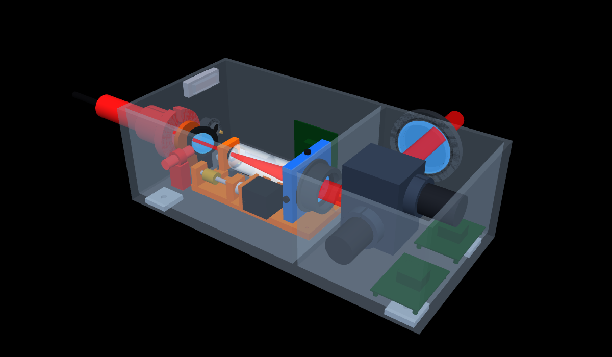

# 调焦头结构方案 v0.2（详细结构）

> 状态：**详细结构草案**（2026-11-03）· 取代 [v0.1 概念布局](调焦头结构方案_v0.1.md)
> 光学依据：[远距离系统方案_v0.5](远距离系统方案_v0.5.md)（5–50 m、光斑 ≤ 5 mm）
> 数据源：[工具/结构参数.py](工具/结构参数.py)　·　生成：[工具/生成CAD.py](工具/生成CAD.py)　·　检查：[工具/干涉检查.py](工具/干涉检查.py)
> CAD：[CAD/调焦头_v0.2.step](CAD/调焦头_v0.2.step)　·　零件清单：[CAD/BOM_v0.2.md](CAD/BOM_v0.2.md)　·　3D 课件：[第 08 课重做](../学习推进记录/第08b课_详细结构.md)



## 1. 参考了哪些设备

| 参考 | 借鉴的结构 | 用在我们的 |
|---|---|---|
| **CN213163617U** 三维动态聚焦振镜系统 | 光路底座 + 光路上盖组成密封安装腔；隔断分左右腔；入光孔接激光器 | 壳体（H01/H02）、隔断、入光孔 |
| **CN205899130U** 高速动态聚焦振镜模组（思特） | Z 轴底座同时装导轨、变焦镜、遮光座、聚焦镜组，保证同轴；内支架装 X/Y 振镜；电机夹包裹式固定；保护窗镜片；驱动板在壳内 | Z 轴底座（Z01）、遮光筒（Z18/Z19）、内支架（G01）、电机夹（G03/G06）、保护窗（W）、驱动板（G08/G09） |
| **CN120928524B** 激光动态聚焦驱动装置 | 镜片安装结构在导轨上滑动；遮光片伸进探测器检测位置 | 动镜镜座（Z04）、挡光片（Z17）+ 原点 / 限位光电开关（Z15/Z16） |
| **SCANLAB varioSCAN II**（R030） | 可选水冷入口光阑；动镜 + 定镜 | 入口光阑（I06）、动镜 / 物镜 |
| 我们自己的 | 丝杠 + 步进（公差放宽 100 倍）、预紧螺母、温度传感器、侧面出光、三点对中 | Z08–Z14、Z20、O01/O05 |

## 2. 总体

| 项 | 值 |
|---|---|
| 壳体 | 360 × 170 × 120 mm（含上盖），6061 铝；隔断 X = 220 |
| 整机包络 | 约 555 × 250 × 129 mm（含后面的激光准直器、侧面保护窗框） |
| 入射光轴高 | 45 mm；出光高 77 mm，**侧面出光** |
| 零件 | **55 种**（自制 / 外购见 BOM） |
| 干涉检查 | **0 处**（`工具/干涉检查.py`，体积 > 1 mm³ 报警） |

```
          ┌──────────────── Z 调焦腔 ───────────────┐┌──────── 振镜腔 ────────┐
 准直器 ─ 法兰 ─ 光阑 ─ 合束镜 ─ [导轨/滑座/动镜]─遮光筒─ 物镜(三点对中) │ 内支架: X镜↑ Y镜→ 保护窗(侧面)
 (后壁)       ↑红光      丝杠·预紧螺母·轴承座·联轴器·步进   隔断   X/Y 电机+电机夹，驱动板在底部
 后壁：DB25、电源航空插头、接地柱       侧壁：步进驱动板       底部：4 个安装垫块（M6）
```

## 3. 各子系统

### 3.1 壳体（H）
- 光路底座：整体铣削，带隔断和隔断通光孔（Ø34）、后壁入光孔（Ø24）、侧壁出光孔、接插件开口、上盖螺纹孔
- 上盖：6 mm 铝板，12 颗 M3 螺钉，周边加密封条（防尘）
- 底部 4 个安装垫块，M6 孔，用来接云台或支架

### 3.2 激光输入（I）
- 准直器（占位 Ø30×80）→ **夹紧套**（开口夹紧）→ **两轴俯仰法兰**（3 颗推拉螺钉）→ 后壁
- **入口光阑**（铜，Ø10）：挡杂散光，大功率时可改水冷
- **合束镜**（Ø25.4，−45°）+ 运动学镜座；**红光模组**从 −Y 侧打进来，反射后和主光同轴

### 3.3 Z 调焦机构（Z）——全部装在 Z 轴底座上
- 导轨（7 mm 微型）+ 滑座 + **动镜镜座**（动镜 f −30、压圈）
- 驱动：**丝杠 Ø5 / 导程 1 mm** + **预紧螺母**（消回差）+ 支撑端 / 固定端轴承座 + 膜片联轴器 + **NEMA 11 步进**（电机座）
- 位置：**挡光片** + **原点 / 限位光电开关**（行程 ±12 mm 以内）
- 遮光筒 Ø30 + 2 个支座；温度传感器（热胀补偿）
- 动镜位置：对焦 ∞ 时 X = 74，对焦 5 m 时后退 4.05 mm

### 3.4 物镜（O）
- 物镜 f 150、Ø40 双胶合，镜筒 + 压圈
- **三点对中座**：两颗 M4 顶丝 + 一颗弹簧顶销（底部坐在 Z 轴底座上，所以不用四点）

### 3.5 振镜（G）
- **内支架**：铝块，内部通光腔；入光孔、出光孔（+Y）、两个电机轴孔
- X 电机从 −Y 侧插入，X 镜把光往上（+Z）打；Y 电机从 +X 侧插入，Y 镜把光往 +Y 侧面打出去
- 电机夹包裹式固定；两块驱动板放在振镜腔底部（带散热块）
- 振镜型号未定：电机、镜片尺寸是 30 mm 口径级的占位

### 3.6 保护窗与接口（W / E）
- 侧面快拆保护窗：窗框（4 颗螺钉）+ Ø60×4 窗片（1064 双面增透）+ O 型圈（窗框里开槽）
- 后壁：DB25（XY2-100 X/Y + 步进 STEP/DIR/EN/HOME，接控制卡）、电源航空插头（振镜 ±15 V、步进 24 V）、接地柱
- Z 腔侧壁：步进驱动板

## 4. 关键公差（沿用 v0.1 的计算）

| 项 | 要求 |
|---|---|
| 滑座不可重复横向晃动 | **≤ 3 μm**（1 μm → 50 m 处 0.33 mm）；可重复部分由控制卡 XY 补偿 |
| 动镜 → 物镜 120 mm 热胀 | 10 K → 28 μm；温度传感器 + 补偿 |
| 丝杠回差 | 预紧螺母 / 单向趋近 |

## 5. 选型以后要替换的占位件

激光准直器（I01）、XY 振镜电机和镜片（G02/G04/G05/G07）、驱动板（G08/G09）、导轨滑座（Z02/Z03）、步进电机（Z13）、动镜 / 物镜（Z05/O03）。

> 改尺寸：改 `工具/结构参数.py` → `python 结构参数.py` → `python 生成CAD.py` → `python 干涉检查.py`（要 0 处）→ `python glb转json.py ../CAD/focus_head_v0.2.glb ../../学习推进记录/互动/focus_head_v0.2.json` 更新课件
